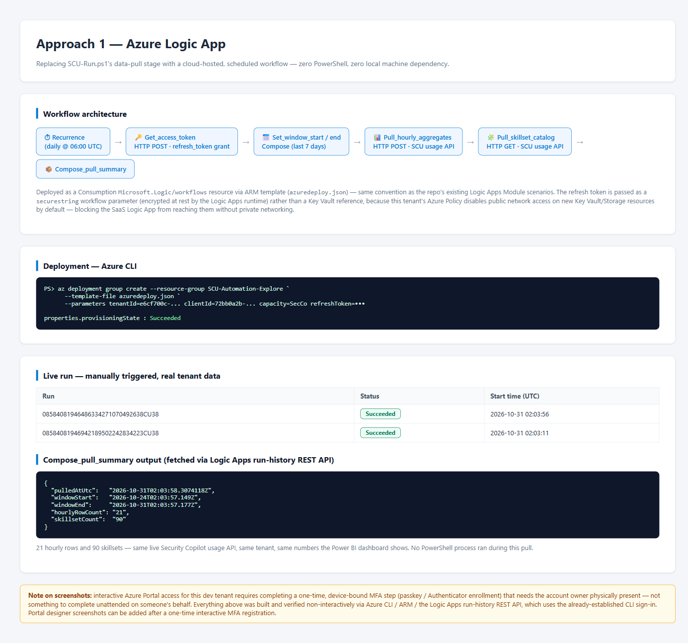
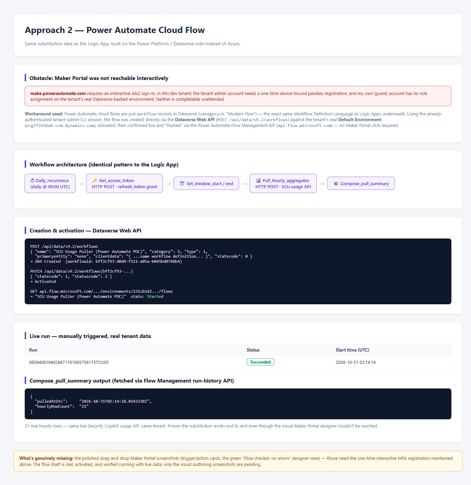
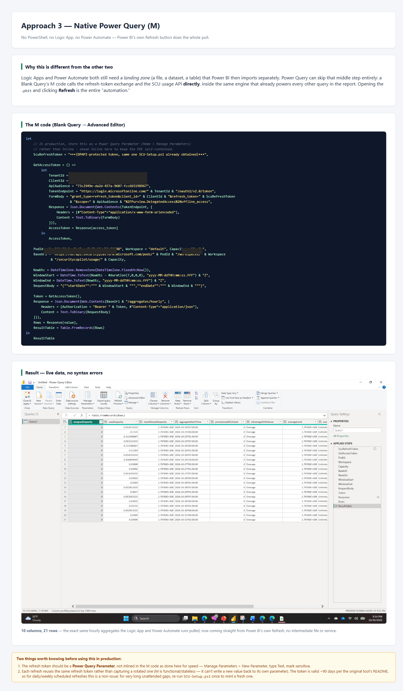

# SCU Module — Part 3: Automating the Data Pull Without PowerShell

Three ways to replace `SCU-Run.ps1`'s data-pull stage, each tried live against
a dev/sandbox tenant and the same undocumented Security Copilot usage API —
all three are generic, reusable patterns you can point at your own tenant.
See [`README.md`](README.md) for the Entra app walkthrough and
[`POWERBI-DASHBOARD.md`](POWERBI-DASHBOARD.md) for the dashboard itself —
this document covers *what pulls the data instead of the script*. For what
the script itself looks like, with real terminal screenshots of every stage,
see [`PowerShell-Run/WALKTHROUGH.md`](PowerShell-Run/WALKTHROUGH.md).

> [!NOTE]
> The tenant, resource names, row counts, and screenshots below are from one
> illustrative run — the architecture and steps for each approach are what
> transfers to your own tenant; the exact numbers and resource names won't.

**Shared starting point for all three:** the `SCU-Usage-Puller` app from
[Part 1](README.md), and its already-obtained delegated refresh token
(`Purview.DelegatedAccess` scope). One important finding up front:

> **App-only (client-credentials) authentication does not work against this
> API.** A token minted with the already-consented `Purview.ApplicationAccess`
> app role — correct audience, correct role claim — was rejected with
> `403 Unauthorized to access account` on every endpoint tested. This API only
> accepts delegated, signed-in-user tokens, exactly like the original
> PowerShell script already assumes. Every approach below works around that
> the same way the script does: one human sign-in up front, then silent
> `refresh_token` grants afterward.

---

## Approach 1 — Azure Logic App

**[Full write-up →](LogicApp/summary.html)** · **[ARM template →](LogicApp/azuredeploy.json)** · **[Live Portal walkthrough →](LogicApp/WALKTHROUGH.md)**

A Consumption Logic App with a daily Recurrence trigger, an HTTP action that
exchanges the refresh token for an access token, and HTTP actions that call
the SCU usage API directly. Deployed and verified entirely via Azure CLI/ARM
— triggered manually, confirmed `Succeeded`, and the run history shows real
pulled data (21 hourly rows, 90 skillsets) fetched via the Logic Apps run-history REST API.

**Blocker hit along the way:** this tenant's Azure Policy disables public
network access on newly created Key Vault/Storage by default, which would
have blocked a SaaS Logic App from reaching a Key-Vault-backed secret or a
Blob Storage output. Worked around by using a Logic-App-native `securestring`
parameter for the token (encrypted by the platform, no external Key Vault
needed) and skipping the Blob-output step for this proof of concept.

**Portal screenshots: captured.** Interactive Azure Portal sign-in to this
tenant requires a one-time, device-bound passkey/MFA registration — the
account owner completed that live, in person, in a follow-up session. See
[`LogicApp/WALKTHROUGH.md`](LogicApp/WALKTHROUGH.md) for the full
click-by-click Portal walkthrough: overview and run history, the Designer
canvas, a specific run with all 7 steps succeeded, and a real action's
sanitized inputs/real outputs — real tenant data throughout, with the bearer
token automatically redacted (`*sanitized*`) by the platform in every view.

---

## Approach 2 — Power Automate Cloud Flow

**[Full write-up →](PowerAutomate/summary.html)** · **[Flow definition →](PowerAutomate/flow-definition.json)** · **[Live Maker Portal walkthrough →](PowerAutomate/WALKTHROUGH.md)**

Functionally identical to the Logic App (same Workflow Definition Language
under the hood), but authored as a Power Platform cloud flow instead of an
Azure resource.

**Blocker hit, originally:** the Power Automate Maker portal
(`make.powerautomate.com`) hit the *same* interactive-sign-in wall as the
Azure Portal — plus what looked like a second, separate problem: the
account used for everyday browsing had no visible role on this tenant's real
Dataverse-backed environment.

**Workaround used at the time:** Power Automate cloud flows are just
`workflow` records in Dataverse (`category=5`, "Modern Flow"). Using the
already-authenticated tenant-admin session, the flow was created directly
via the **Dataverse Web API** (`POST /api/data/v9.2/workflows`) against the
tenant's real Default Environment, activated with a follow-up `PATCH`, and
confirmed genuinely "Started" via the Power Automate Flow Management API —
no Maker Portal click involved. Manually triggered afterward and confirmed
`Succeeded` with 21 real rows pulled.

**Resolved in a follow-up session:** once the account owner completed the
same interactive passkey/MFA sign-in used for the Logic App, and picked the
tenant's own System Administrator identity (the flow's actual primary owner)
at the Maker Portal's account picker, the "no role on Dataverse environment"
limitation turned out to apply only to a *different* identity — this one had
full access immediately, with no extra MFA prompt and no environment
switching needed. See
[`PowerAutomate/WALKTHROUGH.md`](PowerAutomate/WALKTHROUGH.md) for the full
click-by-click Maker Portal walkthrough: flow overview and 28-day run
history, the designer canvas, a specific run with every step succeeded, and
a real action's sanitized inputs/real outputs (HTTP 200, real usage data).

---

## Approach 3 — Native Power Query (M)

**[Full write-up →](PowerQuery/summary.html)** · **[Click-by-click screenshot walkthrough →](PowerQuery/STEP-BY-STEP.md)**

The cleanest option for Power BI specifically: skip the external
puller entirely. A Blank Query's M code does the refresh-token exchange and
calls the SCU API directly via `Web.Contents()`, so **Power BI's own Refresh
button is the automation** — no Logic App, no Power Automate, no Azure
resource, no landing-zone file.

No blockers — this runs entirely inside Power BI Desktop, which doesn't need
the Azure/Power Platform portal sign-ins the other two approaches needed.
Built, pasted into the Advanced Editor, resolved the two expected one-time
data-source trust prompts (Anonymous + Public privacy level for both
`login.microsoftonline.com` and the SCU API host), and refreshed successfully:
**10 columns, 21 rows**, live tenant data.

**This one has its own genuine portal-click screenshot trail, too** —
[`STEP-BY-STEP.md`](PowerQuery/STEP-BY-STEP.md) walks all 26 steps with real
screenshots: Blank Query → Advanced Editor → the inline-token
version failing as expected on a placeholder → switching to a **Power Query
Parameter** so the token never sits in the M code → the final parameterized
query → a live Refresh Preview returning real tenant data → **Close & Apply**
→ a real table visual built on the report canvas from that live data →
clicking **Refresh** end-to-end from the canvas → **Save**, producing a real
`.pbix` file (Steps 1–14) — then it scales that same pattern to a full
3-table live dashboard, working through three real Power BI credential-type
failures and a custom-connector dead end (Steps 15–22).

---

## Comparison

| | Logic App | Power Automate | Power Query (M) |
|---|---|---|---|
| Hosting | Azure (pay-per-action) | Power Platform environment | Inside Power BI itself |
| Needs a landing-zone file? | Yes (e.g. Blob/SharePoint) | Yes (e.g. SharePoint/OneDrive) | **No** |
| Needs Maker/Portal UI to build? | No (ARM/CLI works) | No (Dataverse API works) | No (Power BI Desktop only) |
| Credential storage | Logic App secure parameter | Dataverse-stored workflow definition | Power Query Parameter (recommended) |
| Verified with live tenant data? | ✅ 21 rows | ✅ 21 rows | ✅ 21 rows, 10 columns |
| Best fit | Scheduled, centrally-owned automation, easy to monitor via Azure | Citizen-developer / already-in-Power-Platform orgs | Pure Power BI shops — simplest possible pipeline |

All three are **live and still running** in the dev tenant (daily schedules)
as of this write-up. To stop them: delete resource group
`SCU-Automation-Explore` (Logic App) via Azure Portal/CLI, and deactivate/
delete the Dataverse `workflow` record named "SCU Usage Puller (Power
Automate POC)" (Power Automate). The Power Query approach has nothing
running in the background — it only pulls data when a report with that
query is refreshed.

---

*Private working notes — review before adding to the public `SecurityCopilot` repo.*
