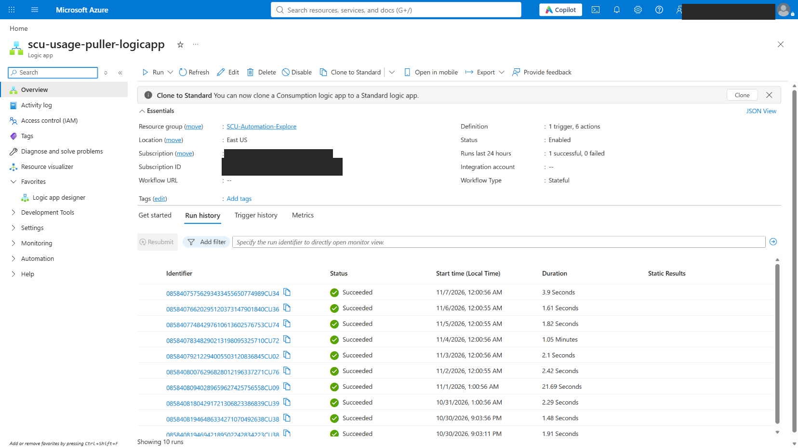
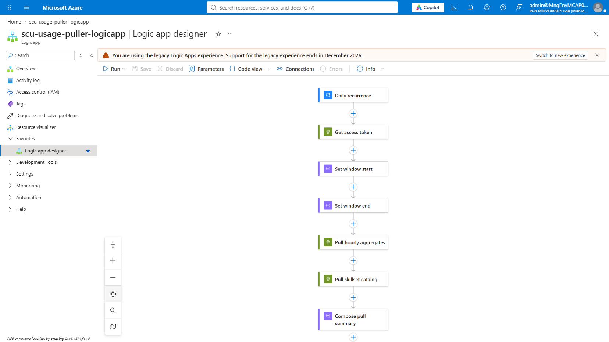
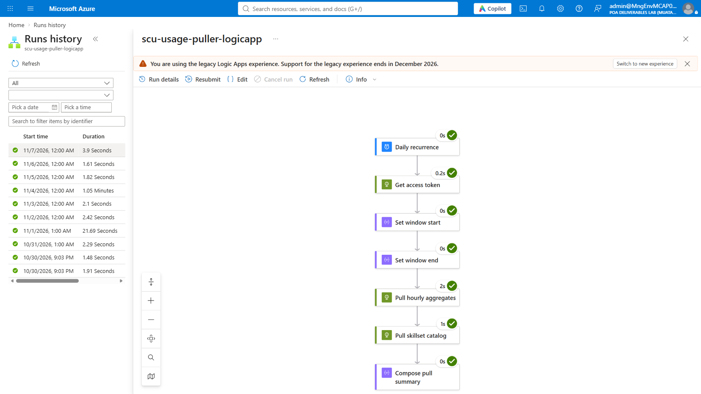
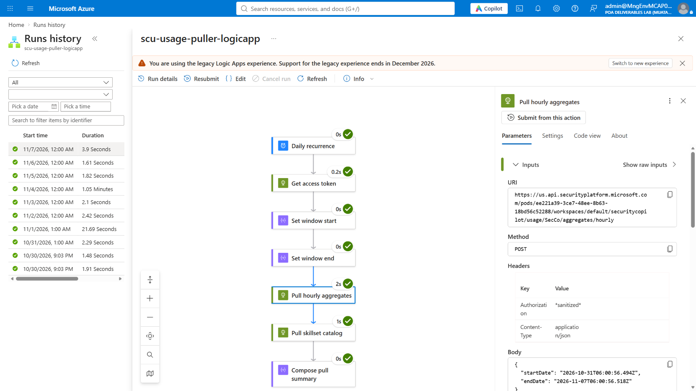
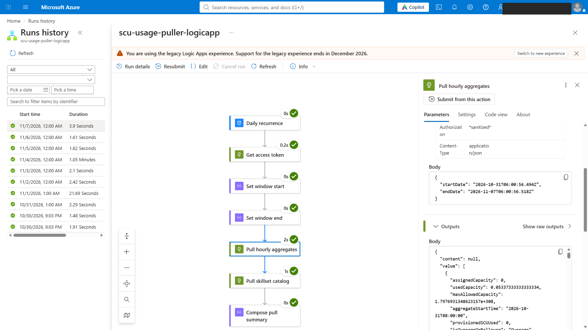
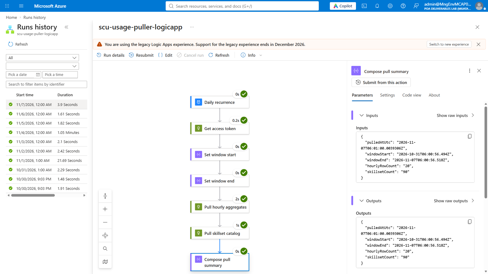

# Live Azure Portal walkthrough — Azure Logic App (`scu-usage-puller-logicapp`)

[](https://portal.azure.com)
[](https://learn.microsoft.com/azure/logic-apps/logic-apps-overview)
[](https://learn.microsoft.com/entra/identity/authentication/concept-authentication-passwordless)

A genuine, screenshot-by-screenshot walkthrough of the already-deployed
**Approach 1** Logic App from
[`AUTOMATION-COMPARISON.md`](../AUTOMATION-COMPARISON.md), captured directly
in the Azure Portal. Every screenshot below is a real, unedited run — not a
mock-up.

> [!NOTE]
> **These are generic steps — the same portal views work the same way for
> any Consumption Logic App.** The screenshots were captured live against
> one dev/sandbox tenant, so the resource names, run IDs, timestamps, and
> row counts shown are specific to that one run. Your own tenant will show
> different IDs and numbers through the exact same steps.

The Logic App itself was originally deployed and verified non-interactively
(Azure CLI / ARM / REST) because interactive Azure Portal sign-in to this
tenant requires a one-time, device-bound passkey/MFA registration that needs
the account owner physically present. That sign-in was completed live during
this walkthrough, which is what made the screenshots below possible.

## Contents

- [Step 1: Sign in to the Azure Portal](#step-1-sign-in-to-the-azure-portal)
- [Step 2: Logic App overview and run history](#step-2-logic-app-overview-and-run-history)
- [Step 3: Open the Logic App Designer](#step-3-open-the-logic-app-designer)
- [Step 4: A specific run, all steps succeeded](#step-4-a-specific-run-all-steps-succeeded)
- [Step 5: Action inputs — real request, sanitized auth](#step-5-action-inputs--real-request-sanitized-auth)
- [Step 6: Action outputs — real usage data returned](#step-6-action-outputs--real-usage-data-returned)
- [Step 7: End-to-end result summary](#step-7-end-to-end-result-summary)
- [Lab results](#lab-results)
- [Good to know](#good-to-know)
- [Troubleshooting](#troubleshooting)
- [Repository layout](#repository-layout)
- [References](#references)

---

## Step 1: Sign in to the Azure Portal

**Why:** this tenant enforces a one-time, device-bound passkey/MFA
registration before any interactive Portal session — a security measure,
not a bug. Two **separate** interactive challenges were needed, back to
back:

1. A general account-level verification via `mysignins.microsoft.com`
   (native Windows Hello / passkey prompt).
2. A second, separate step-up challenge specifically for the Azure
   Portal/Management API application, triggered the moment the Logic App's
   overview page was opened.

Both are native OS-level dialogs outside the browser — there's nothing to
screenshot here that would be useful (or safe) to publish. Once both
completed, the rest of this walkthrough needed no further sign-in.

## Step 2: Logic App overview and run history

**Why:** confirms the Logic App is genuinely deployed, enabled, and running
on its own daily schedule — not just a one-time CLI deployment that was
never touched again.

<p align="center"><br><sub>The <code>scu-usage-puller-logicapp</code> overview blade — daily runs since 10/30/2026, every single one <b>Succeeded</b>.</sub></p>

## Step 3: Open the Logic App Designer

**Why:** shows the actual workflow shape — a trigger and six actions, laid
out exactly as they execute.

<p align="center"><br><sub>Daily recurrence → Get access token → Set window start → Set window end → Pull hourly aggregates → Pull skillset catalog → Compose pull summary.</sub></p>

## Step 4: A specific run, all steps succeeded

**Why:** the monitoring view for one real run proves every step actually
executed — not just that the workflow is syntactically valid.

<p align="center"><br><sub>Run from 11/7/2026, 12:00 AM — all 7 steps green-checked, 3.9 seconds total.</sub></p>

## Step 5: Action inputs — real request, sanitized auth

**Why:** proves the action is calling the real Security Copilot usage API
with a real time window, while confirming no bearer token is ever exposed —
Azure Logic Apps automatically redacts `secureString`-typed values as
`*sanitized*` in this view.

<p align="center"><br><sub>The <b>Pull hourly aggregates</b> action's real <code>URI</code>, <code>POST</code> method, and request body (a live 7-day window) — <code>Authorization</code> shows <code>*sanitized*</code> automatically.</sub></p>

## Step 6: Action outputs — real usage data returned

**Why this matters:** this is the actual payoff — real Security Copilot
usage records coming back from the API call, proving the pipeline works
end to end, not just that the HTTP call "succeeded" with an empty body.

<p align="center"><br><sub>Real returned hourly usage records — <code>usedCapacity</code>, <code>aggregateStartTime</code>, <code>overageSCUUsed</code>, and related fields for this tenant's actual Security Copilot capacity.</sub></p>

## Step 7: End-to-end result summary

**Why:** the final action's own input/output is the run's one-line summary
— confirms the whole pull in a single glance.

<p align="center"><br><sub>The <b>Compose pull summary</b> action's result for this run: <code>hourlyRowCount: 20</code>, <code>skillsetCount: 90</code>, real <code>windowStart</code>/<code>windowEnd</code> timestamps.</sub></p>

---

## Lab results

| Check | Result |
|---|---|
| Azure Portal sign-in (two-stage MFA/passkey) | **Completed live** by the account owner — not automatable |
| Logic App state | **Enabled**, 1 trigger + 6 actions |
| Run history | Daily runs since 10/30/2026, **all Succeeded** |
| Run captured in detail | 11/7/2026, 12:00 AM — 7/7 steps succeeded, 3.9s total |
| "Pull hourly aggregates" inputs | Real API URI/method/body; `Authorization` auto-sanitized |
| "Pull hourly aggregates" outputs | Real hourly usage records returned (non-empty, real values) |
| "Compose pull summary" result | `hourlyRowCount: 20`, `skillsetCount: 90` |
| Any secret exposed in any screenshot? | **No** — `Authorization` always shows `*sanitized*`; "Get access token" action's own output was deliberately never opened |

## Good to know

- **Two separate interactive challenges, not one.** A general account-level
  passkey verification and a second, Azure-Portal-specific step-up
  challenge both had to be completed, even though both used the same
  passkey/Windows Hello prompt. Expect this the first time in a new
  session — it won't repeat until the session or token expires.
- **The `*sanitized*` redaction is a platform feature, not something I did
  manually.** Any Logic App parameter typed as `secureString` (like the
  bearer token built in "Get access token") is automatically masked in the
  monitoring view's Inputs/Outputs, in both the Designer and the REST API.
  This makes it safe to screenshot action inputs/outputs without ever
  exposing the token itself.
- **"Get access token"'s own output was deliberately never opened or
  screenshotted** — that's the one place the raw bearer token would
  actually appear in plaintext (before whichever downstream action
  interpolates it into a sanitized header).
- **This tenant's Logic App still uses the "legacy" designer experience** —
  a deprecation banner says support ends December 2026. Functionally
  identical to the new designer for this walkthrough's purposes.
- **Logic Apps and Power Automate cloud flows share the same underlying
  run engine** — see
  [`PowerAutomate/WALKTHROUGH.md`](../PowerAutomate/WALKTHROUGH.md) for the
  Power Platform equivalent of this exact workflow, including very
  similarly-formatted run IDs.

## Troubleshooting

| Symptom | Likely cause and fix |
|---|---|
| `mysignins.microsoft.com/register` returns a `BadRequest` error page | The security-info registration flow was interrupted or retried. Navigate directly to `mysignins.microsoft.com/security-info` instead — it re-triggers a clean passkey/Windows Hello prompt. |
| Azure Portal asks for MFA again even after `mysignins.microsoft.com` already succeeded | Expected — the Azure Portal/Management API application has its own, separate step-up conditional-access policy. Complete the native Windows Hello/passkey prompt a second time. |
| Designer or monitoring view shows only a loading animation right after navigating | Azure Portal's React views can take a few seconds to render, especially on a deep link. Wait 3–4 seconds, or click the specific run row again instead of relying purely on the URL. |
| Clicking an element in the Designer/monitoring view does nothing | These pages render inside nested iframes; some automation tooling can't reliably target elements by reference across frame boundaries. Re-click directly, or reload the page and try again. |

## Repository layout

```text
Automation-Alternatives/LogicApp/
├── WALKTHROUGH.md                      This guide (Steps 1–7)
├── summary.html                        Rendered architecture + CLI/REST proof-of-work page
├── azuredeploy.json                    ARM template used for the original non-interactive deployment
├── sample-hourly-output.json           Sample API response captured via REST
├── 01-architecture-and-proof.png       Architecture diagram + CLI/REST verification screenshot
└── Steps/                              All screenshots referenced above
    ├── logicapp01-overview-run-history.png
    ├── logicapp02-designer-workflow.png
    ├── logicapp03-run-detail-all-succeeded.png
    ├── logicapp04-action-inputs-sanitized-auth.png
    ├── logicapp05-action-outputs-real-data.png
    └── logicapp06-compose-summary-final-result.png
```

## References

- [Azure Logic Apps overview](https://learn.microsoft.com/azure/logic-apps/logic-apps-overview)
- [Monitor and view run history for Logic Apps](https://learn.microsoft.com/azure/logic-apps/monitor-logic-apps)
- [Secure inputs and outputs of Logic Apps workflows](https://learn.microsoft.com/azure/logic-apps/logic-apps-securing-a-logic-app#secure-inputs-and-outputs)
- [Passwordless sign-in with passkeys / FIDO2](https://learn.microsoft.com/entra/identity/authentication/concept-authentication-passwordless)
- [My Sign-Ins security info](https://mysignins.microsoft.com/security-info)

---

*Companion repo to [`Muatazawad2/SecurityCopilot`](https://github.com/Muatazawad2/SecurityCopilot/tree/main/SCU%20Module).*
