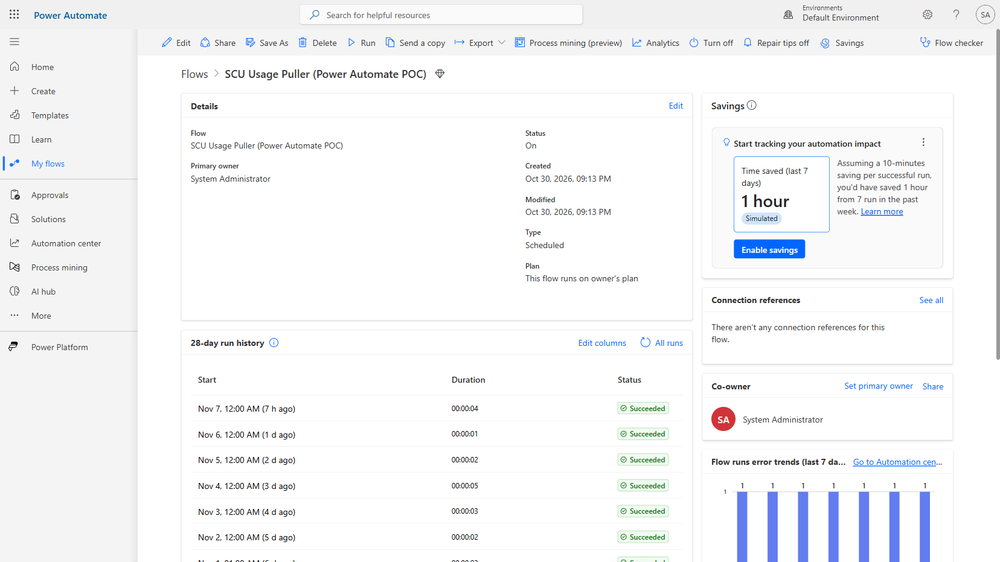
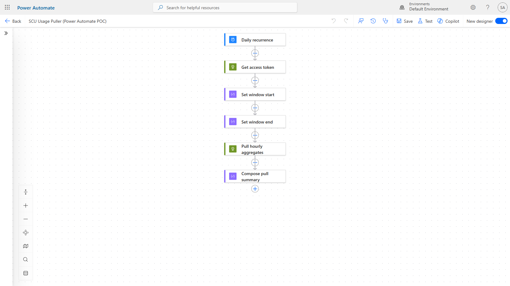
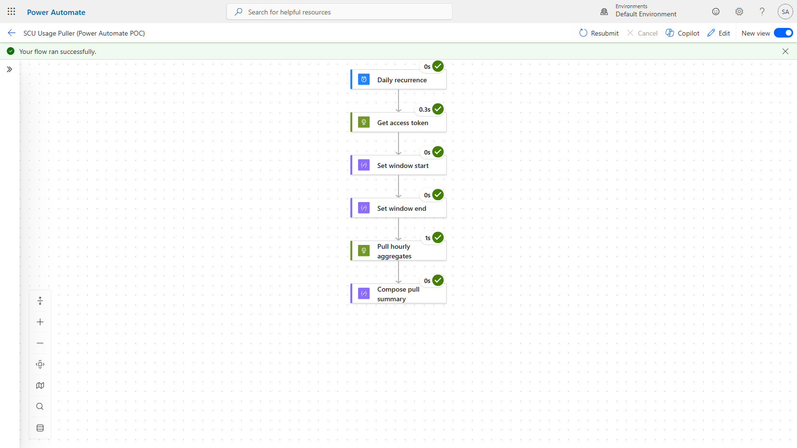
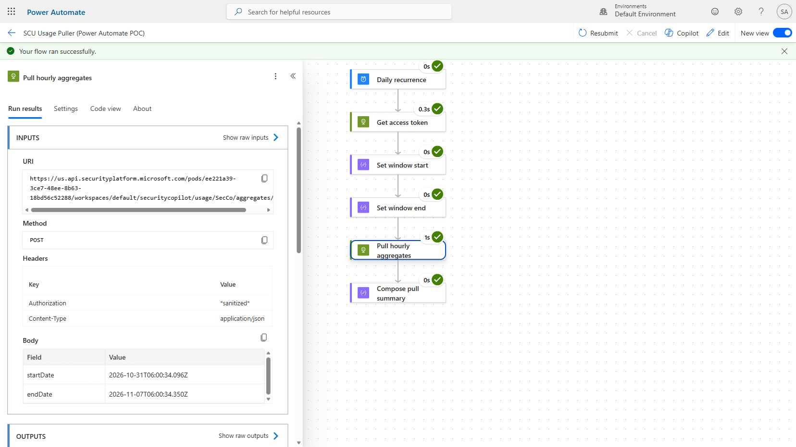
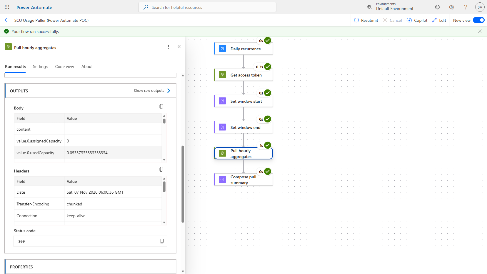
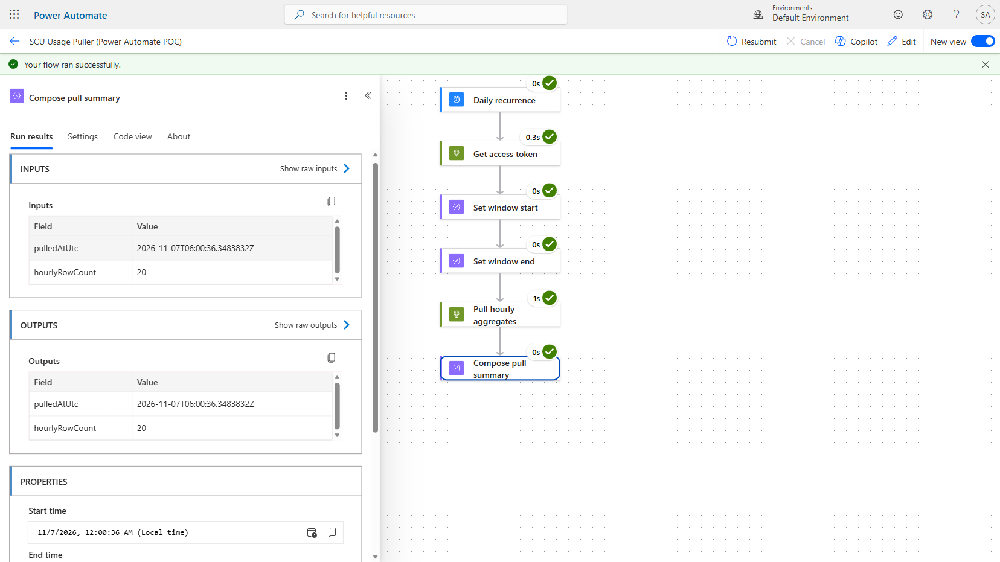

# Live Maker Portal walkthrough — Power Automate (`SCU Usage Puller (Power Automate POC)`)

[](https://make.powerautomate.com)
[](https://learn.microsoft.com/power-automate/overview-cloud)
[](https://learn.microsoft.com/entra/identity/authentication/concept-authentication-passwordless)

A genuine, screenshot-by-screenshot walkthrough of the already-deployed
**Approach 2** cloud flow from
[`AUTOMATION-COMPARISON.md`](../AUTOMATION-COMPARISON.md), captured directly
in the Power Automate Maker Portal. Every screenshot below is a real,
unedited run — not a mock-up.

> [!NOTE]
> **These are generic steps — the same Maker Portal views work the same way
> for any cloud flow.** The screenshots were captured live against one
> dev/sandbox tenant, so the environment, run IDs, timestamps, and row
> counts shown are specific to that one run. Your own tenant will show
> different IDs and numbers through the exact same steps.

The flow itself was originally created and verified non-interactively (via
the Dataverse Web API) because the Maker Portal hit the same interactive
MFA/passkey wall as the Azure Portal. That sign-in was completed live during
this walkthrough — see
[`LogicApp/WALKTHROUGH.md`](../LogicApp/WALKTHROUGH.md) for the full
two-stage sign-in story, which happened first in the same session.

## Contents

- [Step 1: Sign in to the Maker Portal](#step-1-sign-in-to-the-maker-portal)
- [Step 2: Flow overview and 28-day run history](#step-2-flow-overview-and-28-day-run-history)
- [Step 3: Open the flow designer](#step-3-open-the-flow-designer)
- [Step 4: A specific run, all steps succeeded](#step-4-a-specific-run-all-steps-succeeded)
- [Step 5: Action inputs — real request, sanitized auth](#step-5-action-inputs--real-request-sanitized-auth)
- [Step 6: Action outputs — real usage data returned](#step-6-action-outputs--real-usage-data-returned)
- [Step 7: End-to-end result summary](#step-7-end-to-end-result-summary)
- [Lab results](#lab-results)
- [Good to know](#good-to-know)
- [Troubleshooting](#troubleshooting)
- [Repository layout](#repository-layout)
- [References](#references)

---

## Step 1: Sign in to the Maker Portal

**Why:** `make.powerautomate.com` uses its own app registration for sign-in
(a different `client_id` than the Azure Portal), so it re-triggers Microsoft
Entra's account picker even in an already-authenticated browser session.

Picking the account already shown as **signed in** (the same identity used
moments earlier for the Logic App walkthrough) completed sign-in with **no
additional MFA prompt** — the step-up challenge from the Azure Portal did
not need to repeat here.

**This also resolved the previously-documented "second blocker":** the
account that completes this sign-in is this sandbox tenant's own System
Administrator / primary owner of the flow, so it has full Default
Environment access — the "no role on Dataverse environment" limitation
documented in `AUTOMATION-COMPARISON.md` applied to a different, external
identity, not to this tenant-admin sign-in.

## Step 2: Flow overview and 28-day run history

**Why:** confirms the flow is genuinely deployed, turned on, and running on
its own daily schedule — not just a one-time Dataverse API call that was
never touched again.

<p align="center"><br><sub><b>SCU Usage Puller (Power Automate POC)</b> — Status: On, Type: Scheduled, created 10/30/2026 — 28-day run history shows daily runs, every single one <b>Succeeded</b>.</sub></p>

## Step 3: Open the flow designer

**Why:** shows the actual flow shape — a trigger and six actions, laid out
exactly as they execute. Functionally identical to the Logic App version
(same underlying Workflow Definition Language), just authored as a Power
Platform cloud flow instead of an Azure resource.

<p align="center"><br><sub>Daily recurrence → Get access token → Set window start → Set window end → Pull hourly aggregates → Compose pull summary.</sub></p>

## Step 4: A specific run, all steps succeeded

**Why:** the run detail view for one real run proves every step actually
executed — not just that the flow is syntactically valid.

<p align="center"><br><sub>"Your flow ran successfully" — the 11/7/2026, 12:00 AM run, every step green-checked with real durations.</sub></p>

## Step 5: Action inputs — real request, sanitized auth

**Why:** proves the action is calling the real Security Copilot usage API
with a real time window, while confirming no bearer token is ever exposed —
Power Automate (built on the same engine as Logic Apps) automatically
redacts secure values as `*sanitized*` in this view.

<p align="center"><br><sub>The <b>Pull hourly aggregates</b> action's real <code>URI</code>, <code>POST</code> method, and request body (a live 7-day window) — <code>Authorization</code> shows <code>*sanitized*</code> automatically.</sub></p>

## Step 6: Action outputs — real usage data returned

**Why this matters:** this is the actual payoff — real Security Copilot
usage records coming back from the API call, with an HTTP 200 status,
proving the pipeline works end to end.

<p align="center"><br><sub>Real returned usage data — <code>usedCapacity: 0.0533733333333334</code>, <code>assignedCapacity</code>, response headers, and <b>Status code 200</b>.</sub></p>

## Step 7: End-to-end result summary

**Why:** the final action's own input/output is the run's one-line summary
— confirms the whole pull in a single glance, and matches the Logic App's
equivalent step almost exactly.

<p align="center"><br><sub>The <b>Compose pull summary</b> action's result for this run: <code>hourlyRowCount: 20</code>, real <code>pulledAtUtc</code> timestamp, plus the run's <b>Properties</b> (Status: Succeeded, tracking IDs).</sub></p>

---

## Lab results

| Check | Result |
|---|---|
| Maker Portal sign-in | **Completed live**, reusing the already-authenticated identity — no extra MFA prompt needed |
| Dataverse environment access | **Confirmed** — flow visible and fully manageable in "Default Environment" with this identity |
| Flow state | **On**, Type: Scheduled, Primary owner: System Administrator |
| 28-day run history | Daily runs since 10/30/2026, **all Succeeded** |
| Run captured in detail | 11/7/2026, 12:00 AM — all steps succeeded |
| "Pull hourly aggregates" inputs | Real API URI/method/body; `Authorization` auto-sanitized |
| "Pull hourly aggregates" outputs | Real usage records returned, **HTTP 200** |
| "Compose pull summary" result | `hourlyRowCount: 20`, real `pulledAtUtc` timestamp |
| Any secret exposed in any screenshot? | **No** — `Authorization` always shows `*sanitized*`; "Get access token" action's own output was deliberately never opened |

## Good to know

- **The documented "no role on Dataverse environment" blocker was about a
  different identity, not this one.** Once signed in as this sandbox
  tenant's own System Administrator / flow owner, the Maker Portal, the
  Default Environment, and the flow itself were all immediately visible —
  no environment-switching or additional permissions needed.
- **No second MFA challenge was needed here.** The Azure Portal's two-stage
  challenge (documented in
  [`LogicApp/WALKTHROUGH.md`](../LogicApp/WALKTHROUGH.md)) only had to
  happen once per session — picking the already-signed-in account at the
  Maker Portal's account picker reused that session.
- **The `*sanitized*` redaction is a platform feature, not something done
  manually** — Power Automate shares Azure Logic Apps' underlying engine,
  so secure-typed values are masked in run history the same way.
- **Run and tracking IDs look almost identical in format to the Logic App's**
  (e.g. `...CU20` vs `...CU34`) — both products run on the same underlying
  Workflow runtime, just surfaced through different portals.
- **"Get access token"'s own output was deliberately never opened or
  screenshotted** — same precaution as the Logic App walkthrough.

## Troubleshooting

| Symptom | Likely cause and fix |
|---|---|
| Maker Portal re-prompts for sign-in even in an authenticated browser | Expected — `make.powerautomate.com` uses its own app registration, so Entra shows its account picker again. Pick the account already marked "Signed in" to avoid a fresh MFA challenge. |
| Flow isn't visible under "My flows" | Check the environment picker in the top-right ("Environments") — confirm it's pointed at the environment that actually owns the flow (e.g. "Default Environment"), not a different one. |
| A tutorial/coachmark tooltip (e.g. "Drafts and Versioning now available") blocks part of the designer or run view | Cosmetic only — press `Escape`, or click an empty area of the canvas to dismiss it. |
| Run detail or action panel appears blank right after clicking | The Maker Portal's panels can take a moment to render. Click the action name again, or wait a couple of seconds before scrolling to Outputs. |

## Repository layout

```text
Automation-Alternatives/PowerAutomate/
├── WALKTHROUGH.md                      This guide (Steps 1–7)
├── summary.html                        Rendered architecture + Dataverse API proof-of-work page
├── flow-definition.json                Flow definition used for the original non-interactive deployment
├── 01-architecture-and-proof.png       Architecture diagram + Dataverse API verification screenshot
└── Steps/                              All screenshots referenced above
    ├── pa01-overview-run-history.png
    ├── pa02-designer-workflow.png
    ├── pa03-run-detail-all-succeeded.png
    ├── pa04-action-inputs-sanitized-auth.png
    ├── pa05-action-outputs-real-data.png
    └── pa06-compose-summary-final-result.png
```

## References

- [Power Automate overview](https://learn.microsoft.com/power-automate/getting-started)
- [Monitor your flows](https://learn.microsoft.com/power-automate/monitor-flows)
- [Secure inputs and outputs in a flow run](https://learn.microsoft.com/power-automate/error-checker)
- [Dataverse Web API — workflows (cloud flows)](https://learn.microsoft.com/power-automate/web-api-create-cloud-flow)
- [Passwordless sign-in with passkeys / FIDO2](https://learn.microsoft.com/entra/identity/authentication/concept-authentication-passwordless)

---

*Private working notes — review before adding to the public `SecurityCopilot` repo.*
