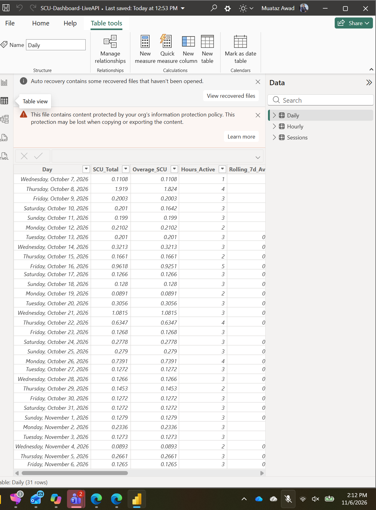
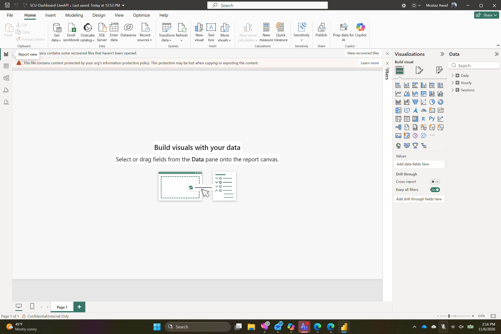

# SCU Module — Part 4: From One Table to a Full Live Dashboard (and a Custom-Connector Dead End)

[](https://learn.microsoft.com/power-bi/fundamentals/desktop-getting-started)
[](https://learn.microsoft.com/powerquery-m/power-query-m-function-reference)
[](https://learn.microsoft.com/copilot/security/manage-usage)

This is **Part 4**, and a direct sequel to
[`STEP-BY-STEP.md`](STEP-BY-STEP.md) (Part 3's Approach 3). That walkthrough
proved the pattern with **one** Blank Query and a 7-day Hourly pull. This part
documents scaling that same pattern to drive **all three core tables**
(`Hourly`, `Sessions`, `Daily`) of a real multi-page dashboard
(`SCU-Dashboard-LiveAPI.pbix`) that had previously loaded those tables from a
static `SCU-Report.xlsx` export — plus a genuine dead end hit and
root-caused along the way: an attempt to replace the ad-hoc queries with a
proper custom Power Query connector, which turned out to be impossible on
this specific Power BI Desktop installation for a reason worth recording.

> [!IMPORTANT]
> **This doc never shows a real refresh token, and the `.pbix` itself is not
> committed to this repo.** Every screenshot below was taken from Table/Report
> view with the Advanced Editor and DAX/M panes closed, specifically to avoid
> ever capturing the token. The one M code file included here
> ([`SCUDashboard-connector.pq`](LiveDashboard-Images/SCUDashboard-connector.pq))
> takes its token from a Power BI credential prompt at runtime
> (`Extension.CurrentCredential()`) and contains no secret value at all — see
> [Good to know](#good-to-know) for why the live dashboard's own queries are
> *less* safe than that pattern today, and what to do about it.

## Contents

- [Goal](#goal)
- [Recap: what Part 3 already proved](#recap-what-part-3-already-proved)
- [Architecture — one pattern, three endpoints](#architecture--one-pattern-three-endpoints)
- [Step 1: Hourly and Sessions converted cleanly](#step-1-hourly-and-sessions-converted-cleanly)
- [Step 2: Daily hit a credential wall](#step-2-daily-hit-a-credential-wall)
- [Step 3: Side quest — building a real custom connector](#step-3-side-quest--building-a-real-custom-connector)
- [Step 4: Root cause — the Microsoft Store edition can't load it](#step-4-root-cause--the-microsoft-store-edition-cant-load-it)
- [Step 5: Back to basics — the simple fix that actually worked](#step-5-back-to-basics--the-simple-fix-that-actually-worked)
- [Result](#result)
- [Good to know](#good-to-know)
- [Troubleshooting](#troubleshooting)
- [Repository layout](#repository-layout)
- [References](#references)

## Goal

Convert `SCU-Dashboard-LiveAPI.pbix`'s three core tables from a static,
point-in-time `SCU-Report.xlsx` export to live, direct-API Power Query
sources — so opening the file and clicking **Refresh** pulls current
Security Copilot usage data straight from the tenant, the same way Part 3's
single Blank Query did, but feeding a full dashboard instead of one proof
table.

## Recap: what Part 3 already proved

Part 3 established the core pattern once, end to end, with one table:
exchange a delegated refresh token for an access token against Entra's
token endpoint, then call the Security Copilot usage API's
`/aggregates/hourly` endpoint with `Web.Contents`, and turn the JSON result
into a table. This part reuses that exact pattern three times over, against
two different endpoint shapes.

## Architecture — one pattern, three endpoints

| Table | Endpoint | Shape | Notes |
|---|---|---|---|
| `Hourly` | `/aggregates/hourly` | Single call, 30-day window | Same call shape as Part 3's proof query. |
| `Sessions` | `/aggregates/dimensional` | **Paginated** (`pageSize: 200`), `List.Generate` loop until a page comes back empty | Per-session rows: user, plugins/skills used, category, status, cost. |
| `Daily` | `/aggregates/dimensional` | Same paginated pull as `Sessions`, then **grouped by calendar day** | Produces `Day`, `SCU_Total`, `Overage_SCU`, `Hours_Active`, and a trailing `Rolling_7d_Av` column. |

All three authenticate the same way: a stored delegated refresh token is
traded for a short-lived access token via
`grant_type=refresh_token` against
`https://login.microsoftonline.com/<TenantId>/oauth2/v2.0/token`, requesting
the `Purview.DelegatedAccess` scope — identical to `SCU-Setup.ps1` /
`SCU-Run.ps1` and to Part 3.

## Step 1: Hourly and Sessions converted cleanly

Both queries followed Part 3's exact recipe (`Web.Contents` → `Json.Document`
→ `Table.FromRecords` → typed/renamed columns) with no surprises. `Sessions`
additionally needed the `List.Generate` pagination loop shown in the
[architecture table](#architecture--one-pattern-three-endpoints) above, since
`/aggregates/dimensional` caps each response at 200 rows. Both refreshed
cleanly on the first real attempt.

## Step 2: Daily hit a credential wall

`Daily` reuses the same paginated `/aggregates/dimensional` call as
`Sessions`, then groups the result by day. Structurally identical to a query
that already worked — but its **first** refresh attempt on this query
triggered Power BI's generic **"Access Web content"** credential dialog for
the API host, and clicking through that dialog by automation hit a wall:
the dialog's **Web API** tab has a **Key** text field that the automation
could reliably *navigate to* (tab/button clicks worked) but not reliably
*type into* — a WebView2 input quirk, not a logic problem in the query
itself. Hourly and Sessions didn't hit this because they'd already earned
that one-time credential trust from earlier refreshes in the same file.

## Step 3: Side quest — building a real custom connector

Rather than keep fighting an ad-hoc credential dialog, the next move was to
do this properly: a genuine Power Query **custom connector**
(`SCUDashboard.pq` → compiled to `SCUDashboard.mez`) exposing `Hourly` and
`Sessions` as native navigation-table entries under **Get Data**, with its
own first-class **Key** credential type — so Power BI handles the one-time
credential prompt itself, the same way it does for any built-in connector,
instead of the raw `Web.Contents` ad-hoc flow.

The connector source is included here as a reusable reference artifact:
[`SCUDashboard-connector.pq`](LiveDashboard-Images/SCUDashboard-connector.pq).
It contains **zero secrets** — the refresh token is never inlined; it's
read at runtime from whatever the user types into Power BI's own credential
dialog (`Extension.CurrentCredential()[Key]`), which is the architecturally
"right" way to do this and strictly more secure than both the ad-hoc
`Web.Contents` pattern and Part 3's Parameter pattern.

Build/placement checklist followed:

- [x] `.mez` built and placed in `%USERPROFILE%\Documents\Power BI Desktop\Custom Connectors\`.
- [x] File verified as a structurally valid zip containing the compiled `.pq`.
- [x] **File → Options → Security → "Allow any extension to load without
      validation or warning"** confirmed enabled (required for *any*
      unsigned custom connector to even be considered).
- [x] Power BI Desktop fully restarted after placing the file.
- [ ] Connector never appeared searching **Get Data** for "Security Copilot"
      or browsing the **Other** category — with **zero** errors, warnings,
      or log entries anywhere.

## Step 4: Root cause — the Microsoft Store edition can't load it

No combination of settings fixed it, because the real cause wasn't a
setting. Checking how Power BI Desktop is installed on this machine:

```powershell
Get-AppxPackage -Name "*PowerBI*" | Select-Object Name, PackageFullName, InstallLocation
```

```
Name            : Microsoft.MicrosoftPowerBIDesktop
PackageFullName : Microsoft.MicrosoftPowerBIDesktop_2.160.579.0_x64__8wekyb3d8bbwe
InstallLocation : C:\Program Files\WindowsApps\Microsoft.MicrosoftPowerBIDesktop_2.160.579.0_x64__8wekyb3d8bbwe
```

This is the **Microsoft Store (MSIX/AppX) edition**. That edition runs in a
Store app sandbox that **cannot load unsigned custom `.mez` connectors at
all** — a hard platform limitation enforced by Store packaging policy, not
documented anywhere inside the Power BI UI itself, and completely
independent of the "allow any extension" security setting (that setting
only matters for the separate, standalone/MSI-installed edition of Power BI
Desktop, downloaded directly from microsoft.com rather than the Store).
That fully explains every symptom observed: a correctly built, correctly
placed, structurally valid connector that silently never appears, with
nothing to debug because nothing is actually attempting to load it.

**Takeaway for next time:** custom connectors on this machine require
uninstalling the Store edition and installing the standalone MSI edition of
Power BI Desktop instead. The connector source above is kept exactly for
that future possibility — it needs no changes to work once run on an
edition that supports it.

## Step 5: Back to basics — the simple fix that actually worked

With the connector path closed off, the fix for `Daily` turned out to be
simpler than the detour: bring Power BI Desktop to the foreground and click
**Refresh now** on the report's own "incomplete data" notification banner
directly (not through the Advanced Editor, not through a new credential
flow) — and it refreshed cleanly with **zero credential prompts**, because
the credential entered earlier against this same API host had already been
trusted. No connector, and no further dialog automation, was actually
needed — the one that looked unresolved just hadn't been re-tried since the
original manual entry.

## Result

<p align="center"><br><sub><b>Daily</b> table in Table view — 31 rows, real dates and SCU figures, pulled live from the usage API.</sub></p>

<p align="center"><br><sub>Report view — <b>Daily</b>, <b>Hourly</b>, and <b>Sessions</b> all present in the Data pane, no "incomplete data" banner.</sub></p>

| Check | Result |
|---|---|
| `Hourly` refresh | **Succeeded** — converted cleanly, first attempt |
| `Sessions` refresh | **Succeeded** — paginated pull, converted cleanly, first attempt |
| `Daily` refresh | **Succeeded** after Step 5 — 31 rows, zero credential prompts |
| Custom connector (`.mez`) | **Blocked** — Microsoft Store/MSIX edition can't load unsigned connectors (root-caused, not fixed; see [Step 4](#step-4-root-cause--the-microsoft-store-edition-cant-load-it)) |
| Full model refresh | **Succeeded** — all 3 tables, no errors |
| "Incomplete data" banner | **Gone** — confirmed via Report view |
| Save | **Succeeded** — title bar confirmed a real save timestamp |

## Good to know

- **The live dashboard's queries currently inline the refresh token**, the
  same way Part 3's [Step 5](STEP-BY-STEP.md#step-5-paste-the-m-code-and-run-it)
  placeholder does — they were **not** migrated to Part 3's
  [Parameter pattern](STEP-BY-STEP.md#part-3-move-the-secret-into-a-parameter),
  let alone the connector's credential-prompt pattern (which is better than
  both). That's a real security gap worth closing: at minimum, move the
  token into a Power Query Parameter like Part 3 does; ideally, revisit the
  custom connector once run on an edition of Power BI Desktop that can load
  it. Either way, **don't share this `.pbix` file as-is** — it has a live
  secret baked into its query definitions in plain text.
- **"No errors anywhere" is itself a diagnostic signal.** When a correctly
  built, correctly placed extension produces literally zero trace of itself
  trying (and failing) to load, that's a strong hint the platform isn't
  attempting to load it at all — worth checking the install edition before
  assuming a config or code problem.
- **A query that looks structurally identical to a working one can still
  hit a different credential state.** `Daily` and `Sessions` call the same
  endpoint with the same auth — the only difference was which one had
  already earned a one-time host-level credential trust in this file.
- **Refresh tokens get pasted in plain text more easily than you'd think**
  while iterating on M code live in a chat-assisted session. Treat any
  session where that happened as having had the token exposed to that
  session's history — rotating it is cheap insurance.

## Troubleshooting

| Symptom | Likely cause and fix |
|---|---|
| Custom connector never appears in **Get Data**, no errors anywhere | Check the install edition first: `Get-AppxPackage -Name "*PowerBI*"`. If it returns a package, you're on the Store/MSIX edition and unsigned connectors cannot load — switch to the standalone MSI edition. |
| "Access Web content" dialog won't accept typed input via automation | Known WebView2 input quirk on this dialog. Click through it manually — paste into the **Key** field and click **Connect**. |
| One query refreshes fine, a structurally identical one doesn't | Compare credential trust state per host/data-source, not the M code — **File → Options → Data Load / Privacy**, or just try **Refresh now** again once the other query has already succeeded once. |
| Full model refresh fails after a single query was edited | Refresh that one query alone first (right-click it in the Data pane → **Refresh**) to isolate whether the failure is query-specific before re-running the whole model. |

## Repository layout

```text
Automation-Alternatives/PowerQuery/
├── STEP-BY-STEP.md                    Part 3 — the original single-table proof of concept
├── LIVE-DASHBOARD.md                  This guide — Part 4
└── LiveDashboard-Images/
    ├── 01-daily-table-live-data.png   Daily table, Table view, 31 live rows
    ├── 02-report-view-healthy.png    Report view, all 3 tables present, no error banner
    └── SCUDashboard-connector.pq     Custom connector source (no secrets — reusable on a
                                       Power BI Desktop edition that can load unsigned connectors)
```

## References

- [Power Query custom connectors overview](https://learn.microsoft.com/power-query/samples/overview)
- [Handling authentication in a custom connector](https://learn.microsoft.com/power-query/samples/trippin/9-doing-more-with-metadata/tripping9)
- [`Extension.CurrentCredential` — Power Query M reference](https://learn.microsoft.com/powerquery-m/extension-currentcredential)
- [Install Power BI Desktop (Store vs. direct download)](https://learn.microsoft.com/power-bi/fundamentals/desktop-get-the-desktop)
- [Privacy levels in Power Query](https://learn.microsoft.com/power-query/privacy-levels)
- [Data refresh in Power BI](https://learn.microsoft.com/power-bi/connect-data/refresh-data)

---

*Private working notes — review before adding to the public `SecurityCopilot` repo.*
