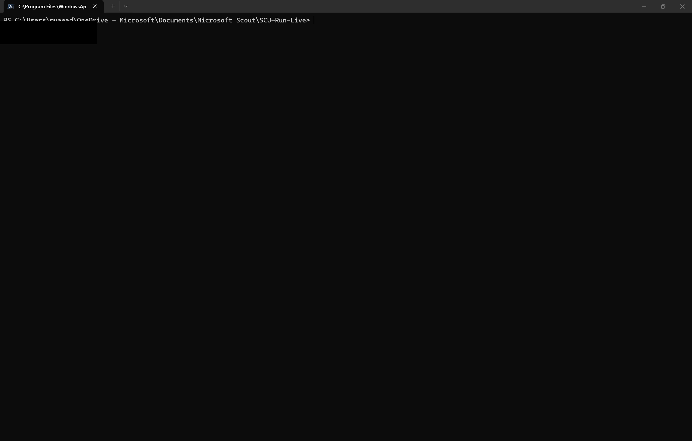
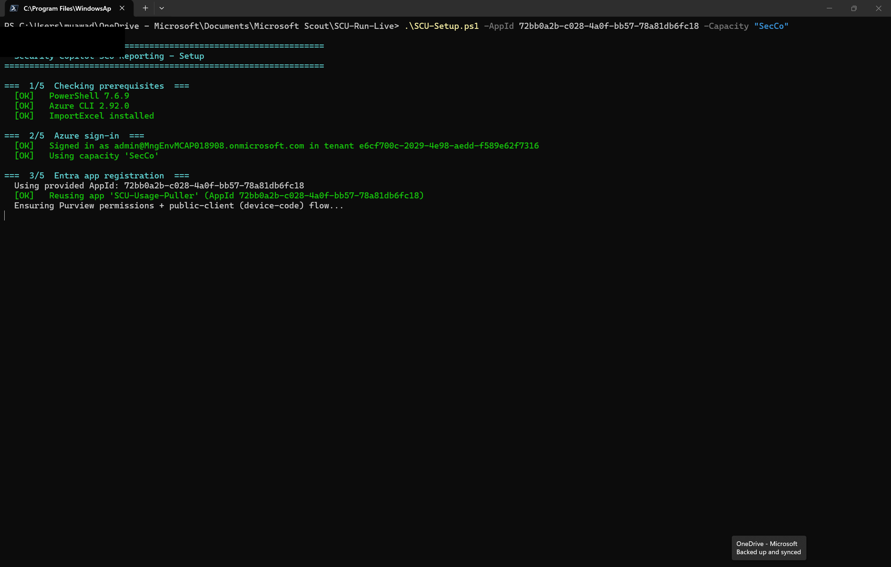
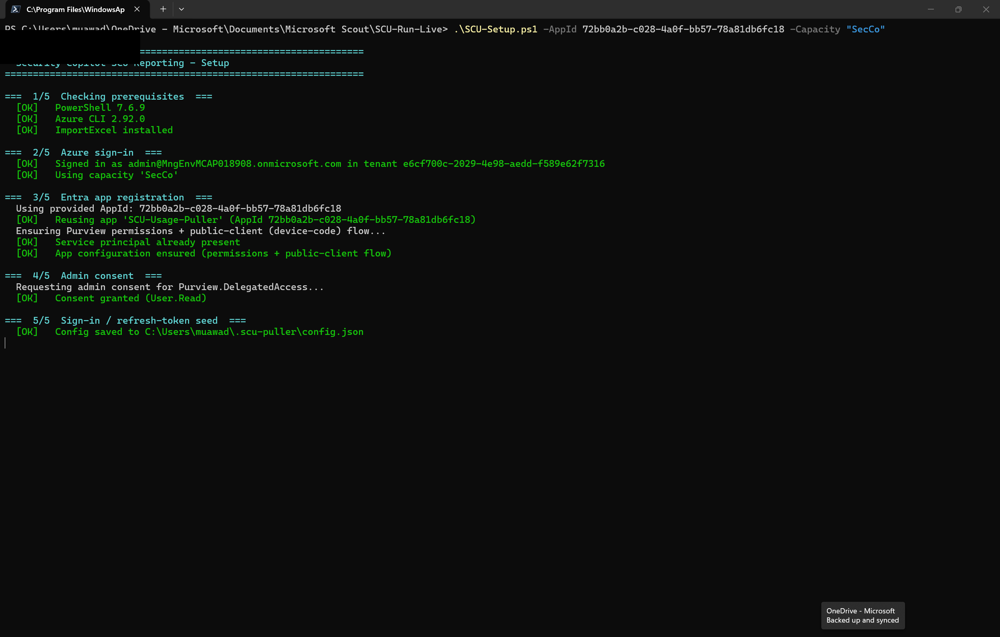
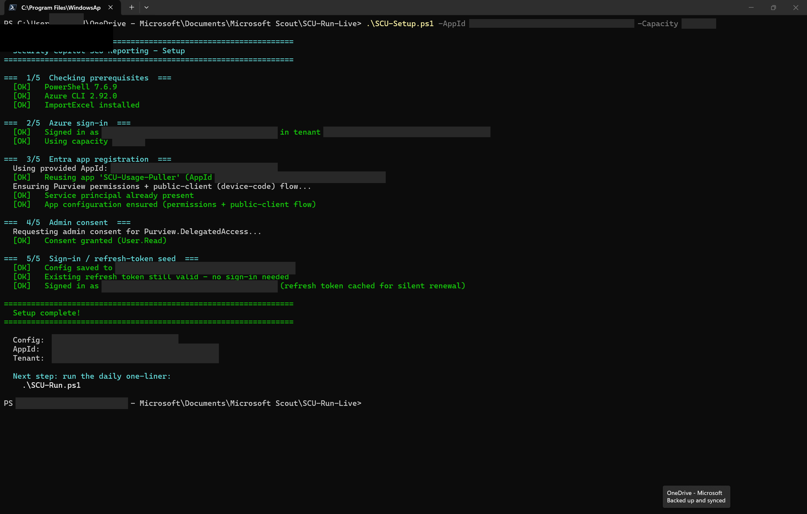
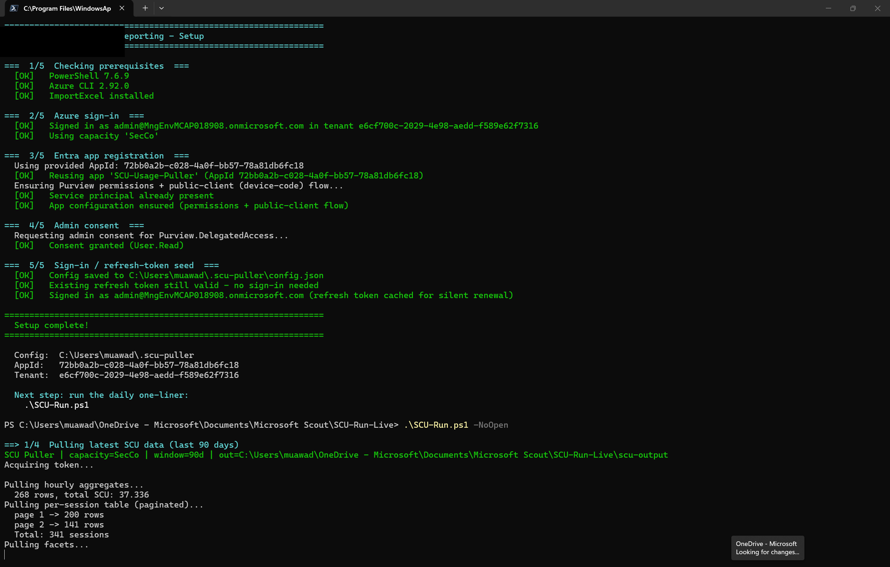
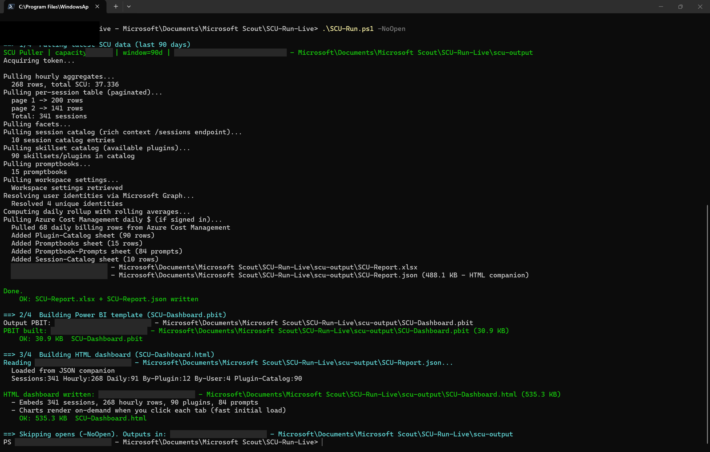
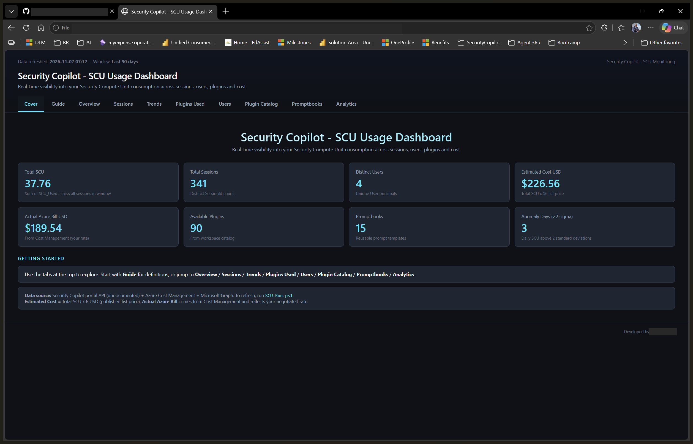

# Pull Security Copilot usage data with `SCU-Setup.ps1` + `SCU-Run.ps1`

[](https://learn.microsoft.com/powershell/scripting/overview)
[](https://learn.microsoft.com/cli/azure/)
[](https://learn.microsoft.com/copilot/security/manage-usage)

A genuine, screenshot-by-screenshot walkthrough of the two scripts this
whole repo is built around: **`SCU-Setup.ps1`** (one-time registration and
sign-in) and **`SCU-Run.ps1`** (the daily one-liner that pulls usage data and
rebuilds both dashboards). Both scripts are public, and every screenshot
below is a real, unedited terminal run — not a mock-up.

> [!NOTE]
> **These are generic steps — the same two commands work the same way in
> any tenant.** The screenshots were captured live against one dev/sandbox
> tenant, so the tenant ID, app ID, sign-in account, capacity name, and row
> counts shown are specific to that one run. None are mocked up or
> composited, but your own tenant will show different IDs and numbers
> through the exact same steps.

## Contents

- [How it works](#how-it-works)
- [Before you start](#before-you-start)
- [Step 1: Open a terminal in the solution folder](#step-1-open-a-terminal-in-the-solution-folder)
- [Step 2: Run `SCU-Setup.ps1`](#step-2-run-scu-setupps1)
- [Step 3: Admin consent and token seeding](#step-3-admin-consent-and-token-seeding)
- [Step 4: Setup complete](#step-4-setup-complete)
- [Step 5: Run `SCU-Run.ps1`](#step-5-run-scu-runps1)
- [Step 6: Data pull and dashboard build complete](#step-6-data-pull-and-dashboard-build-complete)
- [Step 7: Open the generated HTML dashboard](#step-7-open-the-generated-html-dashboard)
- [Lab results](#lab-results)
- [Good to know](#good-to-know)
- [Troubleshooting](#troubleshooting)
- [Repository layout](#repository-layout)
- [References](#references)

## How it works

1. **`SCU-Setup.ps1`** runs once per user, per tenant. It checks
   prerequisites (PowerShell 7+, Azure CLI, the `ImportExcel` module),
   signs in to Azure CLI, creates (or reuses) an Entra app registration,
   grants it `Purview.DelegatedAccess`, requests admin consent, then signs
   the current user in via device code and saves a DPAPI-encrypted refresh
   token under `%USERPROFILE%\.scu-puller\`.
2. **`SCU-Run.ps1`** is the script you run every time you want fresh data.
   It reuses that cached refresh token (silently renewing it — no
   sign-in prompt — as long as it's still within its ~90-day validity), then:
   - pulls hourly usage aggregates, the full per-session table, plugin and
     promptbook catalogs, workspace settings, and (if signed in) Azure Cost
     Management billing data;
   - resolves the raw user GUIDs in that data to display names via
     Microsoft Graph;
   - writes `SCU-Report.xlsx` + `SCU-Report.json`;
   - rebuilds `SCU-Dashboard.pbit` (the Power BI template) and
     `SCU-Dashboard.html` (a self-contained, chart-driven HTML dashboard);
   - opens both in Power BI Desktop and your default browser (unless you
     pass `-NoOpen`).
3. Nothing runs in the background between invocations — there's no
   scheduled task, no cloud resource, and no landing-zone file. Re-run
   `SCU-Run.ps1` whenever you want a fresh snapshot.

## Before you start

### What you need

| Item | Details |
|---|---|
| **PowerShell 7+** | `pwsh` on the `PATH`. The script checks this and stops with a clear message if it's missing. |
| **Azure CLI** | Signed in to the tenant that has your Security Copilot capacity (`az login`). The script checks and will prompt if you're not. |
| **The `ImportExcel` PowerShell module** | `Install-Module ImportExcel -Scope CurrentUser` if you don't already have it. |
| **A Security Copilot capacity in that tenant** | The name of an existing `Microsoft.SecurityCopilot/capacities` resource — you'll pass it as `-Capacity`. |
| **Your tenant's Security Copilot pod ID** | A tenant/region-specific GUID, not shown in any admin UI — you'll pass it as `-PodId`. See [Good to know](#good-to-know) for how to find it. |
| **The `SCU-Usage-Puller` app registration from [Part 1](../../README.md)** | Either let `SCU-Setup.ps1` create it fresh, or pass `-AppId` to reuse one your admin already registered. |
| **Time** | About 2–3 minutes for setup (less if a cached refresh token already exists), then 1–2 minutes per `SCU-Run.ps1` pull depending on how much usage data your tenant has. |

### Getting the scripts

Both scripts are published in the public
[`Muatazawad2/SecurityCopilot`](https://github.com/Muatazawad2/SecurityCopilot/tree/main/SCU%20Module)
repo. Download `SCU-Setup.ps1` and `SCU-Run.ps1` into any working folder —
they don't need to live inside this documentation repo.

---

## Step 1: Open a terminal in the solution folder

**Why:** both scripts are self-contained — no project to build, no
dependencies to restore beyond the prerequisites above. A plain PowerShell
7 prompt in the folder holding the two `.ps1` files is all that's needed.

<p align="center"><br><sub>A fresh <code>pwsh</code> session, already in the folder containing <code>SCU-Setup.ps1</code> and <code>SCU-Run.ps1</code>.</sub></p>

## Step 2: Run `SCU-Setup.ps1`

**Why:** this is the one-time step that proves the Entra app, its
permissions, and a signed-in identity are all in place before any data pull
is attempted.

```powershell
.\SCU-Setup.ps1 -AppId <your-app-registration-client-id> -Capacity "<your-capacity-name>" -PodId "<your-pod-id>"
```

Passing `-AppId` reuses an existing app registration instead of creating a
new one — useful when an admin already ran Part 1 and shared the client ID.
Omit it to let the script create a fresh `SCU-Usage-Puller` app.
`-Capacity` and `-PodId` can both be omitted too — the script prompts for
each interactively if not supplied.

<p align="center"><br><sub>Stage <b>1/5</b> confirms PowerShell, Azure CLI, and <code>ImportExcel</code> are all present; <b>2/5</b> confirms the Azure CLI sign-in and capacity name; <b>3/5</b> finds and reuses the existing app registration rather than creating a duplicate.</sub></p>

## Step 3: Admin consent and token seeding

**Why:** the app needs `Purview.DelegatedAccess` granted tenant-wide before
any user's token can call the usage API — this is the one step that
typically needs an admin account the first time it runs in a tenant.

<p align="center"><br><sub>Stage <b>4/5</b> requests and confirms admin consent for <code>Purview.DelegatedAccess</code>; stage <b>5/5</b> begins writing the local config.</sub></p>

## Step 4: Setup complete

**Why this matters:** if a valid refresh token is already cached from a
previous run (within its ~90-day validity window), `SCU-Setup.ps1` detects
that and **skips the interactive device-code sign-in entirely** — this run
completed end-to-end with zero prompts.

<p align="center"><br><sub>Stage <b>5/5</b> finds the existing cached refresh token still valid and reuses it silently. <b>Setup complete!</b> — the banner confirms the config path, app ID, and tenant, and points to <code>SCU-Run.ps1</code> as the next step.</sub></p>

If no valid cached token exists (first run, or one older than ~90 days),
this same stage instead prints a device-code URL and prompts you to sign in
once in a browser — a one-time step, not a per-run one.

## Step 5: Run `SCU-Run.ps1`

**Why:** this is the command you run every time you want fresh data. No
flags are required for the full experience; `-NoOpen` is used here only to
keep the walkthrough's screenshots focused on the terminal output instead of
launching Power BI Desktop and a browser tab mid-sequence.

```powershell
.\SCU-Run.ps1 -NoOpen
```

<p align="center"><br><sub>Stage <b>1/4</b> begins: hourly aggregates and the full per-session table (paginated) come back first — real counts from this run's 90-day window.</sub></p>

## Step 6: Data pull and dashboard build complete

**Why this is the key result:** every data source `SCU-Run.ps1` touches —
usage aggregates, sessions, plugin/promptbook catalogs, workspace settings,
Microsoft Graph identity resolution, and Azure Cost Management billing —
completed successfully in this one run, and both output artifacts were
rebuilt from that same pull.

<p align="center"><br><sub>The rest of stage <b>1/4</b> (catalogs, identities, cost data, <code>SCU-Report.xlsx</code>/<code>.json</code> written), then stage <b>2/4</b> (<code>SCU-Dashboard.pbit</code> built) and stage <b>3/4</b> (<code>SCU-Dashboard.html</code> built) complete back to back.</sub></p>

## Step 7: Open the generated HTML dashboard

**Why:** `SCU-Dashboard.html` is fully self-contained — one file, no server,
no Power BI license needed to view it. Opening it is the fastest way to
confirm the pull actually produced usable data.

<p align="center"><br><sub>The <b>Cover</b> tab of the freshly generated dashboard — every number here (Total SCU, Total Sessions, Distinct Users, Estimated Cost, Available Plugins, Promptbooks) came from the exact run captured in Steps 5–6 above, with zero manual editing.</sub></p>

---

## Lab results

| Check | Result |
|---|---|
| Prerequisite check (`SCU-Setup.ps1` stage 1/5) | **Passed** — PowerShell, Azure CLI, and `ImportExcel` all detected |
| Azure CLI sign-in (stage 2/5) | **Succeeded** — existing `az login` session reused, capacity name confirmed |
| App registration (stage 3/5) | **Reused** an existing app via `-AppId` rather than creating a duplicate |
| Admin consent (stage 4/5) | **Granted** for `Purview.DelegatedAccess` |
| Refresh token (stage 5/5) | **Reused from cache** — no interactive sign-in needed this run |
| `SCU-Run.ps1` data pull (stage 1/4) | **Succeeded** — hourly aggregates, full paginated session table, facets, session/plugin/promptbook catalogs, workspace settings, Graph identity resolution, and Azure Cost Management billing all returned data |
| Output files written | `SCU-Report.xlsx`, `SCU-Report.json`, `SCU-Dashboard.pbit`, `SCU-Dashboard.html` — all confirmed on disk |
| HTML dashboard (stage 3/4) | **Rendered correctly** — Cover tab's summary tiles matched the terminal's own pull counts exactly |
| Anything left running in the background? | **No** — both scripts exit after the console banner; nothing is scheduled |

## Good to know

- **The refresh token is the only long-lived secret.** It's DPAPI-encrypted
  at rest under the signed-in Windows user account, so it can't be copied
  to another machine or user and reused as-is. Treat
  `%USERPROFILE%\.scu-puller\refresh_token.dat` like any other credential
  file: don't commit it, don't screenshot it, don't email it.
- **`-AppId` avoids app-registration sprawl.** If more than one person on a
  team runs `SCU-Setup.ps1` without `-AppId`, each run creates its own
  `SCU-Usage-Puller` app registration. Share the client ID from the first
  run and have everyone else pass `-AppId <that-client-id>` instead.
- **Pod ID isn't shown in any admin UI.** Unlike the Capacity name, there's
  no portal page that lists it. The quickest way to find yours: open the
  Security Copilot portal, open your browser's dev tools **Network** tab,
  and look for any request to
  `securityplatform.microsoft.com/pods/<guid>/...` — that GUID is your pod
  ID. `SCU-Setup.ps1` saves it to `config.json` the first time, so you only
  need to find it once per tenant.
- **`-CreditLine` on `SCU-Run.ps1` is optional attribution text**, shown in
  a small footer on the HTML dashboard and the Power BI template (e.g.
  `-CreditLine "Built by Contoso IT"`). Left blank by default — no credit
  line appears unless you pass one.
- **`SCU-Run.ps1` has flags for partial runs**, useful once you've already
  got a full run working: `-NoRefresh` (rebuild dashboards from existing
  data without re-pulling), `-SkipPbit` / `-SkipHtml` (skip one output
  format), `-HtmlOnly` (skip Power BI entirely), and `-NoOpen` (don't
  auto-launch anything — used throughout this walkthrough).
- **The ~90-day refresh token window means this isn't "set and forget"
  forever.** If `SCU-Run.ps1` ever reports the refresh token failed and
  falls back to a device-code prompt, that's expected once the token
  expires — just complete the one-time sign-in again.
- **Want a Power BI–native alternative to this script's data pull?** See
  [`Automation-Alternatives/PowerQuery/STEP-BY-STEP.md`](../PowerQuery/STEP-BY-STEP.md)
  for a walkthrough that replaces the pull step with a Power Query **Blank
  Query**, refreshable from inside Power BI Desktop with no script run
  required.

## Troubleshooting

| Symptom | Likely cause and fix |
|---|---|
| `SCU-Setup.ps1` stops at prerequisite checks | Install the missing piece it names — PowerShell 7 (`winget install Microsoft.PowerShell`), Azure CLI (`winget install Microsoft.AzureCLI`), or `ImportExcel` (`Install-Module ImportExcel -Scope CurrentUser`). |
| `SCU-Setup.ps1` prompts for a capacity name every time | Pass `-Capacity "<name>"` explicitly instead of relying on the interactive prompt. |
| `SCU-Setup.ps1` prompts for a pod ID every time | Pass `-PodId "<guid>"` explicitly — see [Good to know](#good-to-know) for how to find it. |
| Two different `SCU-Usage-Puller` app registrations exist in the same tenant | Someone ran `SCU-Setup.ps1` without `-AppId` more than once. Pick one client ID as the canonical one and have everyone pass `-AppId` with that value going forward. |
| `SCU-Run.ps1` falls back to a device-code sign-in unexpectedly | The cached refresh token expired (~90-day window) or was never created on this machine/user. Complete the device-code sign-in once; it's cached again afterward. |
| `SCU-Run.ps1` reports 0 sessions or 0 hourly rows | The tenant genuinely has no Security Copilot usage in the pull window. Widen `-Days` (default 90) or confirm usage exists in the Security Copilot portal directly. |
| Azure Cost Management section is skipped | Expected if the signed-in account isn't signed in to Azure CLI with billing read access on that subscription — usage data still pulls fine without it. |
| Power BI Desktop doesn't open after `SCU-Run.ps1` | Only happens with `-NoOpen` or `-HtmlOnly` (both skip it on purpose), or if Power BI Desktop isn't installed — the script prints a `winget install Microsoft.PowerBI` hint in that case. |

## Repository layout

```text
Automation-Alternatives/PowerShell-Run/
├── WALKTHROUGH.md                 This guide (Steps 1–7)
└── Steps/                         All screenshots referenced above
    ├── run01-terminal-ready.png
    ├── run02-setup-prereqs-signin-app-reuse.png
    ├── run03-setup-admin-consent.png
    ├── run04-setup-complete-token-reused.png
    ├── run05-datapull-started.png
    ├── run06-datapull-and-build-complete.png
    └── run07-html-dashboard-output.png
```

## References

- [`SCU-Setup.ps1` / `SCU-Run.ps1` source (public repo)](https://github.com/Muatazawad2/SecurityCopilot/tree/main/SCU%20Module)
- [Install PowerShell on Windows](https://learn.microsoft.com/powershell/scripting/install/installing-powershell-on-windows)
- [Install the Azure CLI](https://learn.microsoft.com/cli/azure/install-azure-cli)
- [`ImportExcel` module (PowerShell Gallery)](https://www.powershellgallery.com/packages/ImportExcel)
- [Grant tenant-wide admin consent](https://learn.microsoft.com/entra/identity/enterprise-apps/grant-admin-consent)
- [OAuth 2.0 device authorization grant flow (Microsoft identity platform)](https://learn.microsoft.com/entra/identity-platform/v2-oauth2-device-code)
- [Data Protection API (DPAPI) overview](https://learn.microsoft.com/dotnet/standard/security/how-to-use-data-protection)
- [Microsoft Graph users API](https://learn.microsoft.com/graph/api/resources/users)
- [Azure Cost Management + Billing overview](https://learn.microsoft.com/azure/cost-management-billing/costs/overview-cost-management)

---

*Companion repo to [`Muatazawad2/SecurityCopilot`](https://github.com/Muatazawad2/SecurityCopilot/tree/main/SCU%20Module).*
