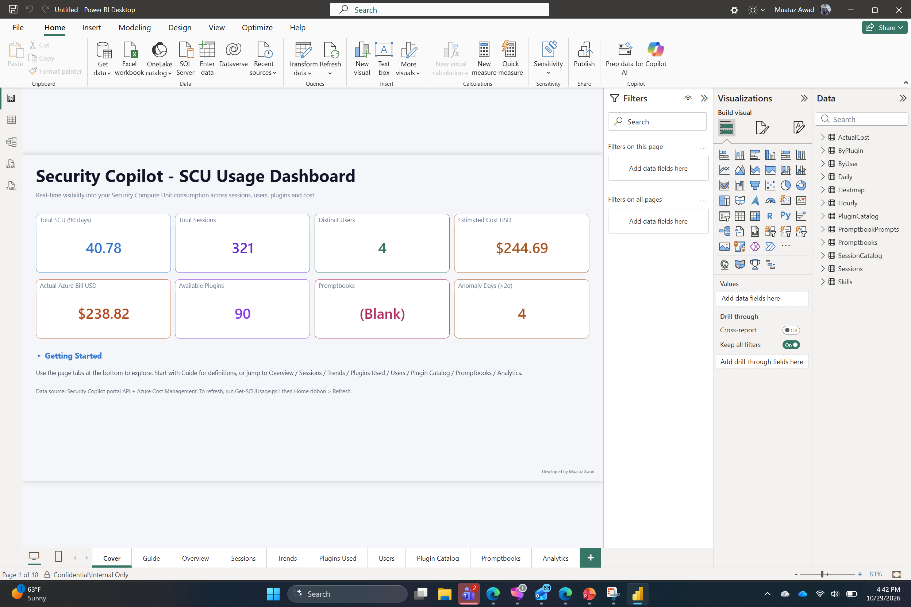
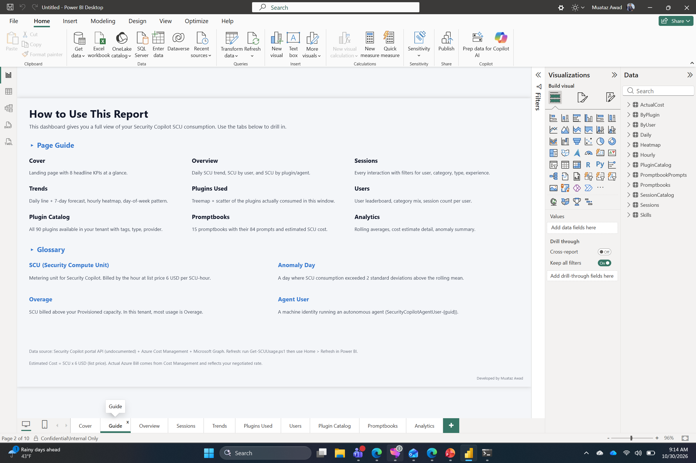
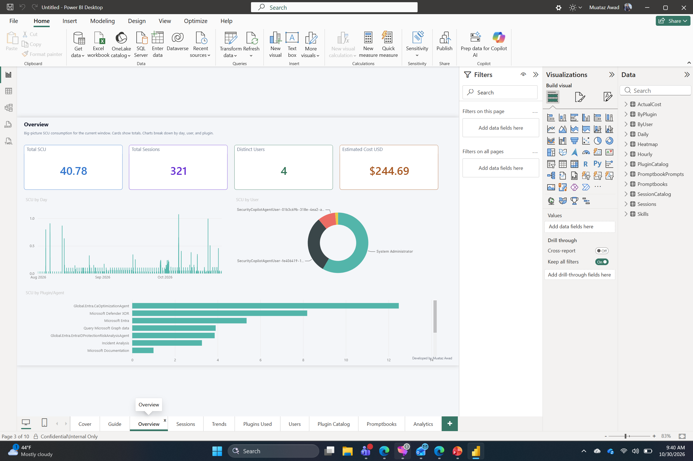
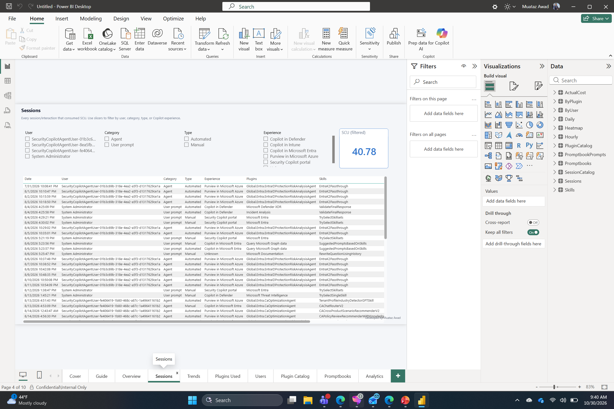
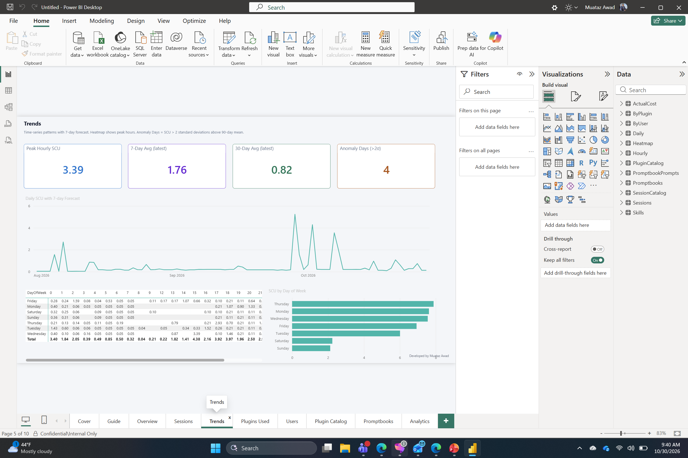
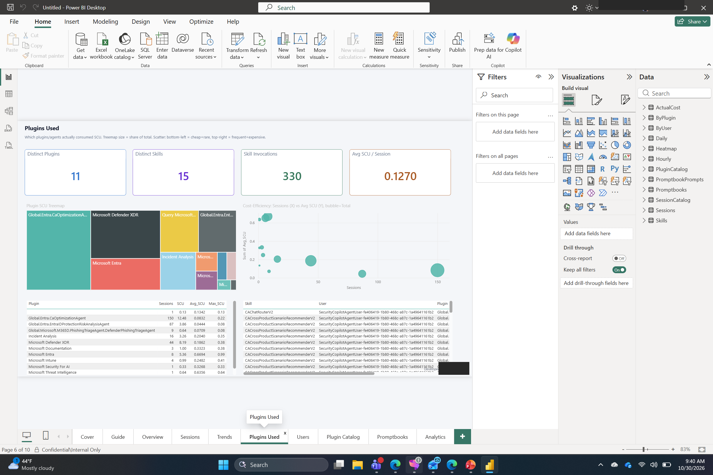
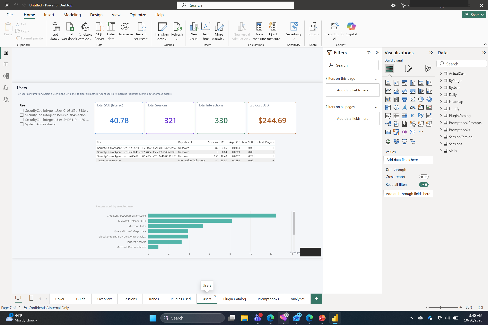
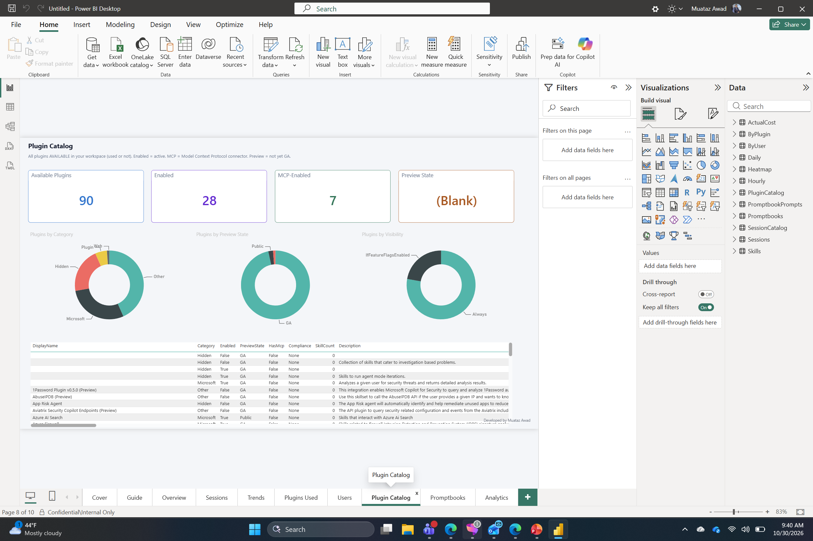
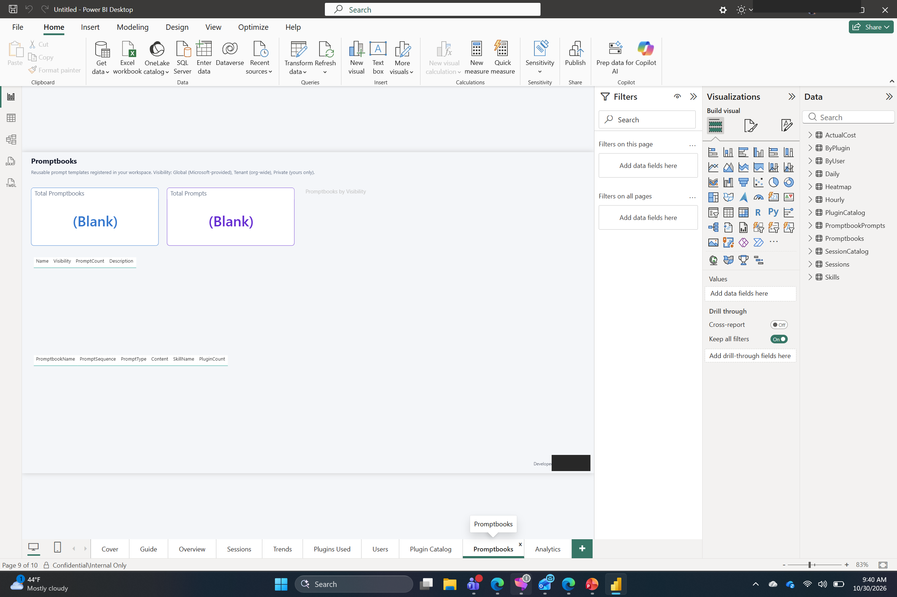
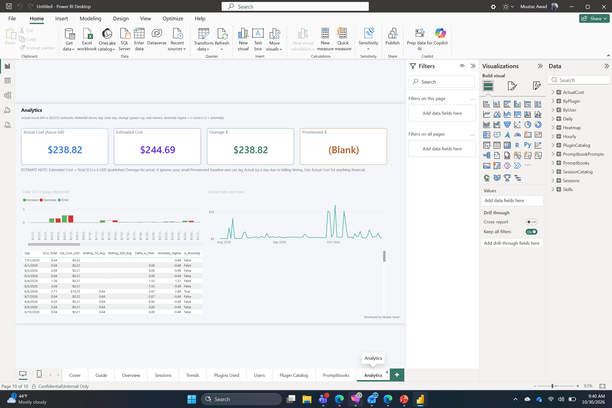

# SCU Module — Part 2: Power BI Usage Dashboard (Pull Data + Redesign)

This is Part 2 of the manual walkthrough: using the **`SCU-Usage-Puller`** app
registered in [Part 1](README.md) to pull real Security Copilot usage data
from your tenant, then loading and redesigning the dashboard template from
the public repo. (Screenshots below are from one example run in a dev tenant.)

> [!NOTE]
> **These are generic, repeatable steps — follow them in your own tenant with
> your own app registration.** The usage numbers, row counts, and screenshots
> below are from one illustrative run against a low-activity dev/sandbox
> tenant. Running this against your own tenant will pull *your* usage data
> and produce different totals — the steps and the fix in Step 2 apply
> regardless of what your numbers turn out to be.

**Repository reference:** <https://github.com/Muatazawad2/SecurityCopilot/tree/main/SCU%20Module>

## What's in this folder

```
PowerBI/
  SCU-Dashboard-Light.pbit   ← redesigned template (light theme, bug-fixed queries)
  Images/
    01-cover-page.png           ← Cover — 8 KPI cards, live data from the example tenant
    02-guide-page.png           ← Guide — definitions/glossary
    03-overview-page.png        ← Overview — daily trend, by-user, by-plugin
    04-sessions-page.png        ← Sessions — filterable interaction log
    05-trends-page.png          ← Trends — 7-day forecast, day-of-week pattern
    06-plugins-used-page.png    ← Plugins Used — treemap + cost-efficiency scatter
    07-users-page.png           ← Users — per-user leaderboard
    08-plugin-catalog-page.png  ← Plugin Catalog — all 90 tenant plugins
    09-promptbooks-page.png     ← Promptbooks (blank — API returned HTTP 500, see Step 2)
    10-analytics-page.png       ← Analytics — waterfall, anomaly detection
```

> The `.pbit` is a **template**: it ships with the Power Query/model schema
> and a `SCUReportPath` parameter, not baked-in data. No tenant usage data is
> included in this repo — only the reusable template and screenshots.

---

## Step 1 — Pull usage data with the registered app

Using the `SCU-Usage-Puller` app registered in Part 1 (substitute your own
app's Client ID) and your tenant's Security Copilot capacity name:

```powershell
.\SCU-Setup.ps1 -AppId <your-app-client-id> -Capacity "<your-capacity-name>"
```

This triggers a **device-code sign-in** (open `https://microsoft.com/devicelogin`,
enter the code, sign in as the tenant admin). On success it requests the
`Purview.DelegatedAccess` scope and saves a DPAPI-encrypted refresh token to
`%USERPROFILE%\.scu-puller\refresh_token.dat` plus a `config.json` (tenant ID,
app ID, capacity name) — so later runs don't need to sign in again.

> Device codes expire in 15 minutes. If `SCU-Setup.ps1`'s own polling loop
> times out before you can paste the code, the fix is to run the device-code
> + token exchange directly against Microsoft Graph endpoints instead of
> relying on the script's internal timer:
> `POST /oauth2/v2.0/devicecode` → `POST /oauth2/v2.0/token` (grant_type
> `device_code`), scope `73c2949e-da2d-457a-9607-fcc665198967/Purview.DelegatedAccess offline_access`.

Then pull the actual usage data (last 90 days) and build the report:

```powershell
.\SCU-Run.ps1 -NoOpen
```

This calls the Security Copilot portal API + Azure Cost Management, writes
`SCU-Report.xlsx` / `.json`, and regenerates `SCU-Dashboard.pbit` / `.html`.
In **this example run's** dev tenant, the run completed with:

| Metric | Value (this example run — yours will differ) |
| --- | --- |
| Total SCU (90 days) | 40.78 |
| Total sessions | 321 |
| Distinct users | 4 |
| Available plugins | 90 |
| Anomaly days (>2σ) | 4 |

Two sub-endpoints (session catalog, promptbooks) returned **HTTP 500** for
this tenant — expected for a low-activity dev/trial tenant. A busier,
production tenant may not hit this at all; the fix in Step 2 below is
needed only if you do. It left the `SessionCatalog`, `Promptbooks`, and
`PromptbookPrompts` tables empty/partial in the generated report, which
surfaced a real bug in the template (next step).

---

## Step 2 — Power Query fix for partial API responses

The generated `SCU-Report.xlsx` is written in a **legacy OLE2 binary format**
(not a true `.xlsx` zip) — Power Query still reads it fine via
`Excel.Workbook()`, but the three tables fed by the failed API calls had
missing columns, which made `Table.TransformColumnTypes` throw and blocked
the **entire** model refresh (one failing query fails the whole `Load`).

Fix applied to the `Promptbooks`, `PromptbookPrompts`, and `SessionCatalog`
queries in the Power Query (`DataModelSchema`) M code: insert a tolerant
column projection immediately before the type-transform step —

```m
Table.SelectColumns(PreviousStep, {"Col1", "Col2", ...}, MissingField.UseNull)
```

— so a column that's absent because the source API returned nothing just
becomes `null` instead of failing the query. The rest of the model (Daily,
Hourly, Sessions, ByUser, ByPlugin, Heatmap, Skills, ActualCost,
PluginCatalog) was unaffected since those endpoints returned data normally.

With that fix, **Transform data → Refresh** / the initial **Load** completes
cleanly even when some source endpoints are empty.

---

## Step 3 — Light-mode redesign

Starting from the regenerated template, the following design changes were
made (directly in the `.pbit`'s `Report\Layout` and theme JSON, validated
with round-trip byte-identical checks before saving):

- **Theme**: light background (`#F4F6F9`), white cards, dark slate text
  (`#1E293B`) instead of the generated dashboard's dark theme.
- **8 KPI cards on the Cover page**, each given a distinct, legible accent
  color on a white card background: Total SCU (blue `#0078D4`), Total
  Sessions (purple `#6D28D9`), Distinct Users (green `#047857`), Estimated
  Cost (amber `#B45309`), Actual Azure Bill (orange `#C2410C`), Available
  Plugins (purple `#9333EA`), Promptbooks (pink `#BE185D`), Anomaly Days
  (amber).
- **All 10 report pages** (Cover, Guide, Overview, Sessions, Trends, Plugins
  Used, Users, Plugin Catalog, Promptbooks, Analytics) given a matching light
  page background.
- **Cover/Guide copy** polished — larger title, "▸" section-header accents.
- The `SCUReportPath` Power Query parameter's default value was pre-filled to
  the report path used during this run, so opening the template and clicking
  **Load** doesn't require typing a path by hand (update it to your own
  `SCU-Report.xlsx` location via **Transform data → Edit Parameters**).

**Follow-up fix — card visuals on the other 9 pages:** the first pass only
restyled the Cover page's 8 KPI cards. A full visual audit found the
remaining 27 "card" visuals across Overview, Sessions, Trends, Plugins Used,
Users, Plugin Catalog, Promptbooks, and Analytics still had the original
template's dark-navy background (`#1E2532`), slate border (`#334155`), and
cyan value text (`#50E6FF`) — which clashed badly once the page background
became light. Every one of those cards was updated to the same white
card / colored border+value-text pattern used on Cover (colors cycled per
page: blue `#0078D4`, purple `#6D28D9`, green `#047857`, amber `#B45309`,
...). A full-text scan of the saved layout afterward confirmed zero
remaining instances of the old dark-card colors anywhere in the report.

### Result — all 10 pages, light mode, live data (this example run)

**Cover**



**Guide**



**Overview**



**Sessions**



**Trends**



**Plugins Used**



**Users**



**Plugin Catalog**



**Promptbooks** *(blank in this example — this tenant's promptbooks API
returned HTTP 500; see Step 1/2 above — the page renders cleanly instead of
crashing the report. Your tenant may return real promptbook data instead.)*



**Analytics**



---

## Using the template yourself

1. Run `SCU-Setup.ps1` / `SCU-Run.ps1` against your own tenant (Step 1) to
   produce your own `SCU-Report.xlsx`.
2. Open `PowerBI/SCU-Dashboard-Light.pbit` in Power BI Desktop.
3. When prompted, set the `SCUReportPath` parameter to your `SCU-Report.xlsx`
   path (or confirm the pre-filled default if the path matches) and click
   **Load**.
4. Explore the 10 pages via the tabs at the bottom of the report canvas.

---

*Private working notes — review before adding to the public `SecurityCopilot` repo.*
