# SCU Module — Manual Entra App Registration (Screenshot Walkthrough)

This is a screenshot-illustrated re-run of the **SCU Module**'s manual setup
(`docs/APP-REGISTRATION.md`, Method B) performed by hand in a dev/sandbox
tenant instead of running `SCU-Setup.ps1`. Every click below was done live in
the Entra admin center and verified against Microsoft Graph afterward.

**Repository reference:** <https://github.com/Muatazawad2/SecurityCopilot/tree/main/SCU%20Module>

> **Part 2 available:** [`POWERBI-DASHBOARD.md`](POWERBI-DASHBOARD.md) covers
> pulling real usage data with this app and a redesigned, bug-fixed, light-mode
> Power BI template (`PowerBI/SCU-Dashboard-Light.pbit`).
>
> **Part 3 available:** [`Automation-Alternatives/AUTOMATION-COMPARISON.md`](Automation-Alternatives/AUTOMATION-COMPARISON.md)
> replaces `SCU-Run.ps1`'s data pull with a Logic App, a Power Automate flow,
> and native Power Query — all three tried live against this tenant, proof
> screenshots below.
>
> **Part 4 available:** [`Automation-Alternatives/PowerQuery/LIVE-DASHBOARD.md`](Automation-Alternatives/PowerQuery/LIVE-DASHBOARD.md)
> scales Part 3's single-table Power Query proof of concept up to a full
> 3-table live dashboard, including a custom-connector dead end root-caused
> to a Microsoft Store/MSIX platform limitation.

## Environment used for this run

| Item | Value |
| --- | --- |
| Tenant | POA Deliverables Lab (`muatazawad.com`) |
| Tenant ID | `e6cf700c-2029-4e98-aedd-f589e62f7316` |
| Signed in as | `admin@MngEnvMCAP018908.onmicrosoft.com` |
| App name | `SCU-Usage-Puller` |
| Application (client) ID | `72bb0a2b-c028-4a0f-bb57-78a81db6fc18` |
| Object ID | `107d4a3f-d91d-43c1-b76d-2191e480d27d` |

> These IDs are specific to this dev tenant — registering in another tenant
> produces different GUIDs, but the steps are identical.

---

## Step 1 — Create the app registration

Entra admin center → **Identity → Applications → App registrations → + New registration**.

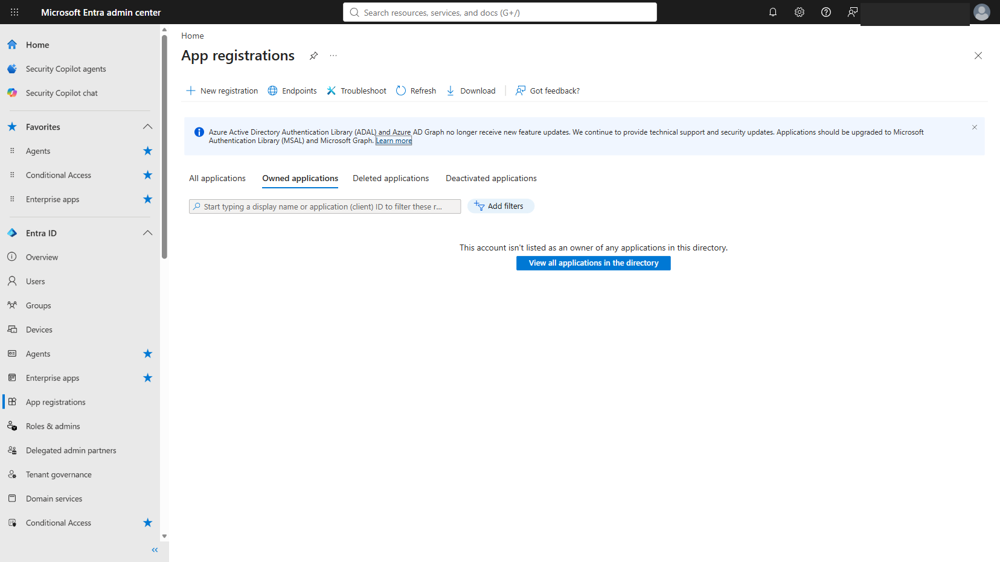

Filled in the form: Name `SCU-Usage-Puller`, **Single tenant only**, Redirect URI left blank.

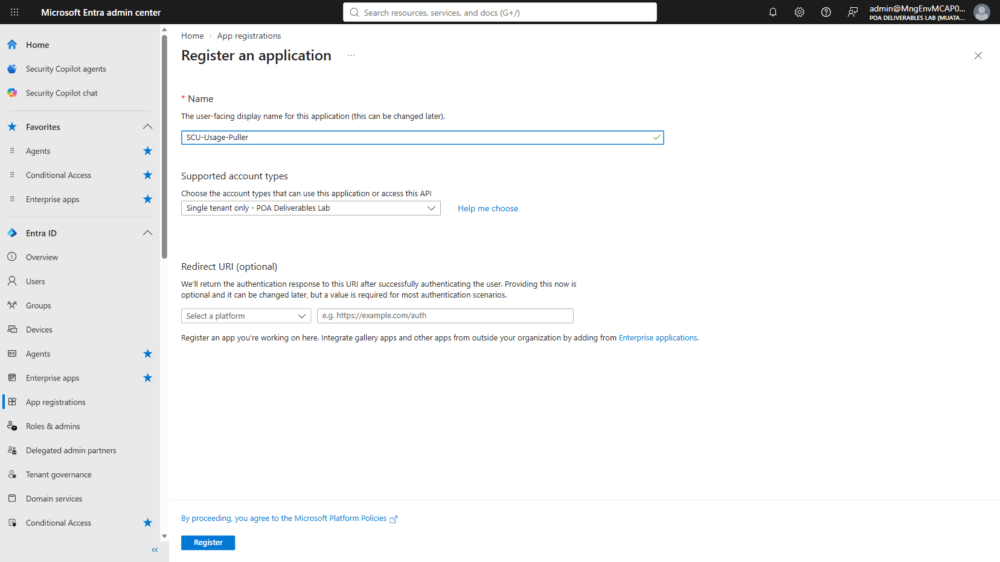

After clicking **Register**, the app's Overview page shows the generated
**Application (client) ID**, **Object ID**, and **Directory (tenant) ID**.

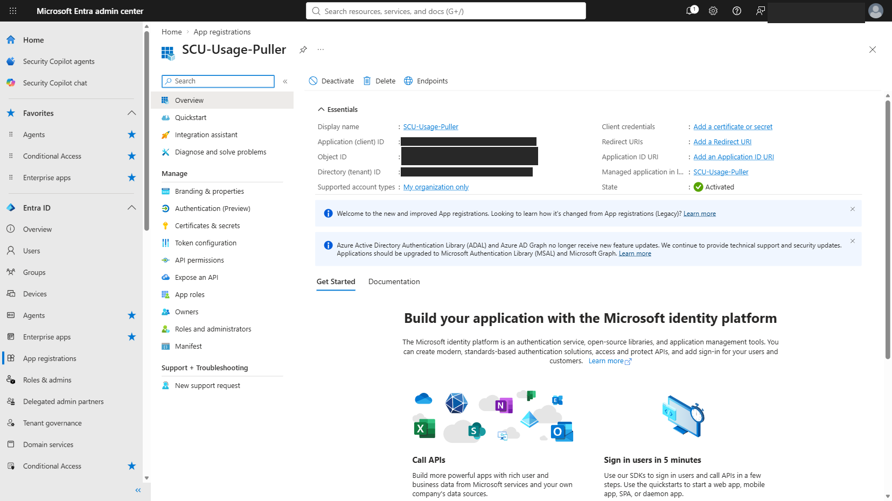

---

## Step 2 — Enable device-code sign-in (public client flow)

Left nav → **Authentication (Preview) → Settings** tab → toggle **Allow public client flows** to Enabled.

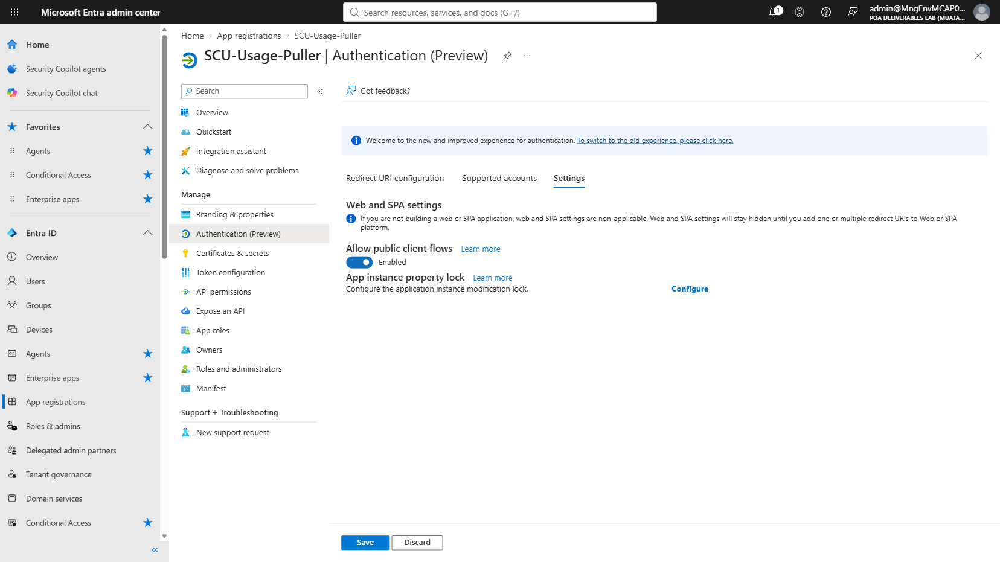

Clicked **Save** — confirmed by the "Successfully updated SCU-Usage-Puller" toast.

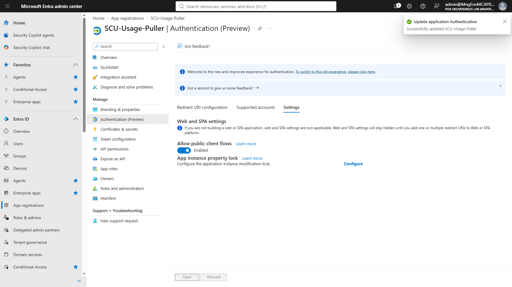

---

## Step 3 — Add the Microsoft Purview API permissions

Starting point: **API permissions** page with only the default Graph `User.Read` delegated permission.

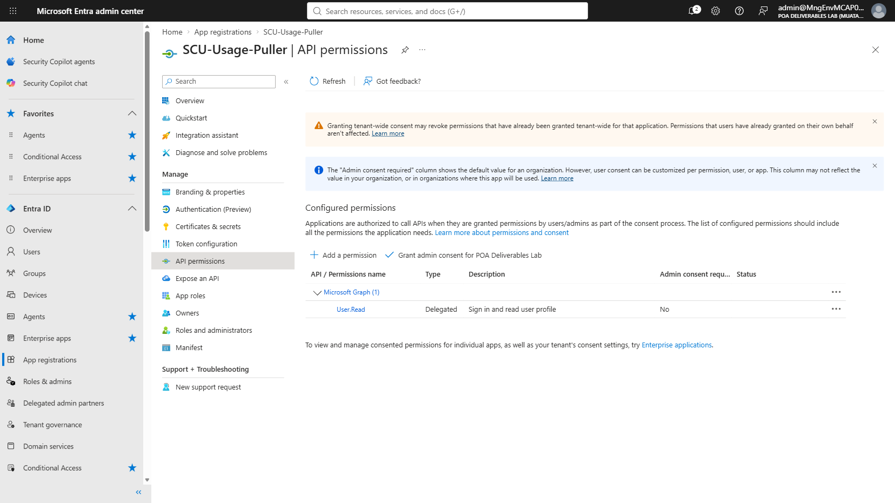

Clicked **+ Add a permission → APIs my organization uses**, then searched by the
Purview AppId (`73c2949e-da2d-457a-9607-fcc665198967`) — it shows up as
**"Azure Purview"** in this tenant (the docs refer to it as "Microsoft Purview";
same AppId, same API, tenant-local display name just differs).

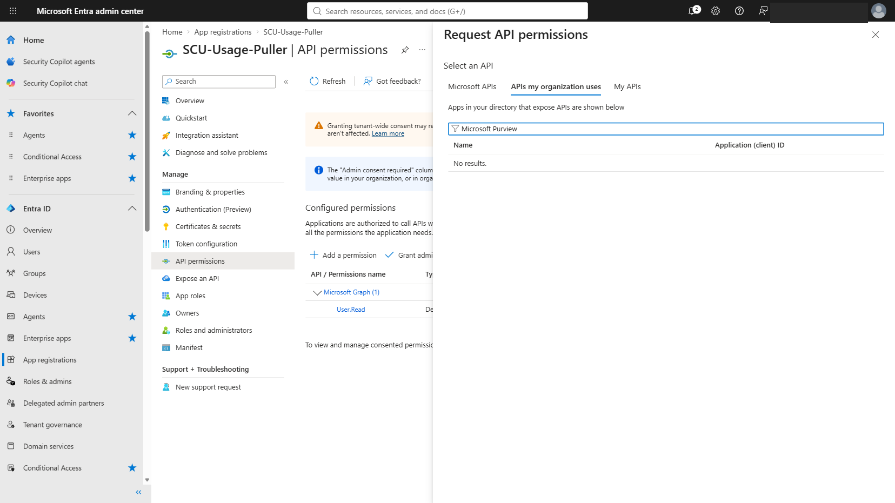

Selected it, opening the permission-type picker for **Microsoft Purview** (`https://purview.azure.net`).

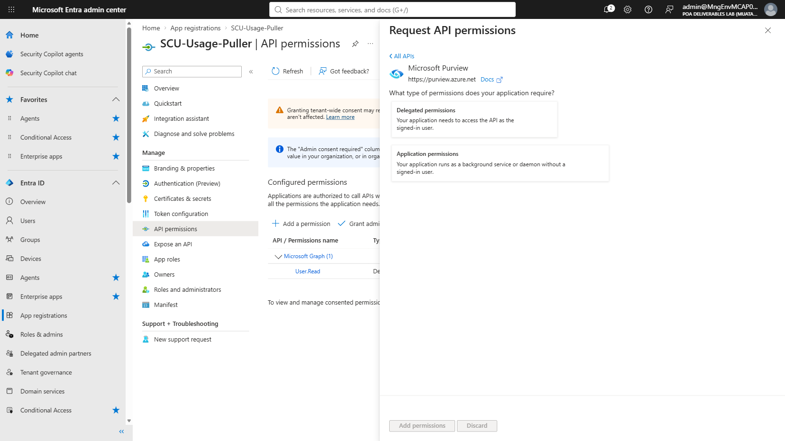

### 3a — Delegated permission

Chose **Delegated permissions** and checked `Purview.DelegatedAccess`.

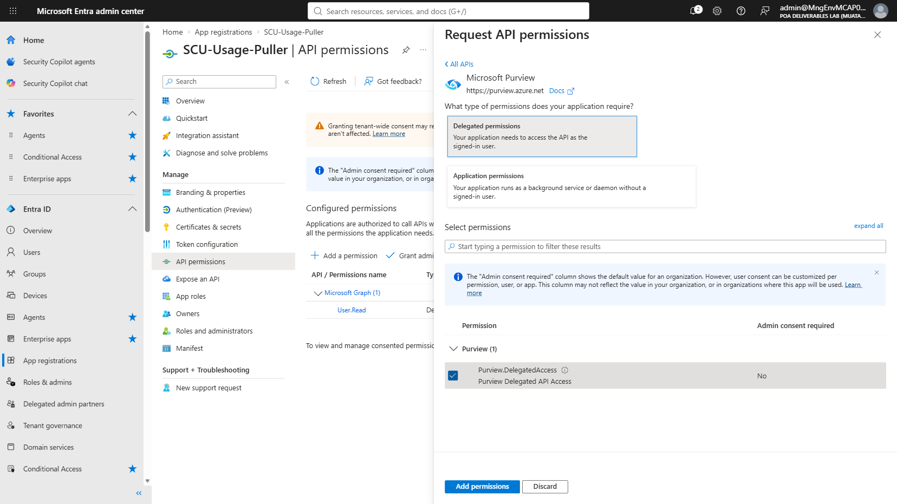

Clicked **Add permissions** — it now appears under "Microsoft Purview (1)".

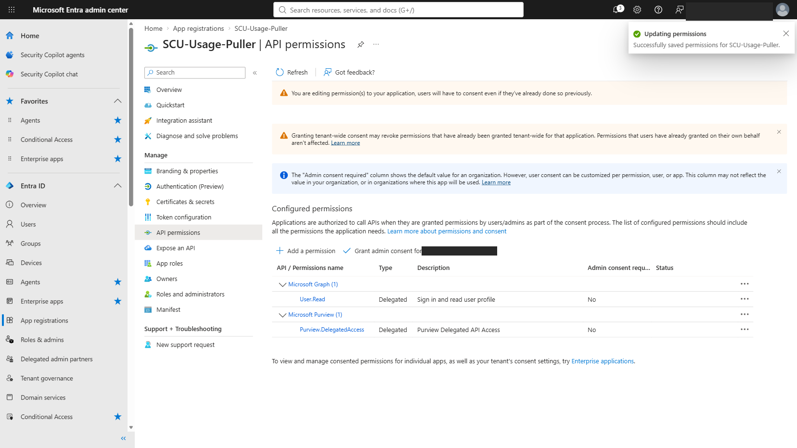

### 3b — Application permission

Repeated **+ Add a permission → APIs my organization uses → Azure Purview**,
this time choosing **Application permissions** and checking `Purview.ApplicationAccess`
(the app role the docs call out as id `8d48872e-7710-4001-bfd0-7dac15c28f69`).

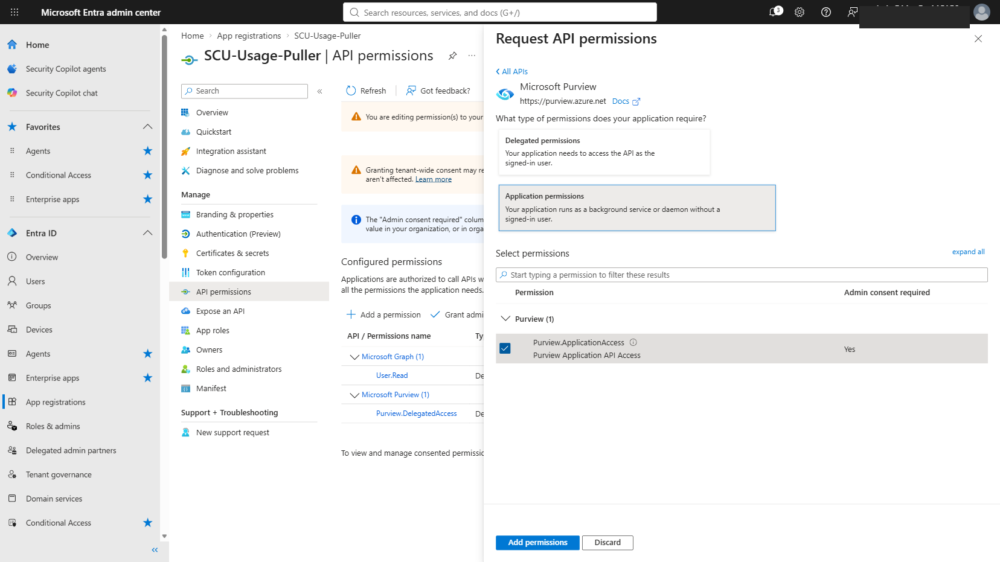

Both permissions are now listed, with **Admin consent required** shown and a
"Not granted" warning on the application permission.

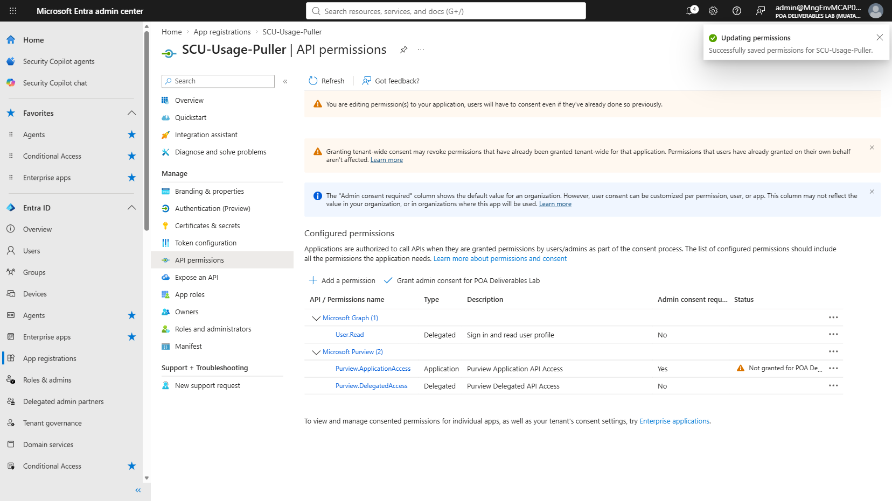

---

## Step 4 — Grant admin consent

Clicked **Grant admin consent for POA Deliverables Lab**, confirmed the dialog.

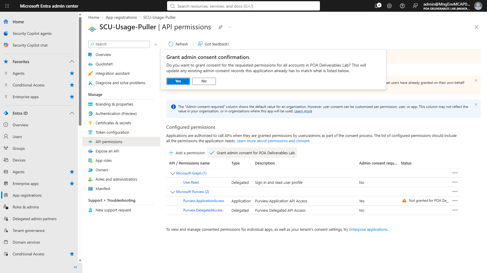

Result: both permissions show a green check and **"Granted for POA Deliverables Lab."**

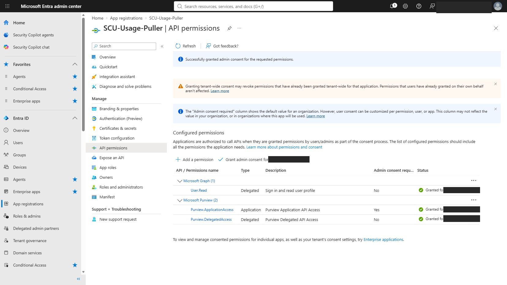

---

## Verification (Microsoft Graph, via Azure CLI)

```powershell
$appId = '72bb0a2b-c028-4a0f-bb57-78a81db6fc18'
$sp = az ad sp show --id $appId --only-show-errors | ConvertFrom-Json
az rest --method get --uri "https://graph.microsoft.com/v1.0/oauth2PermissionGrants?`$filter=clientId eq '$($sp.id)'" |
    ConvertFrom-Json | Select-Object -ExpandProperty value | Format-Table clientId, consentType, scope
az rest --method get --uri "https://graph.microsoft.com/v1.0/servicePrincipals/$($sp.id)/appRoleAssignments" |
    ConvertFrom-Json | Select-Object -ExpandProperty value | Format-Table principalDisplayName, resourceDisplayName, appRoleId
```

Confirmed output:

- `oauth2PermissionGrants`: `consentType = AllPrincipals`, `scope = User.Read Purview.DelegatedAccess`
- `appRoleAssignments`: `SCU-Usage-Puller` → `Azure Purview`, `appRoleId = 8d48872e-7710-4001-bfd0-7dac15c28f69`

Both match the expected values in `docs/APP-REGISTRATION.md` exactly.

---

## Next step — pulling data and the Power BI dashboard

This walkthrough focused on the manual/portal configuration path only. The
app is ready to use with:

```powershell
.\SCU-Setup.ps1 -AppId 72bb0a2b-c028-4a0f-bb57-78a81db6fc18 -Capacity "SecCo"
```

to pull real SCU usage data and build the Power BI dashboard — see
[`POWERBI-DASHBOARD.md`](POWERBI-DASHBOARD.md) for the full run (actual
numbers from this dev tenant) plus a redesigned, bug-fixed, light-mode
dashboard template.

---

## Part 3 — Automating the data pull without PowerShell

Full write-up: [`Automation-Alternatives/AUTOMATION-COMPARISON.md`](Automation-Alternatives/AUTOMATION-COMPARISON.md)

Three substitutes for `SCU-Run.ps1`'s data-pull stage, each built and
verified with **live tenant data** (same dev tenant, same undocumented
Security Copilot usage API). Key finding up front: the API rejects app-only
(client-credentials) tokens outright — delegated, signed-in-user tokens only,
same constraint the original PowerShell already assumes.

> **Note on these screenshots:** interactive sign-in to the Azure Portal and
> the Power Automate Maker portal both hit a one-time, device-bound MFA
> registration wall that needed the account owner physically present — not
> something to push through unattended. So for **Approaches 1 and 2** these
> aren't portal-click screenshots; they're rendered proof-of-work pages
> (architecture + live API output) built because the resources themselves
> were created and verified entirely via CLI/REST instead of the Portal UI.
> **Approach 3 (Power Query) hit no such wall** — it runs entirely inside
> Power BI Desktop, so it has a full, genuine click-by-click screenshot
> walkthrough instead; see its section below. Each links to the underlying
> ARM template / flow definition / M code.

### Approach 1 — Azure Logic App ([ARM template](Automation-Alternatives/LogicApp/azuredeploy.json))

Deployed via `az deployment group create`, triggered manually, confirmed
`Succeeded` — 21 real hourly rows + 90 skillsets pulled.

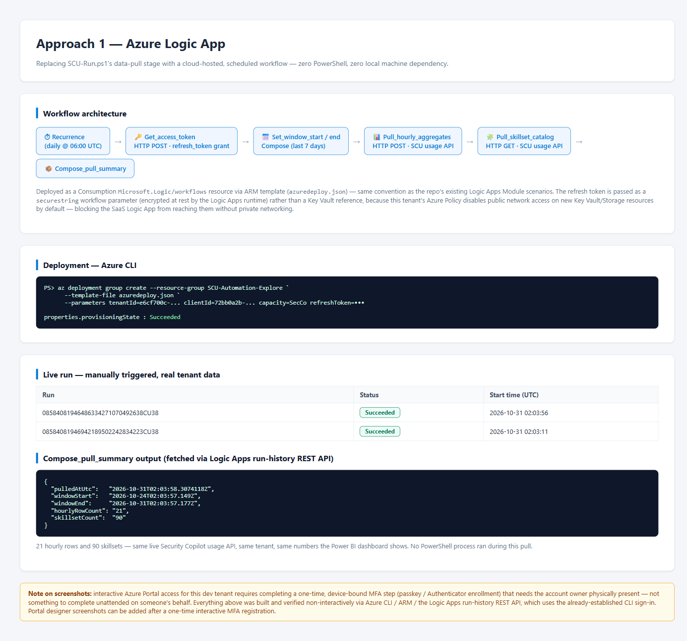

### Approach 2 — Power Automate Cloud Flow ([flow definition](Automation-Alternatives/PowerAutomate/flow-definition.json))

Maker portal was unreachable (same MFA wall), so the flow was created
directly via the Dataverse Web API, activated, and confirmed genuinely
"Started" — triggered manually, 21 rows pulled.

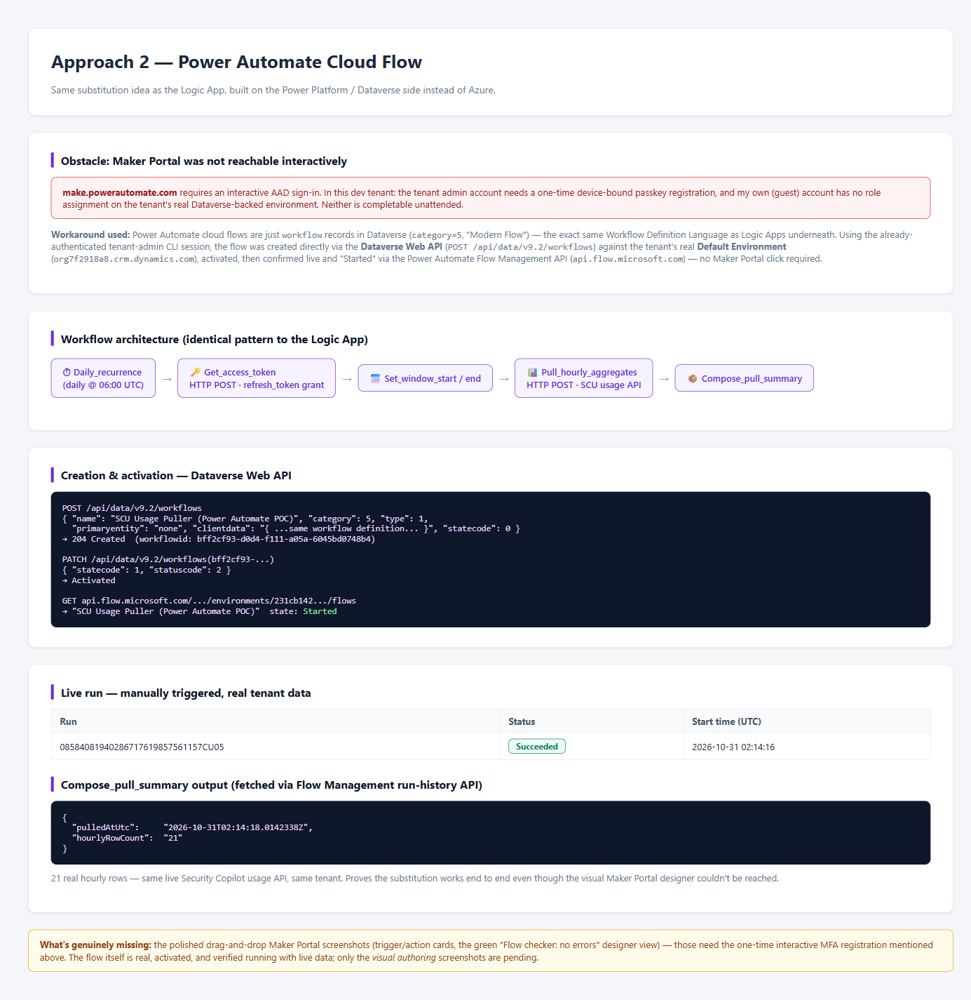

### Approach 3 — Native Power Query (M)

No blockers here — runs entirely inside Power BI Desktop. A Blank Query's M
code calls the SCU API directly via `Web.Contents()`, so Power BI's own
**Refresh** button is the whole automation.


This one also has a full **20-step click-by-click screenshot walkthrough**:
[`Automation-Alternatives/PowerQuery/STEP-BY-STEP.md`](Automation-Alternatives/PowerQuery/STEP-BY-STEP.md) —
Blank Query → Advanced Editor → Manage Parameters (moving the refresh token
out of the M code into a Parameter) → a live Refresh Preview → **Close &
Apply** → a real table visual built from that live data → clicking
**Refresh** on the report canvas itself → **Save**, producing a real
`.pbix` file.

See [`AUTOMATION-COMPARISON.md`](Automation-Alternatives/AUTOMATION-COMPARISON.md)
for the full comparison table and tradeoffs. Each approach's `summary.html`
is a styled version of the same content — GitHub shows it as raw source in
the browser, so download and open it locally (or view the `.md`/images above)
to see it rendered.

---

*Private working notes — review before adding to the public `SecurityCopilot` repo.*
