# SCU Module — Part 1: Entra App Registration (Authentication Foundation)

## The goal, and how this repo gets there

**Goal: get more detailed Security Copilot usage (SCU) insight by
integrating Power BI directly with Security Copilot's usage/cost data.**
That data has no native Power BI connector, though — it only exists behind
an undocumented, delegated-auth-only REST API. Getting it into a dashboard
means building the whole pipeline by hand: register an app that's allowed
to ask for the data, trade a saved sign-in for a short-lived access token
every time you want fresh numbers, call the API with that token, and land
the result somewhere Power BI can read — then, ideally, skip the landing
step entirely and let Power BI call the API directly.

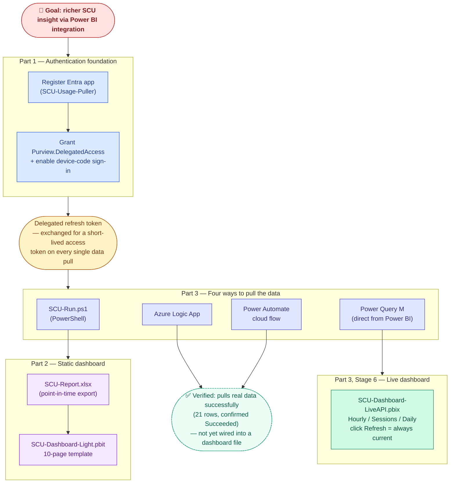

Every part in this repo is one piece of that pipeline — click any row to
jump straight there:

| Stage in the diagram | Where it's covered |
| --- | --- |
| Authentication foundation | [**Part 1**](#scu-module--part-1-entra-app-registration-authentication-foundation) (below) |
| Pulling the data (4 interchangeable ways — all 4 verified with real API calls; only 2 feed an actual dashboard file today) | [**Part 3**](#part-3--automating-the-data-pull-without-powershell) |
| Static dashboard (Excel export → template) | [**Part 2**](#part-2--power-bi-usage-dashboard-pull-data--redesign) |
| Live dashboard (Power BI queries the API directly, no export step) | [**Part 3, Stage 6**](#stage-6-scaling-to-a-full-3-table-live-dashboard) |

---

This is a screenshot-illustrated re-run of the **SCU Module**'s manual setup
(`docs/APP-REGISTRATION.md`, Method B) performed by hand in a dev/sandbox
tenant instead of running `SCU-Setup.ps1`. Every click below was done live in
the Entra admin center and verified against Microsoft Graph afterward.

## All parts in this repo

| Part | Document | What it covers |
| --- | --- | --- |
| **Part 1** *(this doc)* | `README.md` | Register the Entra app by hand — the authentication foundation every other part depends on. Steps 1–4 + Graph verification. |
| **Part 2** | [`POWERBI-DASHBOARD.md`](POWERBI-DASHBOARD.md) | Pull usage data with the Part 1 app, fix a Power Query bug caused by partial API responses, redesign the dashboard template into a 10-page, light-mode report. |
| **Part 3** | [`Automation-Alternatives/AUTOMATION-COMPARISON.md`](Automation-Alternatives/AUTOMATION-COMPARISON.md) | Compare three ways to automate the data pull without PowerShell: Azure Logic App, Power Automate cloud flow, and native Power Query. |
| ↳ Power Query walkthrough | [`Automation-Alternatives/PowerQuery/STEP-BY-STEP.md`](Automation-Alternatives/PowerQuery/STEP-BY-STEP.md) | 26-step click-by-click guide. **Parts 1–5** (Steps 1–14): single-table proof of concept, Blank Query → Parameter → Close & Apply → visual → Refresh → Save. **Part 6** (Steps 15–22): scales that pattern to a full 3-table live dashboard, works through three real Power BI credential-type failures one at a time, and documents a custom-connector dead end root-caused to a Microsoft Store/MSIX platform limitation. |

> [!NOTE]
> **These are generic, repeatable steps — follow them in your own tenant.**
> The tenant ID, app name, Client ID, Object ID, and every number or
> screenshot below came from one illustrative run in a dev/sandbox tenant.
> Registering this same app in *your* tenant produces different GUIDs and
> a different sign-in account — only the sequence of steps is what you
> should expect to match.

## Why this part comes first

Every later part — Part 2's dashboard, Part 3's three automation approaches,
and Part 6's live 3-table pull — authenticates the exact same way: exchange a
delegated refresh token for an access token, using **this app's Client ID**
and **this app's granted `Purview.DelegatedAccess` scope**. If the app
doesn't exist yet, or exists but isn't consented, every `Web.Contents`
call in every later part fails at the token-endpoint step before it ever
reaches the usage API. This part isn't optional setup — it's the identity
the rest of the repo authenticates as.

## Why each step is needed

| Step | Why it's required |
| --- | --- |
| **1 — Create the app registration** | Produces the **Application (client) ID** — the one value every later `ClientId =` in every M/PowerShell query hardcodes. No app, no ID, nothing else can run. |
| **2 — Enable public client flow (device code)** | This is a script/Power Query scenario, not a web app — there's no client secret and no redirect URI to catch a browser callback. Public client flow is the only way to sign in interactively without embedding a secret. |
| **3 — Add Purview API permissions (delegated + application)** | `Purview.DelegatedAccess` is the literal scope requested in every token request from here through Part 6. Without it configured on the app, Entra rejects the scope outright — not a usage-API problem, an app-registration problem. |
| **4 — Grant admin consent** | Delegated org-data scopes don't activate just by being added — a tenant admin must explicitly approve them. Skip this and Step 3's permissions sit there "Not granted" forever; no token is ever issued. |
| **Verification (Graph via CLI)** | Confirms the consent actually took effect at the directory level, so if Part 2/3/6 later hit an auth error, you know it's *not* a stale/missing registration — that's already been ruled out here. |

**Repository reference:** <https://github.com/Muatazawad2/SecurityCopilot/tree/main/SCU%20Module>

## Example environment from this walkthrough (yours will differ)

| Item | Value |
| --- | --- |
| Tenant | POA Deliverables Lab (`muatazawad.com`) |
| Tenant ID | `e6cf700c-2029-4e98-aedd-f589e62f7316` |
| Signed in as | `admin@MngEnvMCAP018908.onmicrosoft.com` |
| App name | `SCU-Usage-Puller` |
| Application (client) ID | `72bb0a2b-c028-4a0f-bb57-78a81db6fc18` |
| Object ID | `107d4a3f-d91d-43c1-b76d-2191e480d27d` |

> These IDs are specific to this dev tenant — registering in another tenant
> produces different GUIDs, but the steps are identical.

---

## Step 1 — Create the app registration

Entra admin center → **Identity → Applications → App registrations → + New registration**.


Filled in the form: Name `SCU-Usage-Puller`, **Single tenant only**, Redirect URI left blank.


After clicking **Register**, the app's Overview page shows the generated
**Application (client) ID**, **Object ID**, and **Directory (tenant) ID**.


---

## Step 2 — Enable device-code sign-in (public client flow)

Left nav → **Authentication (Preview) → Settings** tab → toggle **Allow public client flows** to Enabled.


Clicked **Save** — confirmed by the "Successfully updated SCU-Usage-Puller" toast.


---

## Step 3 — Add the Microsoft Purview API permissions

Starting point: **API permissions** page with only the default Graph `User.Read` delegated permission.


Clicked **+ Add a permission → APIs my organization uses**, then searched by the
Purview AppId (`73c2949e-da2d-457a-9607-fcc665198967`) — it shows up as
**"Azure Purview"** in this tenant (the docs refer to it as "Microsoft Purview";
same AppId, same API, tenant-local display name just differs).


Selected it, opening the permission-type picker for **Microsoft Purview** (`https://purview.azure.net`).


### 3a — Delegated permission

Chose **Delegated permissions** and checked `Purview.DelegatedAccess`.


Clicked **Add permissions** — it now appears under "Microsoft Purview (1)".


### 3b — Application permission

Repeated **+ Add a permission → APIs my organization uses → Azure Purview**,
this time choosing **Application permissions** and checking `Purview.ApplicationAccess`
(the app role the docs call out as id `8d48872e-7710-4001-bfd0-7dac15c28f69`).


Both permissions are now listed, with **Admin consent required** shown and a
"Not granted" warning on the application permission.


---

## Step 4 — Grant admin consent

Clicked **Grant admin consent for POA Deliverables Lab**, confirmed the dialog.


Result: both permissions show a green check and **"Granted for POA Deliverables Lab."**


---

## Verification (Microsoft Graph, via Azure CLI)

```powershell
$appId = '72bb0a2b-c028-4a0f-bb57-78a81db6fc18'
$sp = az ad sp show --id $appId --only-show-errors | ConvertFrom-Json
az rest --method get --uri "https://graph.microsoft.com/v1.0/oauth2PermissionGrants?`$filter=clientId eq '$($sp.id)'" |
    ConvertFrom-Json | Select-Object -ExpandProperty value | Format-Table clientId, consentType, scope
az rest --method get --uri "https://graph.microsoft.com/v1.0/servicePrincipals/$($sp.id)/appRoleAssignments" |
    ConvertFrom-Json | Select-Object -ExpandProperty value | Format-Table principalDisplayName, resourceDisplayName, appRoleId
```

Confirmed output:

- `oauth2PermissionGrants`: `consentType = AllPrincipals`, `scope = User.Read Purview.DelegatedAccess`
- `appRoleAssignments`: `SCU-Usage-Puller` → `Azure Purview`, `appRoleId = 8d48872e-7710-4001-bfd0-7dac15c28f69`

Both match the expected values in `docs/APP-REGISTRATION.md` exactly.

---

## Part 2 — Power BI Usage Dashboard (Pull Data + Redesign)

This is Part 2 of the manual walkthrough: using the **`SCU-Usage-Puller`** app
registered in [Part 1 above](#all-parts-in-this-repo) to pull real Security
Copilot usage data from your tenant, then loading and redesigning the
dashboard template from the public repo. (Screenshots below are from one
example run in a dev tenant.)

> [!NOTE]
> **These are generic, repeatable steps — follow them in your own tenant with
> your own app registration.** The usage numbers, row counts, and screenshots
> below are from one illustrative run against a low-activity dev/sandbox
> tenant. Running this against your own tenant will pull *your* usage data
> and produce different totals — the steps and the fix in Step 2 apply
> regardless of what your numbers turn out to be.


### What's in this folder

```
PowerBI/
  SCU-Dashboard-Light.pbit   ← redesigned template (light theme, bug-fixed queries)
  Images/
    01-cover-page.png           ← Cover — 8 KPI cards, live data from the example tenant
    02-guide-page.png           ← Guide — definitions/glossary
    03-overview-page.png        ← Overview — daily trend, by-user, by-plugin
    04-sessions-page.png        ← Sessions — filterable interaction log
    05-trends-page.png          ← Trends — 7-day forecast, day-of-week pattern
    06-plugins-used-page.png    ← Plugins Used — treemap + cost-efficiency scatter
    07-users-page.png           ← Users — per-user leaderboard
    08-plugin-catalog-page.png  ← Plugin Catalog — all 90 tenant plugins
    09-promptbooks-page.png     ← Promptbooks (blank — API returned HTTP 500, see Step 2)
    10-analytics-page.png       ← Analytics — waterfall, anomaly detection
```

> The `.pbit` is a **template**: it ships with the Power Query/model schema
> and a `SCUReportPath` parameter, not baked-in data. No tenant usage data is
> included in this repo — only the reusable template and screenshots.

---

### Step 1 — Pull usage data with the registered app

Using the `SCU-Usage-Puller` app registered in Part 1 (Client ID shown there
is this walkthrough's example — substitute your own app's Client ID), and
your tenant's Security Copilot capacity name (`"SecCo"` in this example):

```powershell
.\SCU-Setup.ps1 -AppId <your-app-client-id> -Capacity "<your-capacity-name>"
```

This triggers a **device-code sign-in** (open `https://microsoft.com/devicelogin`,
enter the code, sign in as the tenant admin). On success it requests the
`Purview.DelegatedAccess` scope and saves a DPAPI-encrypted refresh token to
`%USERPROFILE%\.scu-puller\refresh_token.dat` plus a `config.json` (tenant ID,
app ID, capacity name) — so later runs don't need to sign in again.

> Device codes expire in 15 minutes. If `SCU-Setup.ps1`'s own polling loop
> times out before you can paste the code, the fix is to run the device-code
> + token exchange directly against Microsoft Graph endpoints instead of
> relying on the script's internal timer:
> `POST /oauth2/v2.0/devicecode` → `POST /oauth2/v2.0/token` (grant_type
> `device_code`), scope `73c2949e-da2d-457a-9607-fcc665198967/Purview.DelegatedAccess offline_access`.

Then pull the actual usage data (last 90 days) and build the report:

```powershell
.\SCU-Run.ps1 -NoOpen
```

This calls the Security Copilot portal API + Azure Cost Management, writes
`SCU-Report.xlsx` / `.json`, and regenerates `SCU-Dashboard.pbit` / `.html`.
In **this example run's** dev tenant, the run completed with:

| Metric | Value (this example run — yours will differ) |
| --- | --- |
| Total SCU (90 days) | 40.78 |
| Total sessions | 321 |
| Distinct users | 4 |
| Available plugins | 90 |
| Anomaly days (>2σ) | 4 |

Two sub-endpoints (session catalog, promptbooks) returned **HTTP 500** for
this tenant — expected for a low-activity dev/trial tenant. A busier,
production tenant may not hit this at all; the fix in Step 2 below is
needed only if you do. It left the `SessionCatalog`, `Promptbooks`, and
`PromptbookPrompts` tables empty/partial in the generated report, which
surfaced a real bug in the template (next step).

---

### Step 2 — Power Query fix for partial API responses

The generated `SCU-Report.xlsx` is written in a **legacy OLE2 binary format**
(not a true `.xlsx` zip) — Power Query still reads it fine via
`Excel.Workbook()`, but the three tables fed by the failed API calls had
missing columns, which made `Table.TransformColumnTypes` throw and blocked
the **entire** model refresh (one failing query fails the whole `Load`).

Fix applied to the `Promptbooks`, `PromptbookPrompts`, and `SessionCatalog`
queries in the Power Query (`DataModelSchema`) M code: insert a tolerant
column projection immediately before the type-transform step —

```m
Table.SelectColumns(PreviousStep, {"Col1", "Col2", ...}, MissingField.UseNull)
```

— so a column that's absent because the source API returned nothing just
becomes `null` instead of failing the query. The rest of the model (Daily,
Hourly, Sessions, ByUser, ByPlugin, Heatmap, Skills, ActualCost,
PluginCatalog) was unaffected since those endpoints returned data normally.

With that fix, **Transform data → Refresh** / the initial **Load** completes
cleanly even when some source endpoints are empty.

---

### Step 3 — Light-mode redesign

Starting from the regenerated template, the following design changes were
made (directly in the `.pbit`'s `Report\Layout` and theme JSON, validated
with round-trip byte-identical checks before saving):

- **Theme**: light background (`#F4F6F9`), white cards, dark slate text
  (`#1E293B`) instead of the generated dashboard's dark theme.
- **8 KPI cards on the Cover page**, each given a distinct, legible accent
  color on a white card background: Total SCU (blue `#0078D4`), Total
  Sessions (purple `#6D28D9`), Distinct Users (green `#047857`), Estimated
  Cost (amber `#B45309`), Actual Azure Bill (orange `#C2410C`), Available
  Plugins (purple `#9333EA`), Promptbooks (pink `#BE185D`), Anomaly Days
  (amber).
- **All 10 report pages** (Cover, Guide, Overview, Sessions, Trends, Plugins
  Used, Users, Plugin Catalog, Promptbooks, Analytics) given a matching light
  page background.
- **Cover/Guide copy** polished — larger title, "▸" section-header accents.
- The `SCUReportPath` Power Query parameter's default value was pre-filled to
  the report path used during this run, so opening the template and clicking
  **Load** doesn't require typing a path by hand (update it to your own
  `SCU-Report.xlsx` location via **Transform data → Edit Parameters**).

**Follow-up fix — card visuals on the other 9 pages:** the first pass only
restyled the Cover page's 8 KPI cards. A full visual audit found the
remaining 27 "card" visuals across Overview, Sessions, Trends, Plugins Used,
Users, Plugin Catalog, Promptbooks, and Analytics still had the original
template's dark-navy background (`#1E2532`), slate border (`#334155`), and
cyan value text (`#50E6FF`) — which clashed badly once the page background
became light. Every one of those cards was updated to the same white
card / colored border+value-text pattern used on Cover (colors cycled per
page: blue `#0078D4`, purple `#6D28D9`, green `#047857`, amber `#B45309`,
...). A full-text scan of the saved layout afterward confirmed zero
remaining instances of the old dark-card colors anywhere in the report.

#### Result — all 10 pages, light mode, live data (this example run)

**Cover**

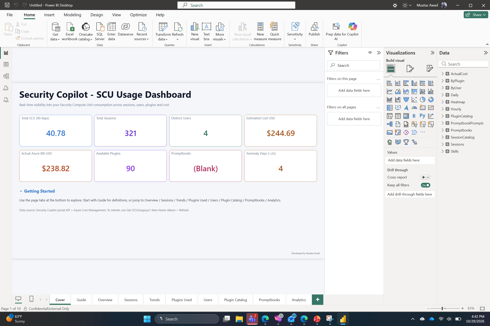

**Guide**

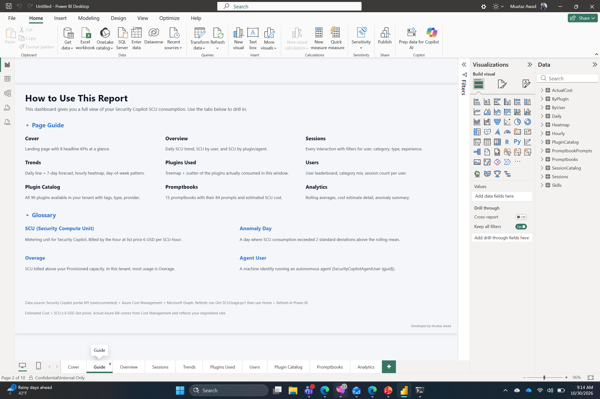

**Overview**

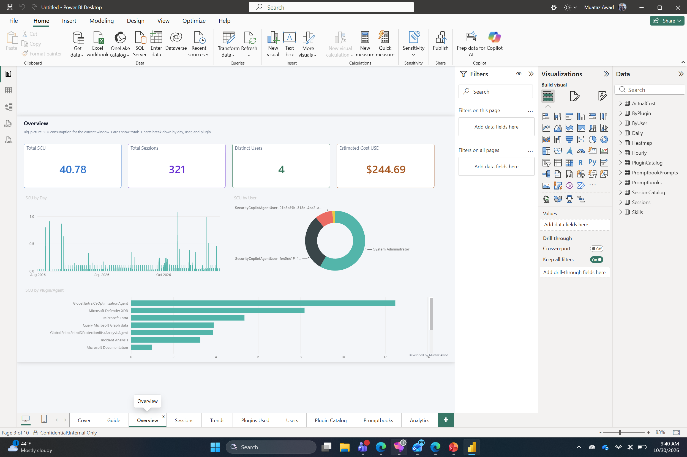

**Sessions**

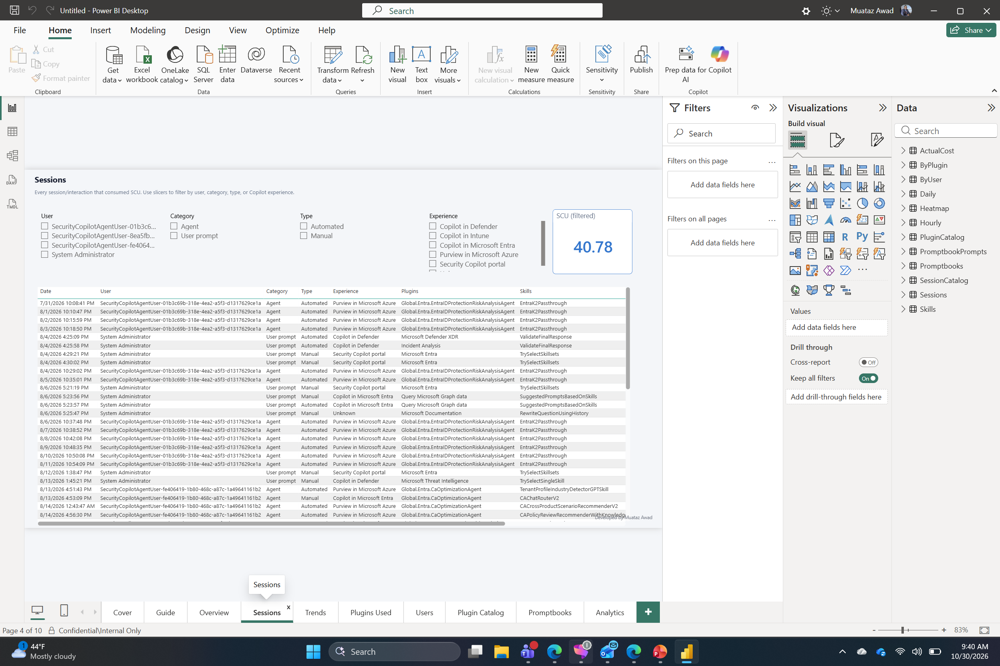

**Trends**

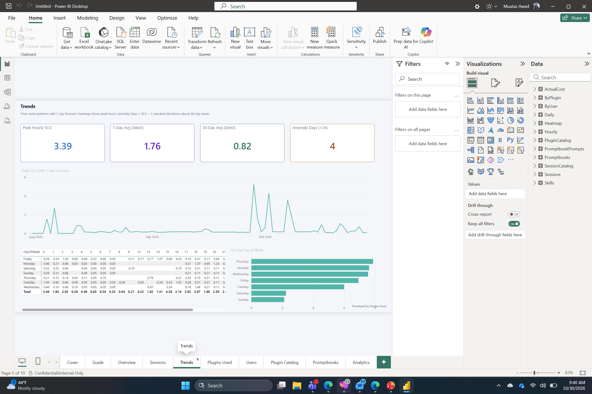

**Plugins Used**

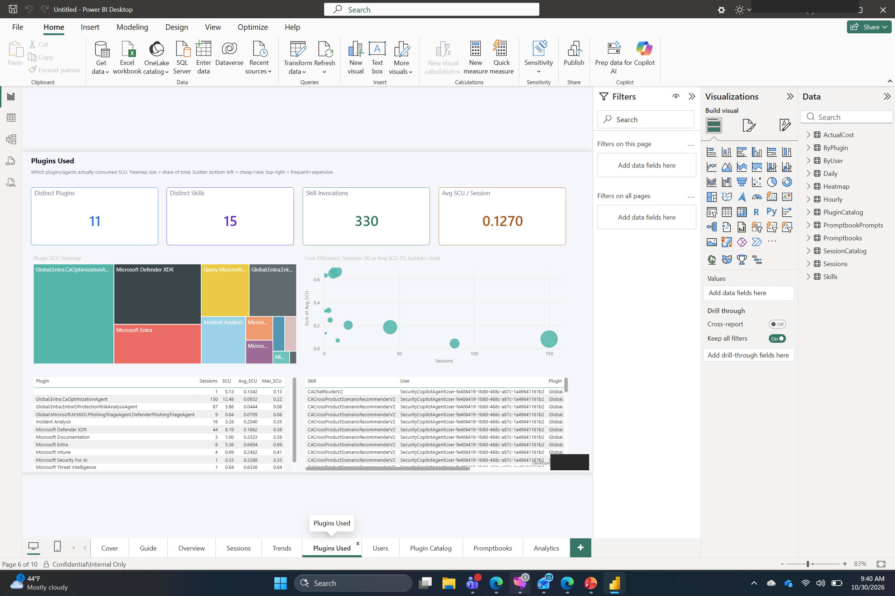

**Users**

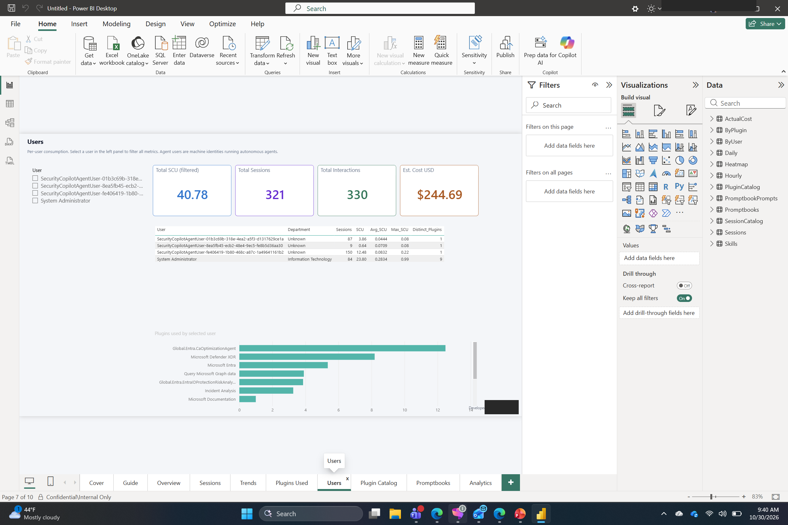

**Plugin Catalog**

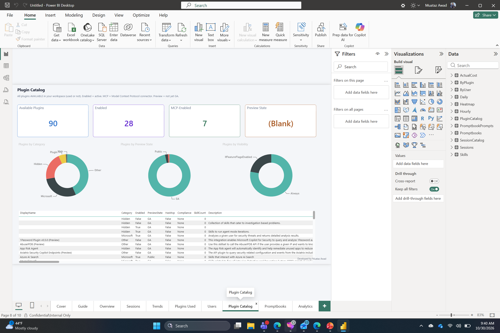

**Promptbooks** *(blank in this example — this tenant's promptbooks API
returned HTTP 500; see Step 1/2 above — the page renders cleanly instead of
crashing the report. Your tenant may return real promptbook data instead.)*

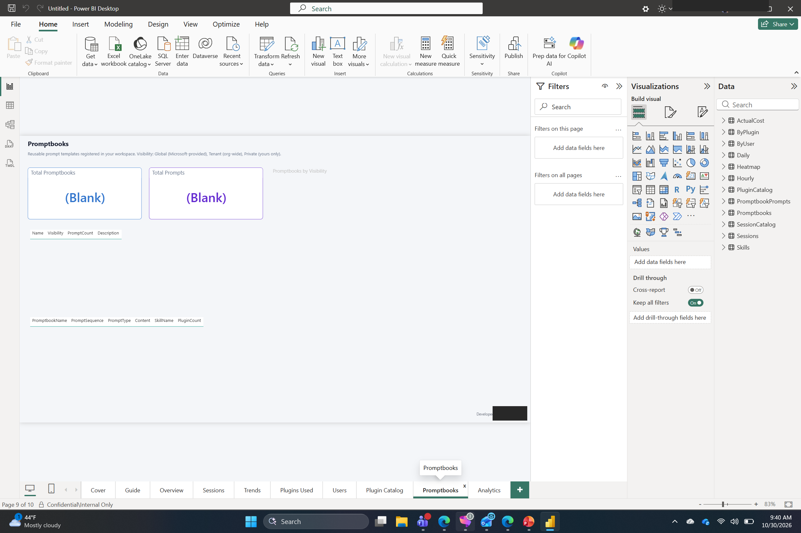

**Analytics**

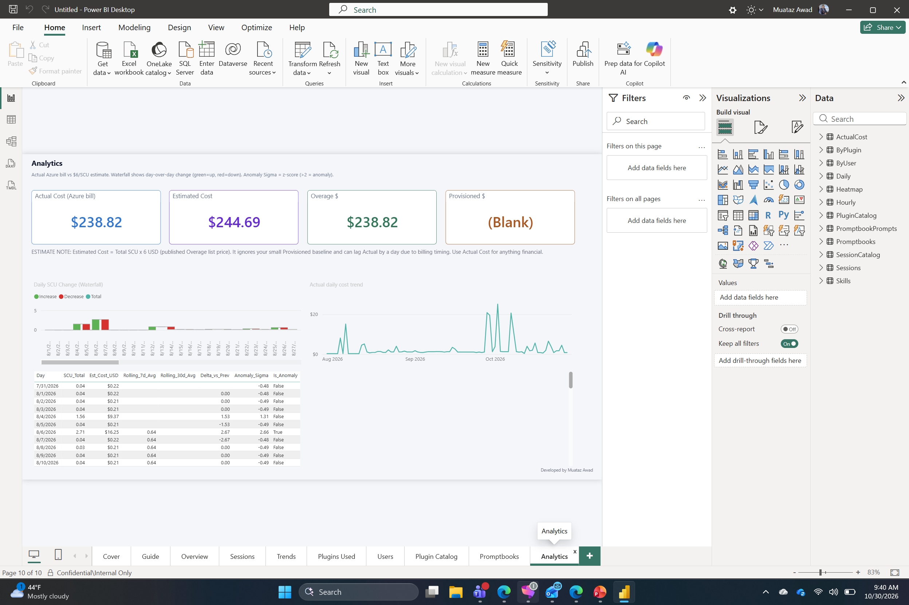

---

### Using the template yourself

1. Run `SCU-Setup.ps1` / `SCU-Run.ps1` against your own tenant (Step 1) to
   produce your own `SCU-Report.xlsx`.
2. Open `PowerBI/SCU-Dashboard-Light.pbit` in Power BI Desktop.
3. When prompted, set the `SCUReportPath` parameter to your `SCU-Report.xlsx`
   path (or confirm the pre-filled default if the path matches) and click
   **Load**.
4. Explore the 10 pages via the tabs at the bottom of the report canvas.

---

## Part 3 — Automating the data pull without PowerShell

Full write-up: [`Automation-Alternatives/AUTOMATION-COMPARISON.md`](Automation-Alternatives/AUTOMATION-COMPARISON.md)

Three substitutes for `SCU-Run.ps1`'s data-pull stage, each built and
verified with **live tenant data** (same dev tenant, same undocumented
Security Copilot usage API). Key finding up front: the API rejects app-only
(client-credentials) tokens outright — delegated, signed-in-user tokens only,
same constraint the original PowerShell already assumes.

> **Note on these screenshots:** interactive sign-in to the Azure Portal and
> the Power Automate Maker portal both hit a one-time, device-bound MFA
> registration wall that needed the account owner physically present — not
> something to push through unattended. So for **Approaches 1 and 2** these
> aren't portal-click screenshots; they're rendered proof-of-work pages
> (architecture + live API output) built because the resources themselves
> were created and verified entirely via CLI/REST instead of the Portal UI.
> **Approach 3 (Power Query) hit no such wall** — it runs entirely inside
> Power BI Desktop, so it has a full, genuine click-by-click screenshot
> walkthrough instead; see its section below. Each links to the underlying
> ARM template / flow definition / M code.

### Approach 1 — Azure Logic App ([ARM template](Automation-Alternatives/LogicApp/azuredeploy.json))

Deployed via `az deployment group create`, triggered manually, confirmed
`Succeeded` — 21 real hourly rows + 90 skillsets pulled.


**Blocker hit along the way:** this tenant's Azure Policy disables public
network access on newly created Key Vault/Storage by default, which would
have blocked a SaaS Logic App from reaching a Key-Vault-backed secret or a
Blob Storage output. Worked around by using a Logic-App-native `securestring`
parameter for the token (encrypted by the platform, no external Key Vault
needed) and skipping the Blob-output step for this proof of concept.

**Portal screenshots:** not captured. Interactive Azure Portal sign-in to
this tenant currently requires a one-time, device-bound passkey registration
that needs the account owner physically present — appropriate not to push
through unattended. Everything shown here was built and verified
non-interactively via Azure CLI / ARM / REST, which was already signed in.

---

### Approach 2 — Power Automate Cloud Flow ([flow definition](Automation-Alternatives/PowerAutomate/flow-definition.json))

Maker portal was unreachable (same MFA wall), so the flow was created
directly via the Dataverse Web API, activated, and confirmed genuinely
"Started" — triggered manually, 21 rows pulled.


**Blocker hit:** the Power Automate Maker portal (`make.powerautomate.com`)
hit the *same* interactive-sign-in wall as the Azure Portal — plus a second,
separate problem: my own account has no role on this tenant's real
Dataverse-backed environment (only visible/accessible via the tenant admin
identity).

**Workaround:** Power Automate cloud flows are just `workflow` records in
Dataverse (`category=5`, "Modern Flow"). Using the already-authenticated
tenant-admin session, the flow was created directly via the **Dataverse Web
API** (`POST /api/data/v9.2/workflows`) against the tenant's real Default
Environment, activated with a follow-up `PATCH`, and confirmed genuinely
"Started" via the Power Automate Flow Management API — no Maker Portal
click involved. Manually triggered afterward and confirmed `Succeeded` with
21 real rows pulled.

---

### Approach 3 — Native Power Query (M)

No blockers here — runs entirely inside Power BI Desktop. A Blank Query's M
code calls the SCU API directly via `Web.Contents()`, so Power BI's own
**Refresh** button is the whole automation.

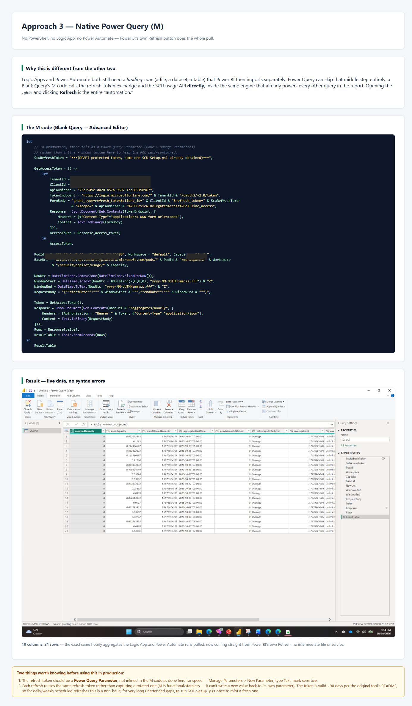

This is the full click-by-click walkthrough for Approach 3 above — 26 steps across 6 stages, starting from an empty Blank Query and ending with a live, scheduled-refresh-ready 3-table dashboard.

#### How it works

1. A **Blank Query** is created with no data source — just an empty canvas
   for hand-written M code.
2. Its M code calls Microsoft Entra's token endpoint directly via
   `Web.Contents`, trading the already-obtained **delegated refresh token**
   for a short-lived access token — the same `refresh_token` grant
   `SCU-Setup.ps1`/`SCU-Run.ps1` already use.
3. With that access token, it calls the Security Copilot usage API's
   `/aggregates/hourly` endpoint for a rolling 7-day window and turns the
   JSON response into a table with `Table.FromRecords`.
4. The refresh token itself is **never inlined in the M code** — it's stored
   in a **Power Query Parameter** (`ScuRefreshToken`) and referenced by name,
   so the query logic and the secret stay separate.
5. Every time the report owner clicks **Refresh**, steps 2–3 repeat. There is
   no scheduled trigger, no intermediate file, and nothing running in the
   background between refreshes.

<p align="center"><br><sub>The finished M code (left) and the live result it returns (right) — the end state this walkthrough builds up to.</sub></p>

#### Key terms

New to Power Query? Here's what each term means in this guide.

| Term | What it means here |
|---|---|
| **Power Query** | The data-transformation engine built into Power BI (also in Excel). You write or record steps in a language called **M**; Power Query runs them every time the report refreshes. |
| **Blank Query** | A Power Query data source with no connector behind it — just a name and whatever M code you write yourself. |
| **M** (the Power Query Formula Language) | The functional language Power Query steps compile down to. The **Advanced Editor** shows and edits it directly as text. |
| **Advanced Editor** | The code-view window for a single query's M code. Normal query building (clicking through the UI) is really just generating M code behind the scenes; this walkthrough writes it by hand instead. |
| **Power Query Parameter** | A named, reusable value (text, number, date, etc.) that any query can reference by name. Used here so the refresh token lives in one place, not pasted inline into the query logic. |
| **Refresh Preview / Refresh** | Re-runs a query's M code and reloads its result. **Refresh Preview** (inside the Power Query Editor) refreshes just the query you're looking at; **Refresh** on the main canvas refreshes every query feeding the report. |
| **Delegated vs. app-only token** | A **delegated** token represents a signed-in user; an **app-only** token represents the app itself with no user present. The Security Copilot usage API only accepts delegated tokens — see [Part 3's comparison table](#comparison) for how that was confirmed. |
| **`Web.Contents`** | The M function that makes an HTTP request. Used twice here: once against Entra's token endpoint, once against the usage API. |

#### Before you start

##### What you need

| Item | Details |
|---|---|
| **Power BI Desktop** | Installed locally. No special license or tenant setting needed — this runs entirely client-side. |
| **The `SCU-Usage-Puller` app registration** | From [Part 1](#example-environment-from-this-walkthrough-yours-will-differ) of this repo, with `Purview.DelegatedAccess` consented. |
| **A valid delegated refresh token** | Already obtained by running `SCU-Setup.ps1` once (same one `SCU-Run.ps1` reuses). It's DPAPI-encrypted at rest under the signed-in Windows user — decrypt it only in memory, never paste it in plain text anywhere persistent. |
| **The tenant's Security Copilot pod details** | `PodId`, `Workspace`, and `Capacity` — the same constants `SCU-Run.ps1` already uses to build the usage API URL. |
| **Time** | About 10 minutes, plus however long the first `Web.Contents` call takes to resolve the one-time data-source trust prompts. |

##### A note on the refresh token

Treat the decrypted refresh token exactly like a password: never type it
into a chat window, commit it to source control, or leave it visible in a
screenshot. This walkthrough's own screenshots were masked for that reason —
see the callout in [Step 7](#step-7-create-the-scurefreshtoken-parameter).

---

#### Stage 1: Create a Blank Query

##### Step 1: Start Power BI Desktop

**Why:** a Blank Query needs nothing from an existing report — starting from
a brand-new file keeps this walkthrough self-contained.

1. Open **Power BI Desktop**.
2. On the start screen, select **Blank report**.

<p align="center">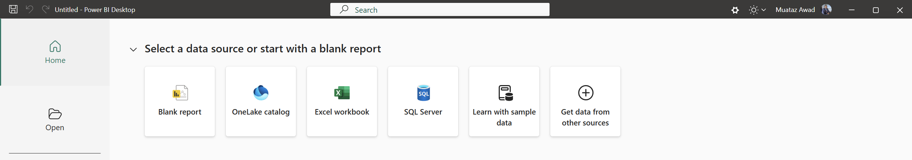<br><sub>Power BI Desktop's start screen. <b>Blank report</b> is the leftmost tile.</sub></p>

The report canvas opens with an empty **Page 1** and the standard ribbon.

<p align="center">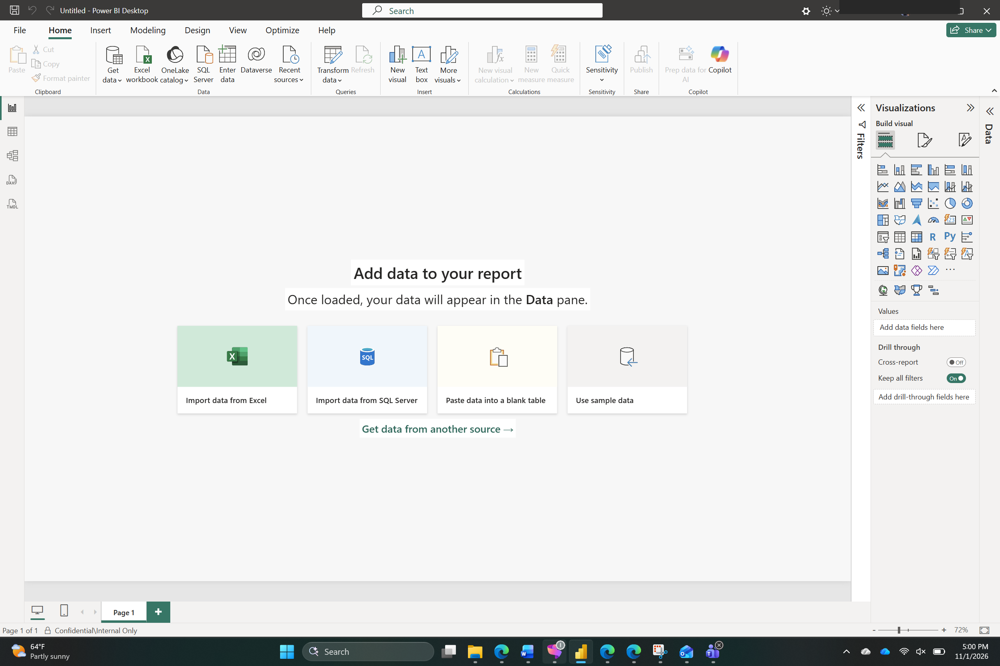<br><sub>A brand-new, unsaved report. Nothing has been connected yet.</sub></p>

##### Step 2: Open Get Data and pick Blank Query

**Why:** every other item in the **Get Data** picker is a connector that asks
for connection details (a server, a file, a URL). **Blank Query** is the one
option that skips all of that and drops straight into an empty M script.

1. **Home → Get data → More…** opens the **Get Data** window.

<p align="center">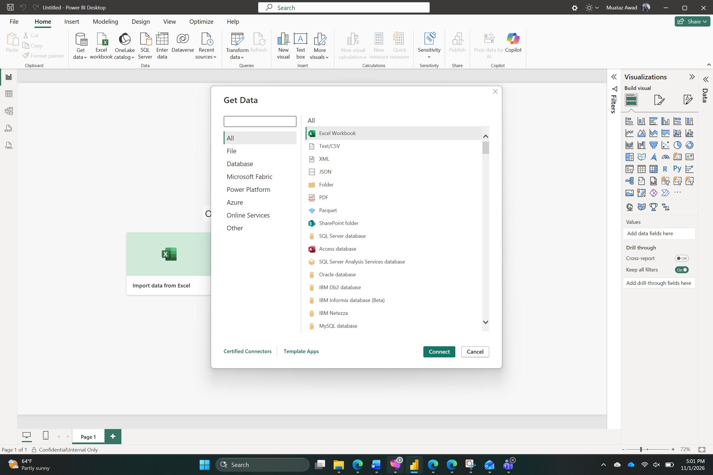<br><sub><b>Get Data</b>, defaulting to the <b>All</b> category with <b>Excel Workbook</b> selected.</sub></p>

2. Type `Blank Query` into the search box at the top-left — it's under the
   **Other** category, but searching is faster than navigating there.

<p align="center">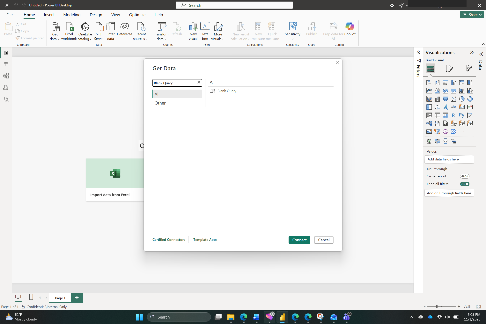<br><sub>Typing narrows the list to a single result: <b>Blank Query</b>.</sub></p>

3. Select **Blank Query**, then **Connect**.

##### Step 3: Confirm the Power Query Editor opened

Unlike most connectors, Blank Query has no connection-parameter dialog to
fill in first — selecting it opens the **Power Query Editor** directly, with
a new, empty query named `Query1`.

<p align="center">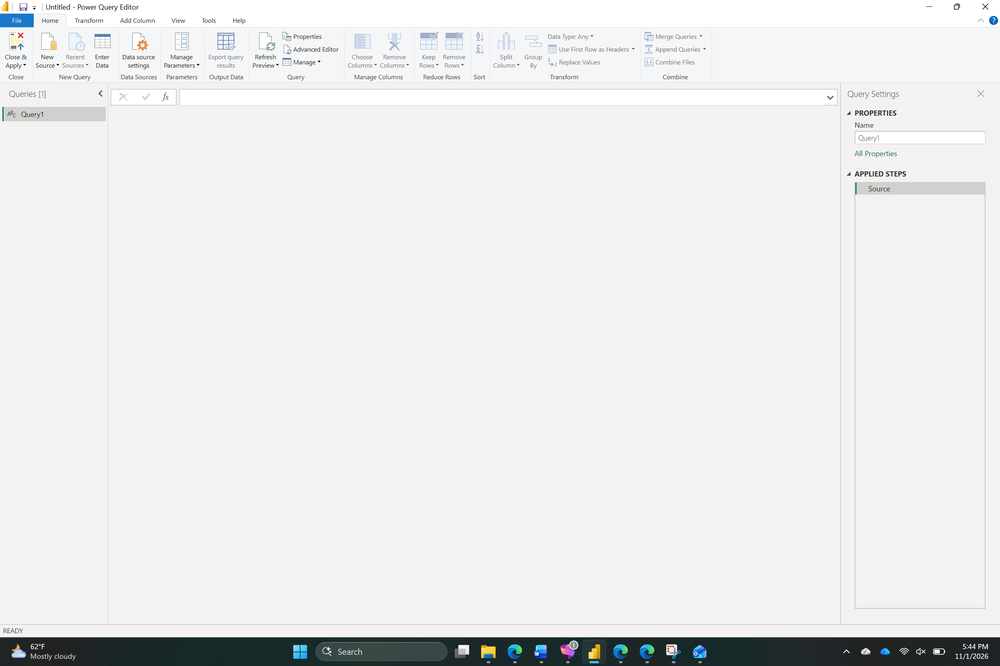<br><sub>The Power Query Editor, maximized. <b>Query1</b> exists but has no code yet — its <b>Applied Steps</b> pane shows only <code>Source</code>.</sub></p>

---

#### Stage 2: Write and test the M code

##### Step 4: Open the Advanced Editor

**Why:** normal Power Query use builds M code indirectly, by clicking
through transformation buttons. The **Advanced Editor** is the direct route —
it shows the query's actual M code as text, and lets you replace it outright.

1. **Home → Advanced Editor**.
2. A brand-new blank query defaults to the simplest possible script:
   `let Source = "" in Source`.

<p align="center">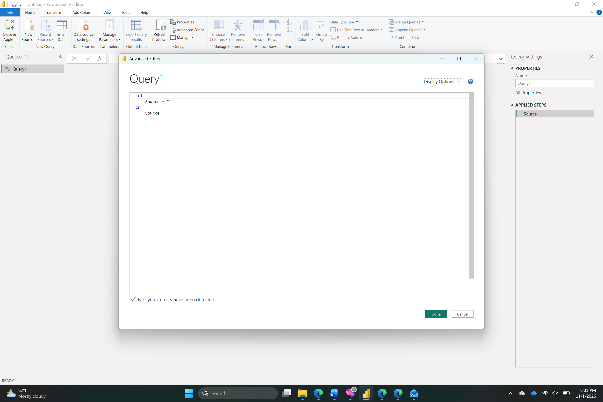<br><sub>The Advanced Editor's default scaffold for a new Blank Query. <b>No syntax errors have been detected</b> confirms the editor is validating as you type.</sub></p>

##### Step 5: Paste the M code and run it

**Why this step exists at all:** the fastest way to confirm the request
shape (the token exchange, the API URL, the headers) is correct is to test
it with the token **inlined as a plain string** first — one variable,
easy to swap out — before worrying about where that secret should actually
live. That's exactly what the code's own comment says to do next.

1. Select all the default code and replace it with the full M script below
   (also saved as [`Steps/mcode-placeholder.m`](Automation-Alternatives/PowerQuery/Steps/mcode-placeholder.m)).
   In place of a real token, this version uses a placeholder string so it's
   safe to paste anywhere, including here:

   ```text
   let
       // In production, store this as a Power Query Parameter (Home > Manage Parameters)
       // rather than inline - shown inline here to keep the POC self-contained.
       ScuRefreshToken = "PASTE_YOUR_REFRESH_TOKEN_HERE",

       GetAccessToken = () =>
           let
               TenantId = "<your-tenant-id>",
               ClientId = "<SCU-Usage-Puller's client ID>",
               ApiAudience = "73c2949e-da2d-457a-9607-fcc665198967",
               TokenEndpoint = "https://login.microsoftonline.com/" & TenantId & "/oauth2/v2.0/token",
               FormBody = "grant_type=refresh_token&client_id=" & ClientId & "&refresh_token=" & ScuRefreshToken
                          & "&scope=" & ApiAudience & "%2FPurview.DelegatedAccess%20offline_access",
               Response = Json.Document(Web.Contents(TokenEndpoint, [
                   Headers = [#"Content-Type"="application/x-www-form-urlencoded"],
                   Content = Text.ToBinary(FormBody)
               ])),
               AccessToken = Response[access_token]
           in
               AccessToken,

       PodId = "<your pod ID>", Workspace = "default", Capacity = "<your capacity name>",
       BaseUrl = "https://us.api.securityplatform.microsoft.com/pods/" & PodId & "/workspaces/" & Workspace
                & "/securitycopilot/usage/" & Capacity,

       NowUtc = DateTimeZone.RemoveZone(DateTimeZone.FixedUtcNow()),
       WindowStart = DateTime.ToText(NowUtc - #duration(7,0,0,0), "yyyy-MM-ddTHH:mm:ss.fff") & "Z",
       WindowEnd = DateTime.ToText(NowUtc, "yyyy-MM-ddTHH:mm:ss.fff") & "Z",
       RequestBody = "{""startDate"":""" & WindowStart & """,""endDate"":""" & WindowEnd & """}",

       Token = GetAccessToken(),
       Response = Json.Document(Web.Contents(BaseUrl & "/aggregates/hourly", [
           Headers = [Authorization = "Bearer " & Token, #"Content-Type"="application/json"],
           Content = Text.ToBinary(RequestBody)
       ])),
       Rows = Response[value],
       ResultTable = Table.FromRecords(Rows)
   in
       ResultTable
   ```

   > The copy above redacts `TenantId`, `ClientId`, `PodId`, and `Capacity`
   > with placeholders for this published guide. The actual lab run used the
   > real dev-tenant values (which match the table in the
   > [root README](#example-environment-from-this-walkthrough-yours-will-differ)) — only the
   > refresh token itself needs to stay secret.

<p align="center">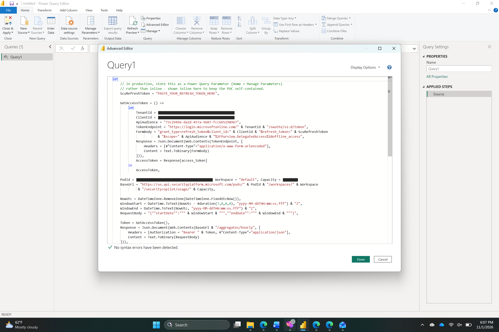<br><sub>The pasted M code, with a placeholder in place of the real token. <b>No syntax errors have been detected</b> — the code is well-formed even though it will fail to authenticate.</sub></p>

2. Select **Done**, then **Home → Refresh Preview**.
3. With a placeholder instead of a real token, expect a `400 Bad Request`
   from the token endpoint — this is the **expected** result, and it
   confirms the request is reaching the right URL with the right shape.

<p align="center">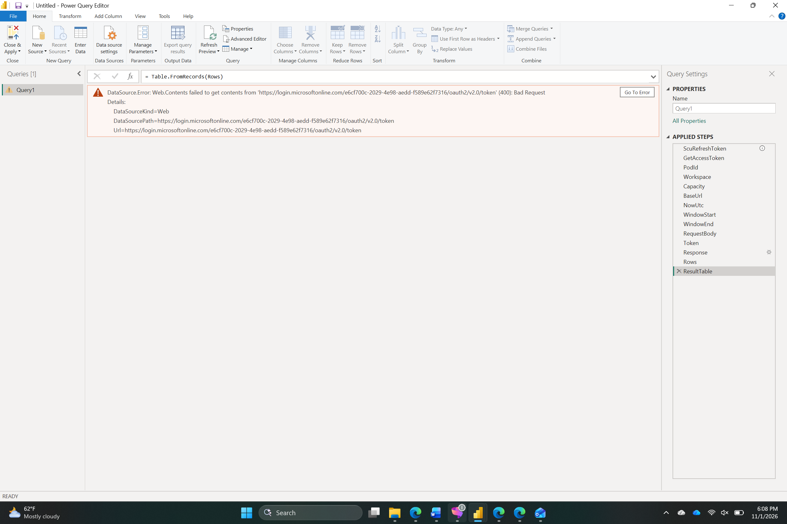<br><sub>The expected failure: <code>DataSource.Error: Web.Contents failed to get contents from '…/oauth2/v2.0/token' (400): Bad Request</code>. The <b>Applied Steps</b> pane on the right confirms every step up to <code>ResultTable</code> ran — only the actual token exchange rejected the placeholder.</sub></p>

---

#### Stage 3: Move the secret into a Parameter

##### Step 6: Open Manage Parameters

**Why:** leaving the token inlined (as in Step 5) means it's baked into the
query's saved M code — visible in any export, diff, or screenshot of that
query. A **Power Query Parameter** keeps the same value but stores it as a
separate, named object instead, so the M code itself never contains it.

1. **Home → Manage Parameters** is a split button (it has its own dropdown
   arrow). Selecting it opens two options: **Edit Parameters** and
   **New Parameter**.

<p align="center">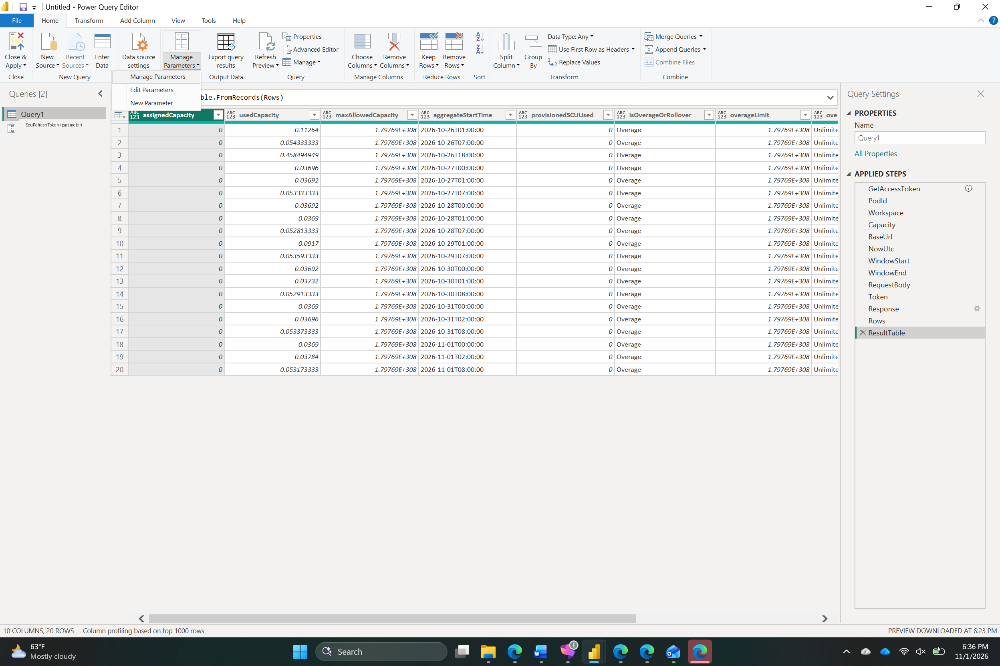<br><sub><b>Home → Manage Parameters</b>. <b>New Parameter</b> opens a blank form; <b>Edit Parameters</b> (used next) opens every existing parameter on the query.</sub></p>

##### Step 7: Create the `ScuRefreshToken` parameter

1. Select **Edit Parameters** (or **New Parameter** for a brand-new one).
2. Fill in the parameter's fields:

| Field | Value | Why |
|---|---|---|
| Name | `ScuRefreshToken` | Matches the identifier the M code will reference — Power Query resolves parameters by name. |
| Type | **Text** | The refresh token is an opaque string, not a number/date/etc. |
| Current Value | *(the decrypted refresh token)* | This is the actual secret. Power Query stores it as part of the query definition — see [Good to know](#good-to-know). |

> [!CAUTION]
> This dialog shows the Current Value field as **plain, unmasked text** —
> there's no password-style dot-masking. Never leave this dialog open in a
> screen share, and never screenshot it with the real value present. The
> screenshot below was taken with a placeholder typed into the field, then
> **Cancel** was selected (not OK) so the real stored value was never
> actually changed by the act of documenting this step.

<p align="center">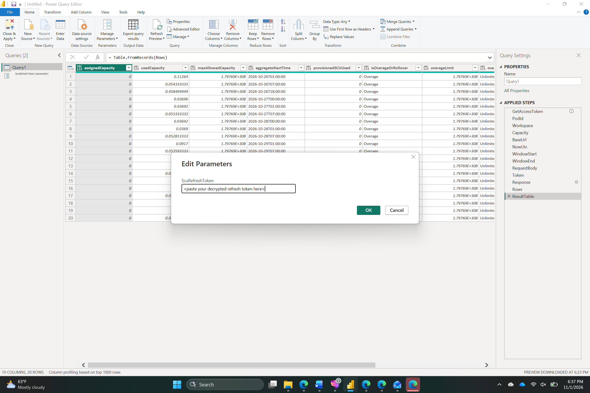<br><sub><b>Edit Parameters</b>, showing the <code>ScuRefreshToken</code> parameter's single text field. Shown here with a placeholder in place of the real decrypted token.</sub></p>

3. Select **OK** to save (or **Cancel**, as above, if you're only verifying
   the dialog's layout).

---

#### Stage 4: Finalize and refresh

##### Step 8: Point the M code at the parameter

**Why:** with `ScuRefreshToken` now a Parameter, the query no longer needs to
declare or assign it — Power Query resolves the bare name automatically at
evaluation time, the same way it resolves any other query's name.

1. Open **Advanced Editor** again and replace the inline assignment with a
   bare reference, matching
   [`Steps/mcode-final-parameterized.m`](Automation-Alternatives/PowerQuery/Steps/mcode-final-parameterized.m):

   ```text
   let
       // ScuRefreshToken is now a Power Query Parameter (Home > Manage Parameters)
       // instead of being inlined here - production-safe pattern.
       GetAccessToken = () =>
           let
               TenantId = "<your-tenant-id>",
               ClientId = "<SCU-Usage-Puller's client ID>",
               ApiAudience = "73c2949e-da2d-457a-9607-fcc665198967",
               TokenEndpoint = "https://login.microsoftonline.com/" & TenantId & "/oauth2/v2.0/token",
               FormBody = "grant_type=refresh_token&client_id=" & ClientId & "&refresh_token=" & ScuRefreshToken
                          & "&scope=" & ApiAudience & "%2FPurview.DelegatedAccess%20offline_access",
               Response = Json.Document(Web.Contents(TokenEndpoint, [
                   Headers = [#"Content-Type"="application/x-www-form-urlencoded"],
                   Content = Text.ToBinary(FormBody)
               ])),
               AccessToken = Response[access_token]
           in
               AccessToken,

       PodId = "<your pod ID>", Workspace = "default", Capacity = "<your capacity name>",
       BaseUrl = "https://us.api.securityplatform.microsoft.com/pods/" & PodId & "/workspaces/" & Workspace
                & "/securitycopilot/usage/" & Capacity,

       NowUtc = DateTimeZone.RemoveZone(DateTimeZone.FixedUtcNow()),
       WindowStart = DateTime.ToText(NowUtc - #duration(7,0,0,0), "yyyy-MM-ddTHH:mm:ss.fff") & "Z",
       WindowEnd = DateTime.ToText(NowUtc, "yyyy-MM-ddTHH:mm:ss.fff") & "Z",
       RequestBody = "{""startDate"":""" & WindowStart & """,""endDate"":""" & WindowEnd & """}",

       Token = GetAccessToken(),
       Response = Json.Document(Web.Contents(BaseUrl & "/aggregates/hourly", [
           Headers = [Authorization = "Bearer " & Token, #"Content-Type"="application/json"],
           Content = Text.ToBinary(RequestBody)
       ])),
       Rows = Response[value],
       ResultTable = Table.FromRecords(Rows)
   in
       ResultTable
   ```

2. Select **Done**. The queries list on the left now shows both `Query1`
   and the `ScuRefreshToken` parameter.

<p align="center">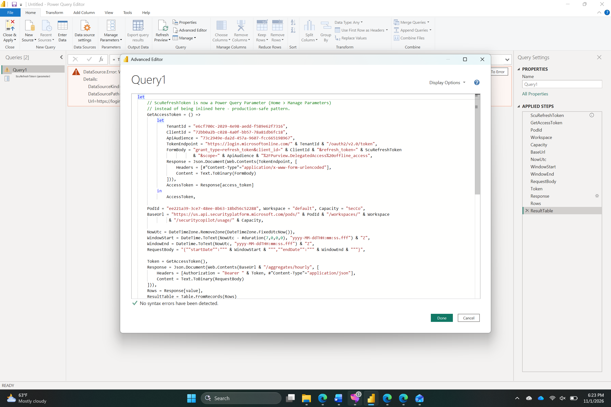<br><sub>The final M code — <code>ScuRefreshToken</code> is referenced by name only, with no inline secret anywhere in this screenshot. <b>No syntax errors have been detected.</b></sub></p>

> The Queries pane also previews each parameter's current value next to its
> name (Power Query does this by default for every parameter, not just this
> one). That portion of the screenshot above is masked for the same reason
> as Step 7 — it isn't rendered any differently in the real UI.

##### Step 9: Refresh Preview and confirm live data

1. **Home → Refresh Preview** re-runs the query end to end: exchange the
   refresh token for an access token, call the usage API, and return the
   result table.
2. The first refresh may prompt for the data source's **privacy level**
   (Anonymous/Public is fine for both `login.microsoftonline.com` and the
   usage API host) — see [Privacy levels in Power
   Query](https://learn.microsoft.com/power-query/privacy-levels) if you
   haven't seen this prompt before.

<p align="center">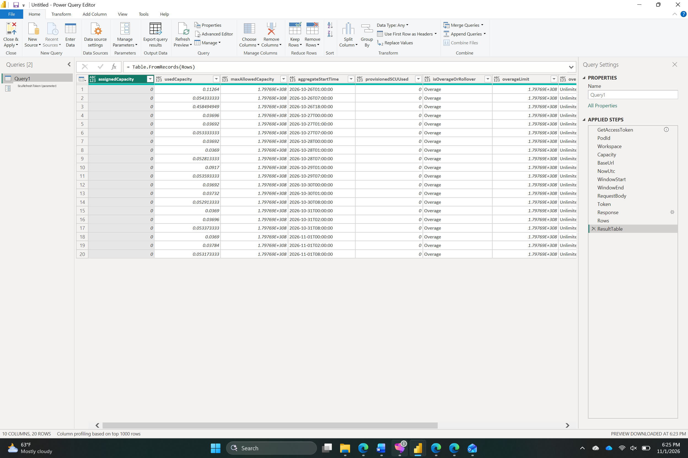<br><sub><b>10 columns, 20 rows</b> of real hourly usage aggregates, with real timestamps through the current date. <b>PREVIEW DOWNLOADED AT 6:23 PM</b> (bottom-right) confirms this is a live result, not cached.</sub></p>

From here, **Close & Apply** loads the query into the report's data model
like any other source, and every subsequent **Refresh** on the report canvas
repeats this exact flow — no external moving parts, no landing-zone file,
nothing running in the background between refreshes. Part 5 below actually
clicks **Close & Apply** and builds a visual from the result, so there's no
ambiguity about what the finished state looks like.

---

#### Stage 5: Load it into the report and visualize

##### Step 10: Close & Apply

**Why:** everything up to now happened inside the **Power Query Editor**,
which is a staging area — its "Preview" never touches the report itself.
**Close & Apply** is the one action that commits the query into the report's
data model, closes the editor, and returns you to the report canvas.

1. **Home → Close & Apply** is also a split button. Selecting the main
   (left) part runs **Close & Apply** directly; the dropdown arrow exposes
   **Apply** (load without closing the editor) and **Close** (discard
   without loading) as well.

<p align="center">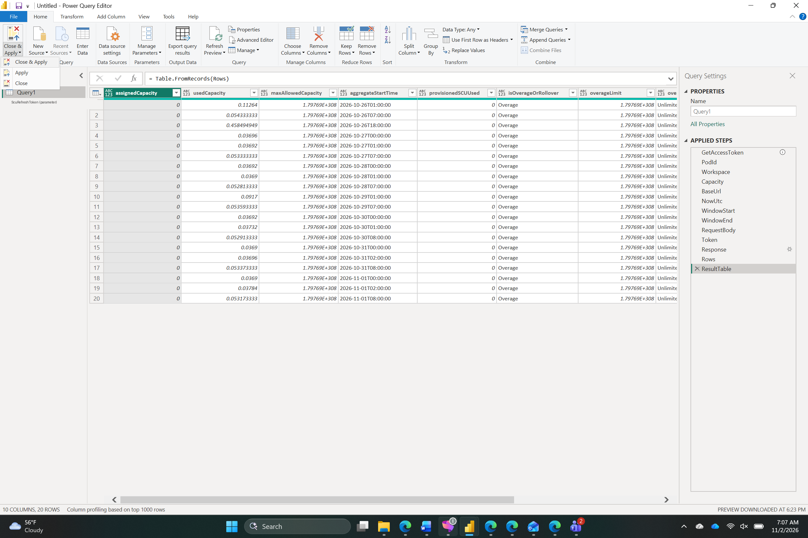<br><sub><b>Home → Close & Apply</b>. The three options shown are <b>Close & Apply</b> (commit and close), <b>Apply</b> (commit and stay open), and <b>Close</b> (discard).</sub></p>

2. Power BI shows a **Load** dialog while it evaluates the query and any
   parameters one more time before committing the result to the model.

<p align="center">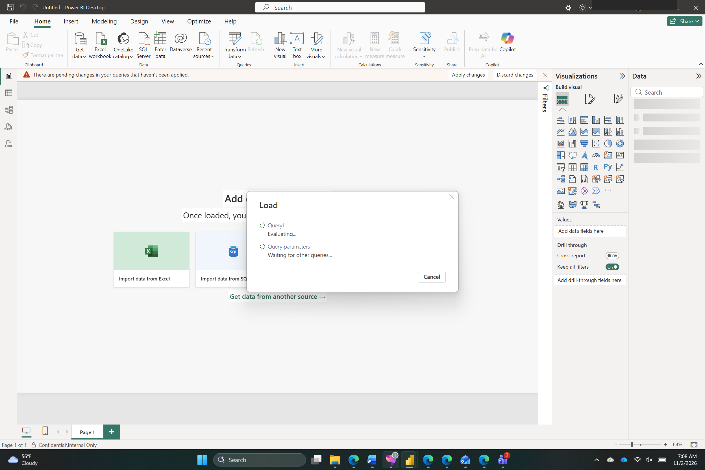<br><sub>The one-time <b>Load</b> dialog — <code>Query1: Evaluating…</code> — this is the same M code run as Step 9's Refresh Preview, just loading into the model instead of the editor's preview grid.</sub></p>

##### Step 11: Confirm the query landed in the report

Once loading finishes, the Power Query Editor window closes on its own and
you're back on the report canvas, with `Query1` now listed in the **Data**
pane on the right.

<p align="center">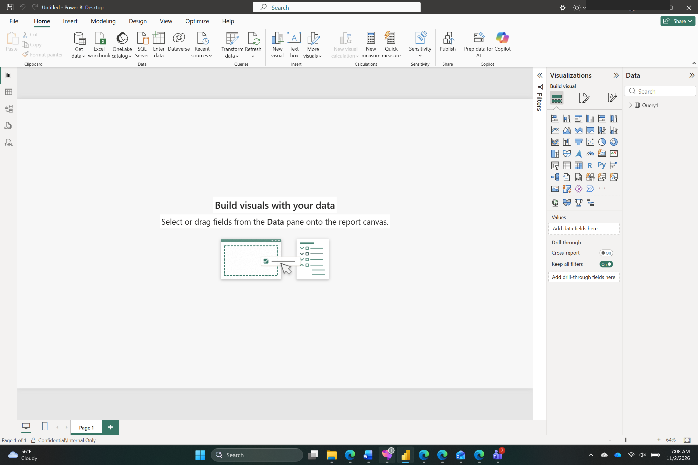<br><sub>Back on the report canvas. <code>Query1</code> appears in the <b>Data</b> pane — the editor is gone, and the canvas is ready for a visual.</sub></p>

Expand `Query1` in the Data pane to see all 10 columns the query returns.
Only field **names** are listed here — `ScuRefreshToken` doesn't appear at
all, because Parameters aren't part of the data model; they exist only
inside Power Query itself.

<p align="center">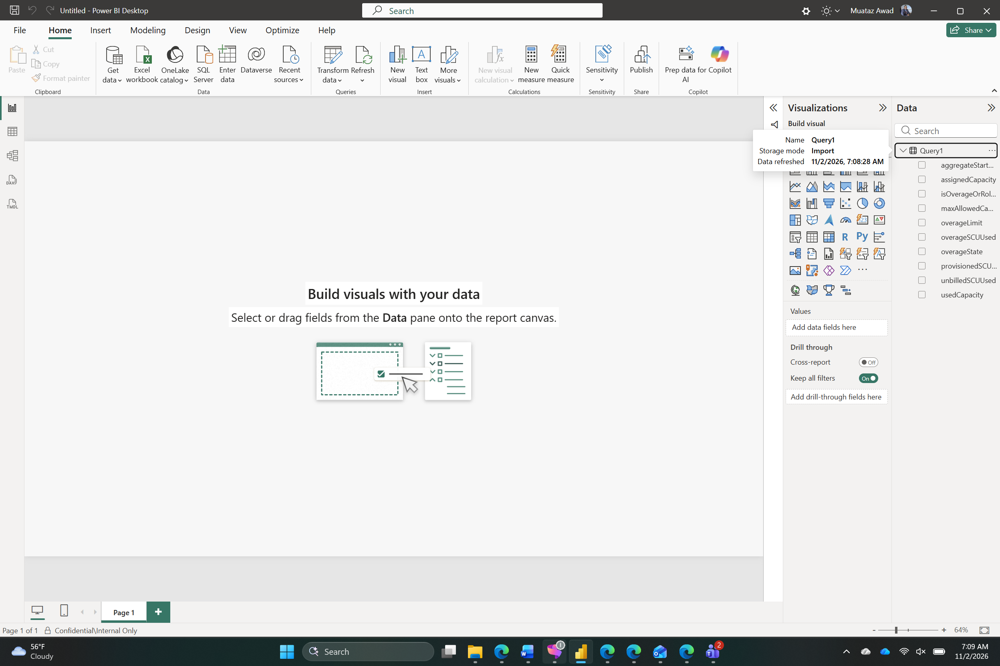<br><sub>All 10 columns from the usage API response, ready to use in any visual: <code>aggregateStartTime</code>, <code>assignedCapacity</code>, <code>isOverageOrRollover</code>, <code>maxAllowedCapacity</code>, <code>overageLimit</code>, <code>overageSCUUsed</code>, <code>overageState</code>, <code>provisionedSCUUsed</code>, <code>unbilledSCUUsed</code>, <code>usedCapacity</code>.</sub></p>

##### Step 12: Build a visual from the real data

**Why:** this is the actual point of pulling the data in the first place —
a visual on the report canvas is what a report reader sees. Nothing about
this step is specific to this data source; any table loaded into the model
builds visuals the same way.

1. With no visual selected, checking a field's box in the Data pane creates
   a new **Table** visual automatically and adds that field as a column.
   Checking further boxes adds more columns to the same visual.
2. For this walkthrough, four columns were added: `aggregateStartTime`,
   `usedCapacity`, `assignedCapacity`, `provisionedSCUUsed`.
3. The default visual size is small — **Format visual → General →
   Properties → Size** has explicit **Height**/**Width** fields if you'd
   rather type exact values than drag the resize handles.

<p align="center">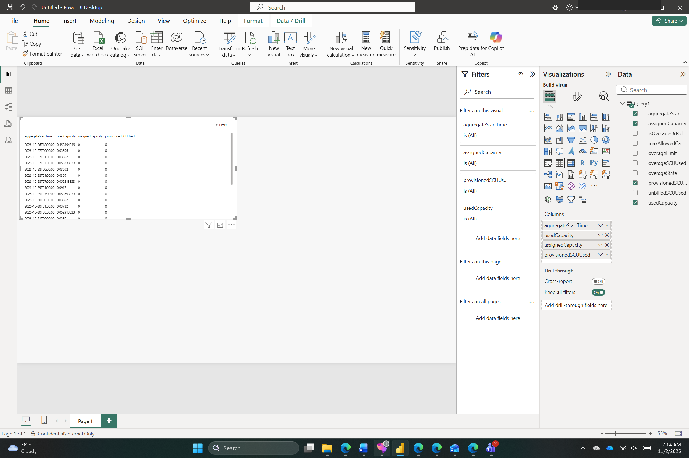<br><sub>The finished table — real hourly usage rows, pulled live from the Security Copilot usage API, with zero PowerShell and zero external services involved from here on. This is the end state the whole walkthrough builds up to.</sub></p>

##### Step 13: Prove the loop — click Refresh on the report canvas

**Why:** every step so far happened once, by hand. The whole point of this
approach is that **Home → Refresh** on the main report canvas (not
**Refresh Preview** inside the editor) re-runs the entire pull — token
exchange, API call, table reload — with one click and no editor involved.
This step actually clicks it, rather than just asserting it would work.

1. With the table visual already on the canvas, select **Home → Refresh**.
2. Power BI re-evaluates `Query1` (and resolves `ScuRefreshToken` again)
   exactly as Step 9 did, then reloads the visual with whatever the usage
   API returns at that moment.

<p align="center">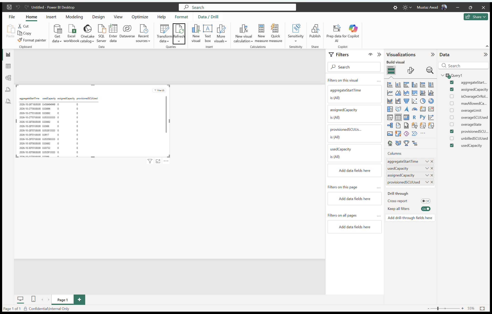<br><sub><b>Home → Refresh</b>, clicked — the button's focus outline confirms it ran. The table reloads in place; no dialogs, no editor, no PowerShell.</sub></p>

##### Step 14: Save your work

1. **Ctrl+S** (or **File → Save**) prompts for a name the first time, since
   this report started as an unsaved Blank Query session.

<p align="center">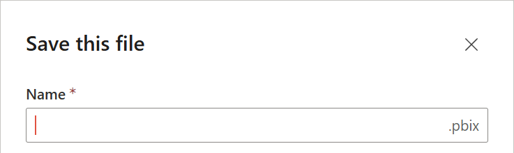<br><sub>The one-time naming prompt. Everything after this — folder, OneDrive vs. local — is standard Windows/Power BI save behavior, not specific to this walkthrough.</sub></p>

2. Once saved, the title bar switches from <code>Untitled</code> to the
   file's name, confirming a real <code>.pbix</code> now exists on disk.

<p align="center">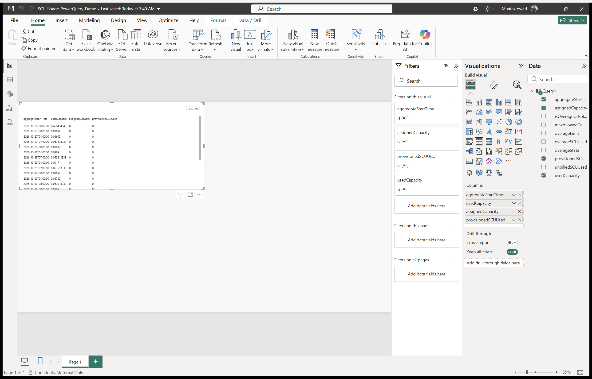<br><sub>Title bar reads the saved file name instead of <code>Untitled</code> — a tangible <code>.pbix</code> deliverable, with the same table visual intact.</sub></p>

> [!CAUTION]
> This `.pbix` still has the real decrypted refresh token sitting in the
> `ScuRefreshToken` parameter (see [Good to know](#good-to-know)). It was
> saved to a local working folder only, deliberately **not** committed to
> this repository — treat any `.pbix` saved from this walkthrough as a
> secret, the same way the [Roll back](#roll-back) section already
> describes.

---

#### Stage 6: Scaling to a full 3-table live dashboard

Steps 1–14 above proved the pattern with **one** Blank Query and a 7-day
Hourly pull. This part documents scaling that same pattern to drive **all
three core tables** (`Hourly`, `Sessions`, `Daily`) of a real multi-page
dashboard (`SCU-Dashboard-LiveAPI.pbix`) that had previously loaded those
tables from a static `SCU-Report.xlsx` export — plus a genuine credential
wall hit and root-caused one failure mode at a time, and a dead end hit
along the way: an attempt to replace the ad-hoc queries with a proper
custom Power Query connector, which turned out to be impossible on this
specific Power BI Desktop installation for a reason worth recording.

> [!NOTE]
> The architecture and every credential-type failure mode below are generic
> — they'll reproduce in any tenant using this same ad-hoc `Web.Contents`
> pattern. The row counts (31 Daily rows, etc.) and the Microsoft Store/MSIX
> finding in Step 21 are specific to this one run and this one machine's
> Power BI Desktop install — check your own install edition before assuming
> Step 21 applies to you.

> [!IMPORTANT]
> This section never shows a real refresh token, and the `.pbix` itself is
> not committed to this repo. Every screenshot below was taken from
> Table/Report view and Power BI's own **Access Web content** credential
> dialog with the Advanced Editor and DAX/M panes closed, specifically to
> avoid ever capturing the token. The one tenant identifier visible in two
> screenshots (the Entra **Tenant ID**) is already published in plain text
> in this document's [example environment table](#example-environment-from-this-walkthrough-yours-will-differ) — it is not a
> secret. The one M code file included here
> ([`SCUDashboard-connector.pq`](Automation-Alternatives/PowerQuery/Steps/SCUDashboard-connector.pq)) takes its
> token from a Power BI credential prompt at runtime
> (`Extension.CurrentCredential()`) and contains no secret value at all.

##### Goal

Convert `SCU-Dashboard-LiveAPI.pbix`'s three core tables from a static,
point-in-time `SCU-Report.xlsx` export to live, direct-API Power Query
sources — so opening the file and clicking **Refresh** pulls current
Security Copilot usage data straight from the tenant, the same way Steps
1–14 above did with one table, but feeding a full dashboard instead of one
proof table.

##### Architecture — one pattern, three endpoints

| Table | Endpoint | Shape | Notes |
|---|---|---|---|
| `Hourly` | `/aggregates/hourly` | Single call, 30-day window | Same call shape as the Part 1–5 proof query. |
| `Sessions` | `/aggregates/dimensional` | **Paginated** (`pageSize: 200`), `List.Generate` loop until a page comes back empty | Per-session rows: user, plugins/skills used, category, status, cost. |
| `Daily` | `/aggregates/dimensional` | Same paginated pull as `Sessions`, then **grouped by calendar day** | Produces `Day`, `SCU_Total`, `Overage_SCU`, `Hours_Active`, rolling 7-/30-day averages, day-over-day deltas, and a simple anomaly flag. |

All three authenticate the same way: a stored delegated refresh token is
traded for a short-lived access token via `grant_type=refresh_token`
against `https://login.microsoftonline.com/<TenantId>/oauth2/v2.0/token`,
requesting the `Purview.DelegatedAccess` scope — identical to
`SCU-Setup.ps1` / `SCU-Run.ps1` and to Steps 1–14.

##### Step 15: Hourly and Sessions converted cleanly

Both queries followed the same recipe as Steps 1–14 (`Web.Contents` →
`Json.Document` → `Table.FromRecords` → typed/renamed columns), with
`Sessions` additionally needing the `List.Generate` pagination loop from the
[architecture table](#architecture--one-pattern-three-endpoints) above,
since `/aggregates/dimensional` caps each response at 200 rows. Both
refreshed cleanly once a credential was accepted for their shared API host.

##### Step 16: Data source settings — one prompt per host, not per query

**Why:** Power BI's generic data-source credential gate is a separate layer
from the M code itself. It tracks one entry **per exact URL** a query calls
— independent of how many queries share that URL, and independent of
whatever the M code does internally (including this file's pattern of
building its own `Authorization: Bearer <token>` header by hand inside
`Web.Contents`). **File → Options and settings → Data source settings**
lists every URL the file has ever called and lets you inspect or clear its
stored credential one at a time.

<p align="center">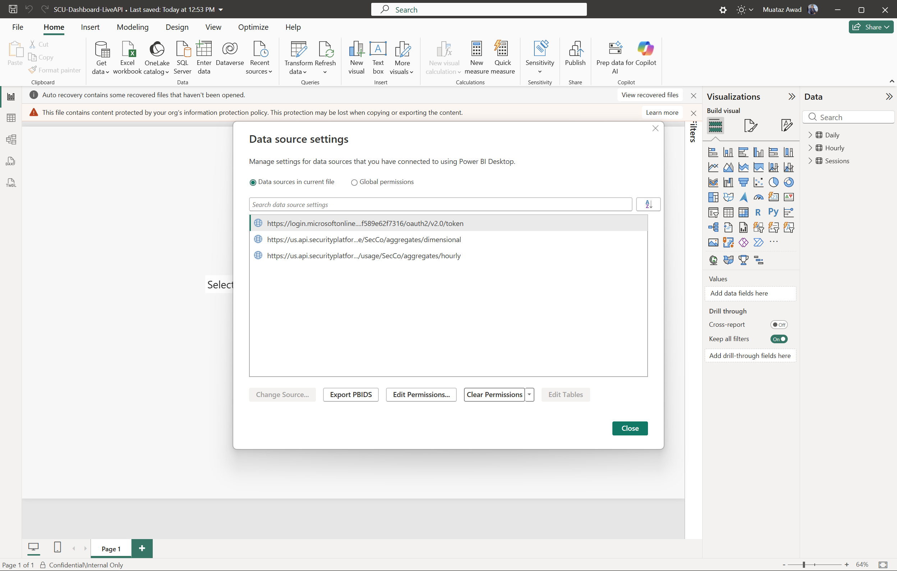<br><sub><b>Data source settings</b> — three entries for this file: the Entra token endpoint, the <code>aggregates/dimensional</code> endpoint (<code>Sessions</code> + <code>Daily</code>), and the <code>aggregates/hourly</code> endpoint. Clearing one entry's permission only affects queries that call that exact URL.</sub></p>

##### Step 17: Web API + Key — looks right, fails structurally

**Why this was tried first:** the **Web API** credential type's **Key**
field looks like the obvious match for "paste a token-shaped value in a
box". It isn't, for this M code specifically — and the error below is
consistent and structural, not a typo or a one-off glitch.

1. Triggering a refresh with no stored credential for the
   `aggregates/dimensional` host opens Power BI's **Access Web content**
   dialog.
2. Choosing the **Web API** tab and typing any value into **Key**, then
   clicking **Connect**, fails every time with the same message.

<p align="center">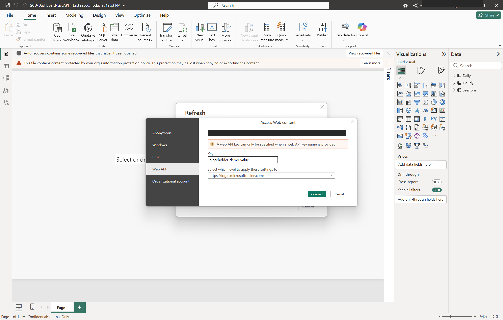<br><sub><b>"A web API key can only be specified when a web API key name is provided."</b> This credential type only works when the M code itself declares an <code>ApiKeyName</code> option on <code>Web.Contents</code> so Power BI knows which header/query-string parameter to inject the key into. This file's ad-hoc <code>Web.Contents</code> calls never declare one, by design — the Bearer header is already built by hand — so no value typed here will ever satisfy this credential type.</sub></p>

##### Step 18: Anonymous — rejected by the API's own preflight check

**Why this was tried next:** "Anonymous" tells Power BI *not* to inject any
credential of its own, which sounds like the right fit for a query that
already builds its own auth header. The nuance is that Power BI still runs
a bare connectivity check against the data source before it will save that
choice — and that check carries no custom headers at all.

<p align="center">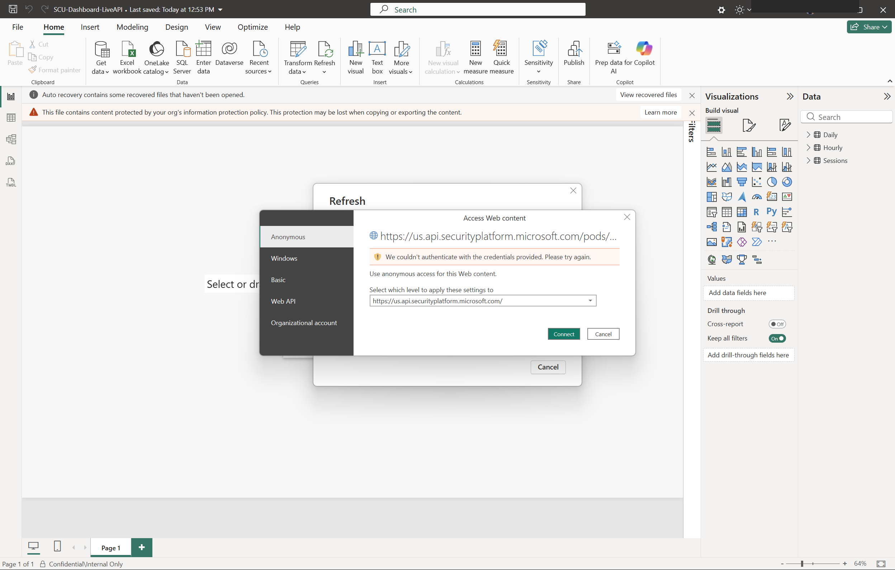<br><sub><b>"We couldn't authenticate with the credentials provided."</b> The real usage API legitimately requires the Bearer token this file's M code builds by hand — a bare, header-less preflight request against the same host is correctly rejected. This isn't a bug in the query; it's Power BI validating a credential type before trusting it, using a plainer request than the query's own.</sub></p>

##### Step 19: Organizational account — needs a live interactive sign-in

**Why this was tried last among the automatic options:** it's the one
credential type most likely to be genuinely valid for a Microsoft-hosted
API. The catch is what "valid" means here — it hands off to a real,
interactive Microsoft Entra sign-in flow, not this file's existing
refresh-token exchange.

<p align="center">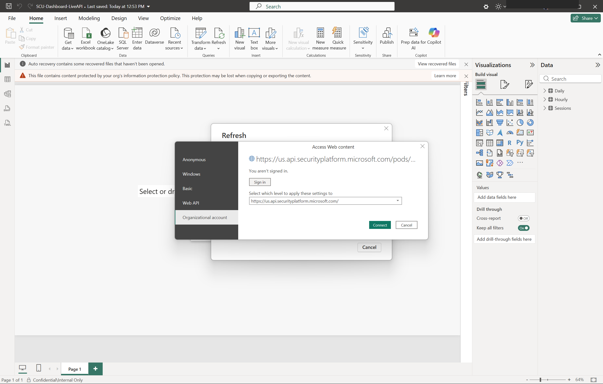<br><sub><b>"You aren't signed in"</b> with a <b>Sign in</b> button. This path is correct for connectors that want Power BI to manage a fresh AAD session on your behalf — it isn't what this API wants either way, since the M code already carries its own delegated token end to end.</sub></p>

##### Step 20: Side quest — building a real custom connector

Rather than keep working through the generic credential dialog's options,
the next move was to do this properly: a genuine Power Query **custom
connector** (`SCUDashboard.pq` → compiled to `SCUDashboard.mez`) exposing
`Hourly` and `Sessions` as native navigation-table entries under **Get
Data**, with its own first-class **Key** credential type — so Power BI
handles the one-time credential prompt itself, the same way it does for any
built-in connector, instead of the raw `Web.Contents` ad-hoc flow.

The connector source is included here as a reusable reference artifact:
[`SCUDashboard-connector.pq`](Automation-Alternatives/PowerQuery/Steps/SCUDashboard-connector.pq). It contains
**zero secrets** — the refresh token is never inlined; it's read at runtime
from whatever the user types into Power BI's own credential dialog
(`Extension.CurrentCredential()[Key]`), which is the architecturally
"right" way to do this and strictly more secure than both the ad-hoc
`Web.Contents` pattern and the [Parameter pattern](#stage-3-move-the-secret-into-a-parameter)
from Steps 1–14.

Build/placement checklist followed:

- [x] `.mez` built and placed in `%USERPROFILE%\Documents\Power BI Desktop\Custom Connectors\`.
- [x] File verified as a structurally valid zip containing the compiled `.pq`.
- [x] **File → Options → Security → "Allow any extension to load without
      validation or warning"** confirmed enabled (required for *any*
      unsigned custom connector to even be considered).
- [x] Power BI Desktop fully restarted after placing the file.
- [ ] Connector never appeared searching **Get Data** for "Security Copilot"
      or browsing the **Other** category — with **zero** errors, warnings,
      or log entries anywhere.

##### Step 21: Root cause — the Microsoft Store edition can't load it

No combination of settings fixed it, because the real cause wasn't a
setting. Checking how Power BI Desktop is installed on this machine:

```powershell
Get-AppxPackage -Name "*PowerBI*" | Select-Object Name, PackageFullName, InstallLocation
```

```
Name            : Microsoft.MicrosoftPowerBIDesktop
PackageFullName : Microsoft.MicrosoftPowerBIDesktop_2.160.579.0_x64__8wekyb3d8bbwe
InstallLocation : C:\Program Files\WindowsApps\Microsoft.MicrosoftPowerBIDesktop_2.160.579.0_x64__8wekyb3d8bbwe
```

This is the **Microsoft Store (MSIX/AppX) edition**. That edition runs in a
Store app sandbox that **cannot load unsigned custom `.mez` connectors at
all** — a hard platform limitation enforced by Store packaging policy, not
documented anywhere inside the Power BI UI itself, and completely
independent of the "allow any extension" security setting (that setting
only matters for the separate, standalone/MSI-installed edition of Power BI
Desktop, downloaded directly from microsoft.com rather than the Store).
That fully explains every symptom observed: a correctly built, correctly
placed, structurally valid connector that silently never appears, with
nothing to debug because nothing is actually attempting to load it.

**Takeaway for next time:** custom connectors on this machine require
uninstalling the Store edition and installing the standalone MSI edition of
Power BI Desktop instead. The connector source above is kept exactly for
that future possibility — it needs no changes to work once run on an
edition that supports it.

##### Step 22: Resolution — one real credential entry per host, then it sticks

With the connector path closed off, the fix for `Daily`/`Sessions` turned
out to be the generic credential dialog after all — just with the right
expectation set by Steps 17–19 above: of the five tabs in **Access Web
content** (Anonymous, Windows, Basic, Web API, Organizational account),
only the ones that actually match how the real API authenticates can
succeed, and the dialog's own "Select which level to apply these settings
to" dropdown matters too — it defaults to the bare host, and that's the
scope Power BI remembers the choice against. Once **one** credential entry
for a host is accepted, Power BI trusts that host for every query that
calls it going forward — a plain **Refresh**, with no further prompts,
works exactly like it already did for `Hourly`.

<p align="center">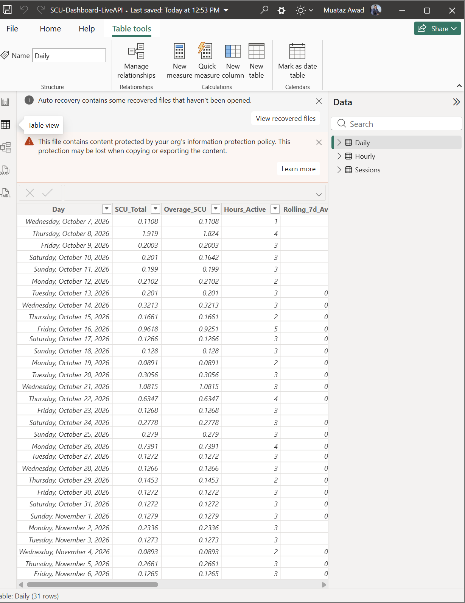<br><sub><b>Daily</b> table in Table view — 31 rows, real dates and SCU figures, pulled live from the usage API.</sub></p>

<p align="center">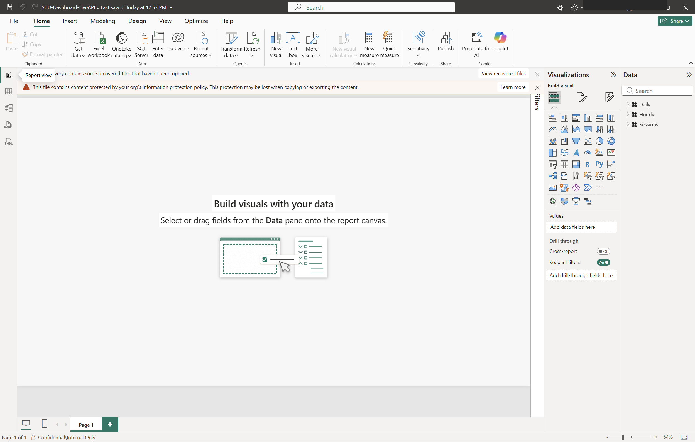<br><sub>Report view — <b>Daily</b>, <b>Hourly</b>, and <b>Sessions</b> all present in the Data pane, no "incomplete data" banner.</sub></p>

##### Stage 6 results

| Check | Result |
|---|---|
| `Hourly` refresh | **Succeeded** — converted cleanly once its host's credential was accepted |
| `Sessions` refresh | **Succeeded** — paginated pull, shares `Daily`'s host and credential |
| Web API + Key | **Fails structurally** — "A web API key can only be specified when a web API key name is provided" (Step 17); this M code never declares `ApiKeyName`, so no key value fixes it |
| Anonymous | **Rejected** — "We couldn't authenticate with the credentials provided" (Step 18); the API's own preflight check requires the Bearer header this credential type doesn't send |
| Organizational account | **Blocked on automation** — requires a live interactive Entra sign-in (Step 19), not this file's existing token exchange |
| Custom connector (`.mez`) | **Blocked** — Microsoft Store/MSIX edition can't load unsigned connectors (root-caused, not fixed; see [Step 21](#step-21-root-cause--the-microsoft-store-edition-cant-load-it)) |
| `Daily` refresh | **Succeeded** after Step 22 — 31 rows, in-memory data confirmed intact throughout |
| Full model refresh | **Succeeded** — all 3 tables, no errors |
| "Incomplete data" banner | **Gone** — confirmed via Report view |

###### Good to know (Stage 6)

- **The live dashboard's queries currently inline the refresh token**, the
  same way Step 5's placeholder does — they were **not** migrated to the
  [Parameter pattern](#stage-3-move-the-secret-into-a-parameter), let alone
  the connector's credential-prompt pattern (which is better than both).
  That's a real security gap worth closing: at minimum, move the token into
  a Power Query Parameter like Steps 1–14 do; ideally, revisit the custom
  connector once run on an edition of Power BI Desktop that can load it.
  Either way, **don't share this `.pbix` file as-is** — it has a live
  secret baked into its query definitions in plain text.
- **Power BI's data-source credential gate is generic, not query-aware.**
  It doesn't know this file's M code builds its own Bearer header — it only
  knows "does *something* work for this exact host", using whichever test
  that credential type performs. That's why three different credential
  types failed three different ways instead of one single error.
- **"No errors anywhere" is itself a diagnostic signal.** When a correctly
  built, correctly placed extension produces literally zero trace of itself
  trying (and failing) to load, that's a strong hint the platform isn't
  attempting to load it at all — worth checking the install edition before
  assuming a config or code problem.
- **A query that looks structurally identical to a working one can still
  hit a different credential state.** `Daily` and `Sessions` call the same
  endpoint with the same auth — the only difference is which one had
  already earned a one-time host-level credential trust in this file.

###### Troubleshooting (Stage 6)

| Symptom | Likely cause and fix |
|---|---|
| `A web API key can only be specified when a web API key name is provided` | The M code's `Web.Contents` call never declares an `ApiKeyName` option. This credential type cannot work for this query shape — try Anonymous or Organizational account instead, or add `ApiKeyName` to the M code if you want Web API + Key to be the long-term pattern. |
| `We couldn't authenticate with the credentials provided` on Anonymous | The real API requires an `Authorization` header that Anonymous's bare preflight check doesn't send. Confirm the host is actually reachable with a valid Bearer token (e.g. via a REST client) before assuming the query itself is broken. |
| Organizational account shows "You aren't signed in" | Expected — this credential type always requires a real, interactive AAD sign-in. Not suitable for unattended/automated credential setup; use it only when a person is available to click through once. |
| Custom connector never appears in **Get Data**, no errors anywhere | Check the install edition first: `Get-AppxPackage -Name "*PowerBI*"`. If it returns a package, you're on the Store/MSIX edition and unsigned connectors cannot load — switch to the standalone MSI edition. |
| One query refreshes fine, a structurally identical one doesn't | Compare credential trust state per host/data-source (**Data source settings**, Step 16), not the M code. |
| A credential choice is accepted but the next refresh still prompts again | Check the "Select which level to apply these settings to" dropdown in **Access Web content** — a narrower level than intended may have been selected; re-clear and re-enter at the host level shown by default. |

---

#### Lab results

| Check | Result |
|---|---|
| Placeholder token (Step 5) | `400 Bad Request` from the token endpoint — expected, confirms request shape |
| Real token via Parameter (Step 9) | **Succeeded** — `10 columns, 20 rows` returned |
| Data freshness | Real hourly timestamps through the current date (rolling 7-day window) |
| Data-source trust prompts | Two, one-time: Anonymous/Public privacy level for `login.microsoftonline.com` and the usage API host |
| Close & Apply (Step 10) | **Succeeded** — `Query1` loaded into the report's data model, editor closed automatically |
| Table visual (Step 12) | **Built successfully** — 4 real columns rendered on the report canvas from the loaded data |
| Canvas Refresh (Step 13) | **Succeeded** — re-ran end to end from the report canvas itself, no editor involved |
| Save (Step 14) | **Succeeded** — title bar confirms a real `.pbix` now exists on disk |
| Anything left running in the background? | **No** — the query only executes when something triggers a refresh |

#### Good to know

- **A Power Query Parameter is not a vault.** It's stored as part of the
  query definition inside the `.pbix`/`.pbit` file, in plain text. It's a
  cleaner place to put a secret than inline M code, but it is **not**
  equivalent to Azure Key Vault or a credential store. Don't share the
  `.pbix` file itself without first clearing the parameter's value.
- **M can't write back to its own parameter.** M is a functional, stateless
  language — a refresh can *read* `ScuRefreshToken`, but nothing in the query
  can rotate it automatically. Per the original tool's README, this refresh
  token is valid for roughly 90 days, so daily/weekly scheduled refreshes
  are fine; for long unattended gaps, re-run `SCU-Setup.ps1` once to mint a
  fresh token and paste it back into the parameter.
- **The Edit Parameters dialog shows values unmasked.** There's no
  password-style field for Text parameters — see the callout in
  [Step 7](#step-7-create-the-scurefreshtoken-parameter).
- **The Queries pane previews parameter values next to their names.** Keep
  that in mind before screen-sharing or screenshotting the Power Query
  Editor with a real secret loaded.
- **This API only accepts delegated tokens.** An app-only
  (client-credentials) token was tested against the same endpoints and
  rejected outright — see
  [Part 3's comparison table](#comparison) for that result.
- **Want to go past one proof table to a full dashboard?** See
  [Part 6: Scaling to a full 3-table live dashboard](#stage-6-scaling-to-a-full-3-table-live-dashboard)
  below — it scales this exact pattern to a 3-table live dashboard, works
  through three different credential-type failure modes one at a time, and
  documents a custom-connector dead end root-caused to a Microsoft
  Store/MSIX platform limitation.

#### Troubleshooting

| Symptom | Likely cause and fix |
|---|---|
| `400 Bad Request` from the `…/oauth2/v2.0/token` URL | Expected if you're using the placeholder token from Step 5. If it happens with a real token, the token has likely expired (~90 days) — re-run `SCU-Setup.ps1`. |
| `403 Unauthorized to access account` from the usage API | The access token is app-only, not delegated. Confirm `GetAccessToken` used the `refresh_token` grant, not `client_credentials`. |
| Advanced Editor shows a red underline / "errors have been detected" | Usually a missing comma or quote after pasting — M is whitespace-tolerant but strict about punctuation. Compare against [`mcode-final-parameterized.m`](Automation-Alternatives/PowerQuery/Steps/mcode-final-parameterized.m). |
| Refresh hangs on a privacy-level or trust prompt | Expected once per new host the query calls. Accept Anonymous/Public for both `login.microsoftonline.com` and the usage API host, or adjust in **File → Options → Privacy**. See [Privacy levels in Power Query](https://learn.microsoft.com/power-query/privacy-levels). |
| `ScuRefreshToken` shows as unrecognized/undefined in the M code | The parameter wasn't created yet, or its name doesn't exactly match (case-sensitive). Re-check **Manage Parameters**. |
| Refresh succeeds but returns 0 rows | The rolling 7-day window may genuinely have no usage in a quiet dev tenant — this isn't an error. Widen `#duration(7,0,0,0)` to test. |

#### Roll back

1. Delete the table visual from the report canvas (select it → **Delete**).
2. **Home → Manage Parameters → Edit Parameters**, clear or delete
   `ScuRefreshToken` if you're done testing.
3. Delete `Query1` (right-click in the Data pane → **Delete**) to remove the
   query and its loaded data from the model entirely.
4. The `.pbix` saved in Step 14 has a real token in its parameter — treat
   that file itself as a secret. Don't share it; re-save without the
   parameter's value first, or delete the file entirely if you're done
   testing.

#### Repository layout

```text
Automation-Alternatives/PowerQuery/
├── STEP-BY-STEP.md              This guide (Parts 1–6)
├── summary.html                 Polished single-page write-up (composite view, Parts 1–5)
├── 00-architecture-and-code.png M code + live result, side by side
├── 01-live-data-result.png      Live result, full size
└── Steps/                       All screenshots and reference code referenced above
    ├── step01 … step20          Parts 1–5 — single-table proof of concept
    ├── step21 … step26          Part 6 — scaling to the 3-table live dashboard
    ├── mcode-placeholder.m       The Step 5 version (inline placeholder token)
    ├── mcode-final-parameterized.m   The Step 8 version (references the Parameter)
    └── SCUDashboard-connector.pq      Part 6's custom connector source (no secrets —
                                       reusable on a Power BI Desktop edition that can
                                       load unsigned connectors; see Step 20)
```

#### References

- [What is Power Query?](https://learn.microsoft.com/power-query/power-query-what-is-power-query)
- [Using the Power Query editor (incl. the Advanced Editor)](https://learn.microsoft.com/power-query/power-query-ui)
- [Parameters in Power Query](https://learn.microsoft.com/power-query/power-query-query-parameters)
- [Privacy levels in Power Query](https://learn.microsoft.com/power-query/privacy-levels)
- [`Web.Contents` — Power Query M reference](https://learn.microsoft.com/powerquery-m/web-contents)
- [`Json.Document` — Power Query M reference](https://learn.microsoft.com/powerquery-m/json-document)
- [Power Query M function reference (full index)](https://learn.microsoft.com/powerquery-m/power-query-m-function-reference)
- [Data refresh in Power BI](https://learn.microsoft.com/power-bi/connect-data/refresh-data)
- [Create and format table visualizations in Power BI](https://learn.microsoft.com/power-bi/visuals/power-bi-visualization-tables)
- [Format pane General tab overview (Size/Position properties)](https://learn.microsoft.com/power-bi/visuals/power-bi-visualization-format-pane-overview)
- [Power Query custom connectors overview](https://learn.microsoft.com/power-query/samples/overview)
- [Handling authentication in a custom connector](https://learn.microsoft.com/power-query/samples/trippin/9-doing-more-with-metadata/tripping9)
- [`Extension.CurrentCredential` — Power Query M reference](https://learn.microsoft.com/powerquery-m/extension-currentcredential)
- [Install Power BI Desktop (Store vs. direct download)](https://learn.microsoft.com/power-bi/fundamentals/desktop-get-the-desktop)

---

Zooming back out from that full Power Query walkthrough to compare all
three Part 3 approaches side by side:

### Comparison

| | Logic App | Power Automate | Power Query (M) |
|---|---|---|---|
| Hosting | Azure (pay-per-action) | Power Platform environment | Inside Power BI itself |
| Needs a landing-zone file? | Yes (e.g. Blob/SharePoint) | Yes (e.g. SharePoint/OneDrive) | **No** |
| Needs Maker/Portal UI to build? | No (ARM/CLI works) | No (Dataverse API works) | No (Power BI Desktop only) |
| Credential storage | Logic App secure parameter | Dataverse-stored workflow definition | Power Query Parameter (recommended) |
| Verified with live tenant data? | ✅ 21 rows | ✅ 21 rows | ✅ 21 rows, 10 columns |
| Best fit | Scheduled, centrally-owned automation, easy to monitor via Azure | Citizen-developer / already-in-Power-Platform orgs | Pure Power BI shops — simplest possible pipeline |

All three are **live and still running** in the dev tenant (daily schedules)
as of this write-up. To stop them: delete resource group
`SCU-Automation-Explore` (Logic App) via Azure Portal/CLI, and deactivate/
delete the Dataverse `workflow` record named "SCU Usage Puller (Power
Automate POC)" (Power Automate). The Power Query approach has nothing
running in the background — it only pulls data when a report with that
query is refreshed.

Each approach's `summary.html` is a styled version of the same content — GitHub shows it as raw source in the browser, so download and open it locally (or view the `.md`/images above) to see it rendered.

---

*Private working notes — review before adding to the public `SecurityCopilot` repo.*
